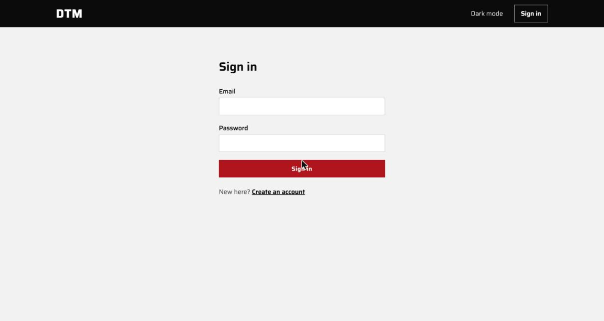
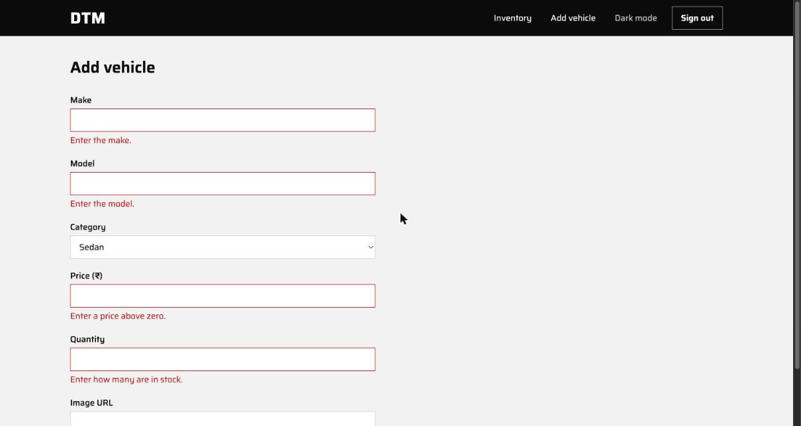
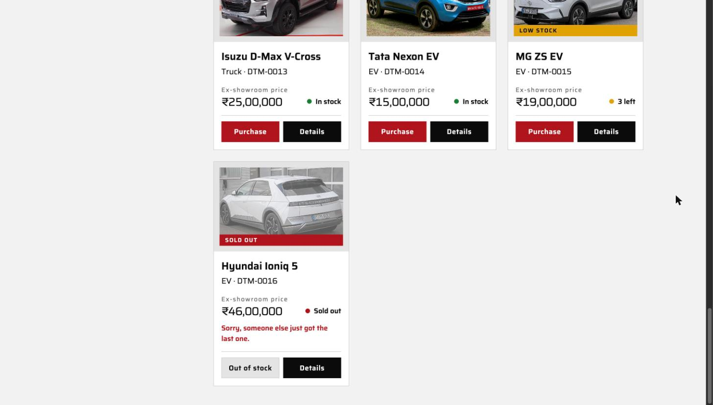

# PROMPTS

Raw chat logs from the Claude Code sessions, pasted as exported.

Share link for the final session: TODO

## 01-planning

~~~text
▗ ▗   ▖ ▖  Claude Code v2.1.310
           Sonnet 5.5 · Claude Pro
 ▘▘   ▝▝   ~/DTM


❯ first set up one subagent in .claude/agents/architect.md, model opus, read    
  only tools. its only job is design advice: reviewing plans, the data model,   
  the concurrency design, and getting us unstuck. it never writes or edits      
  code.                                                                         
                                                                                
  then read docs/BRIEF.md, its a take home for incubyte. dont write any app     
  code yet, i want to plan this properly first.                                 
                                                                                
  context on them: theyre an xp shop. tdd, small frequent releases, pair        
  programming, devs owning the whole pipeline. i want the repo to actually work 
  that way, not just tick the brief.                                            
                                                                                
  the app is called Dhyey Tandel Motors, DTM for short.                         
                                                                                
  stack: fastapi, sqlalchemy, alembic, postgres, pytest on the backend. react,  
  vite, ts, tailwind on the frontend. deploying on my own vps with docker       
  compose and caddy behind cloudflare. i picked fastapi because [your reason].  
                                                                                
  decisions im fixing now:                                                      
  - list returns every car, even 0 stock. the ui shows those as out of stock    
  - put, delete and restock are admin only                                      
  - a purchase is always 1 unit                                                 
  - no role picking at register, admin comes from a seed script                 
  - purchase is one atomic update, never read then write. 409 if its out of     
  stock                                                                         
  - prices stored as int cents                                                  
  - out of scope for one day: refresh tokens, email verification, pagination.   
  written down, not forgotten                                                   
                                                                                
  write the brief as short user stories in docs/STORIES.md. from those,         
  docs/TEST_LIST.md with every backend test case grouped by auth, vehicles,     
  search, inventory, edge cases included. my decisions go in docs/DECISIONS.md  
  with a line on why for each.                                                  
                                                                                
  then CLAUDE.md with how we work.                                              
                                                                                
  process:                                                                      
  - strict tdd, one behaviour at a time. failing test, run it, show me it       
  fails, commit. minimum code to pass, run everything, commit. refactor commit  
  only if theres something worth cleaning                                       
  - sometimes ill write the failing test myself and youll make it pass. dont    
  touch my tests unless i say so                                                
  - commit body says what you did and what i decided, then 2 blank lines, then  
  Co-authored-by: Claude Code <noreply@anthropic.com>                           
  - stop at the end of each phase so i can review                               
                                                                                
  code rules, these matter as much as the tests passing:                        
  - i have to be able to explain every line in an interview. if something needs 
  more than a couple of sentences to explain, its too clever, write it simpler  
  - small functions that do one thing. if the name needs an "and" in it, split  
  it                                                                            
  - names say what things are, no abbreviations. comments only for why, never   
  for what                                                                      
  - services dont know about http. they raise domain errors (VehicleNotFound,   
  OutOfStock etc) and one handler maps those to status codes, so the business   
  logic is reusable and testable without fastapi                                
  - services talk to repositories through an interface, so tests can use fakes  
  and the db can change without touching business logic                         
  - no magic numbers or strings, constants or config                            
  - dont abstract until something is actually repeated. no base classes or      
  helpers "for later"                                                           
  - type hints everywhere. ruff and mypy on the backend, eslint and prettier on 
  the frontend, all in ci                                                       
  - frontend: components dont call fetch. api calls live in one api layer, data 
  comes through hooks, repeated ui bits become small shared components          
  - no dead code, no commented out code                                         
                                                                                
  agents:                                                                       
  - you write all the code and make all the commits. no subagent ever edits     
  files                                                                         
  - never run agents in parallel on code                                        
  - call the architect automatically for: checking the test list and decisions  
  before we start, the data model before the first migration, the purchase      
  concurrency design before writing it, and any bug you havent fixed after 2    
  tries. tell me what it said                                                   
  - test-runner (haiku) for running tests, reviewer (sonnet) at the end of each 
  phase, explore (haiku) for searching                                          
                                                                                
  run the architect over the stories, test list and decisions now and show me   
  what it flagged. then stop, i want to go through the test list myself.        

  Searched for 1 pattern, read 2 files, listed 1 directory (ctrl+o to expand)

⏺ Write(.claude/agents/architect.md)
  ⎿  Wrote 36 lines to .claude/agents/architect.md
       1 ---
       3 description: Design advisor for DTM. Use to review plans, the te
         st list, the data model, the concurrency design, and to get unst
         es or edits code.
       4 model: opus
       6 ---
       7 
         dealership inventory app built as a take-home for Incubyte, an X
         P (extreme programming) shop.
      10 ## Your only job
     … +45 lines (ctrl+o to expand)

⏺ Write(docs/STORIES.md)
  ⎿  Wrote 85 lines to docs/STORIES.md
       1 # User stories
       3 Dhyey Tandel Motors (DTM) is a car dealership inventory app. The
         se stories are the brief, cut into small slices. Each backend be
       4 
       5 Roles: **visitor** (no account), **customer** (registered), **ad
       6 
       7 ## Auth
       9 **A1. Register.** As a visitor, I want to register with an email
          and password, so that I can use the dealership.
         e.
     … +122 lines (ctrl+o to expand)

⏺ Architect agent and stories are written. Next I'm writing the test list,
  decisions and CLAUDE.md, then I'll run the architect over them.

⏺ Write(docs/TEST_LIST.md)
  ⎿  Wrote 178 lines to docs/TEST_LIST.md
       1 # Backend test list
       3 One line per behaviour. Each becomes one failing test, one commi
         t, one passing commit.
       5 Layer tags:
       6 - **unit**: service with a fake repository. No HTTP, no database
       7 - **api**: HTTP request through the test client against a real P
         ostgres test database.
         cannot prove the behaviour (atomic update, constraints).
       9 
         epend on an open question in `STORIES.md`.
     … +214 lines (ctrl+o to expand)

⏺ Write(docs/DECISIONS.md)
  ⎿  Wrote 51 lines to docs/DECISIONS.md
      1 # Decisions
      3 Append only. Earlier entries are never rewritten. A change of min
        d is a new entry that points at the old one.
      5 ## [2026-10-24] Backend framework: FastAPI
      7 **Decision** — FastAPI for the backend.
      8 
        e, so validation and the 422 tests need almost no code of ours. D
        ependencies make "needs a token" and "needs admin" one-line decla
        pytest. [unverified] This reason was written by Claude on the own
        e interview.
     … +69 lines (ctrl+o to expand)

⏺ Write(CLAUDE.md)
  ⎿  Wrote 91 lines to CLAUDE.md
       1 # Dhyey Tandel Motors (DTM)
       3 Car dealership inventory app, built as a take-home for Incubyte 
         (an XP shop: TDD, small frequent releases, pair programming, dev
         elopers own the whole pipeline). The repo should work that way, 
       4 
       5 Read before working: `docs/BRIEF.md`, `docs/STORIES.md`, `docs/T
       6 
       7 ## Stack
       8 
      10 - Frontend: React, Vite, TypeScript, Tailwind
     … +112 lines (ctrl+o to expand)

⏺ Now the architect review.

⏺ architect(Architect review of plan docs)
  ⎿  Initializing…
  ⎿  Error: Agent type 'architect' not found. Available agents: claude, 
     claude-code-guide, Explore, general-purpose, Plan, statusline-setup

⏺ The new architect agent isn't registered in this session yet, because agents
  load at startup. I'll use the built-in read-only Plan agent on Opus with the
  architect's instructions instead.

⏺ Plan(Architect review of plan docs) Opus 5.5
  ⎿  Backgrounded agent (↓ to manage · ctrl+o to expand)

⏺ The architect review is still running. I've written these files, and nothing
  is committed yet:

  - .claude/agents/architect.md: Opus, read-only tools (Read, Grep, Glob).
  - docs/STORIES.md: the brief as short stories, with the out-of-scope list and
    five open questions.
  - docs/TEST_LIST.md: 21 edge cases plus the auth, vehicles, search and
    inventory tests, each tagged unit, api or db.
  - docs/DECISIONS.md: your fixed decisions, one line of why each.
  - CLAUDE.md: how we work.

  Four things you should know:
  - FastAPI reason: you left a placeholder, so I wrote one. It's marked
    [unverified] in DECISIONS.md. Replace it with your own before the interview.
  - POST /api/vehicles: your decisions don't say who can add a vehicle. The
    brief's frontend section implies admin only, so I assumed that and tagged
    those tests [confirm].
  - Decision format: the entries use a short Decision and Why format, not the
    full /log template, because you asked for a line of why.
  - Agent registration: architect isn't available as an agent type until Claude
    Code restarts. That's why this review runs on the built-in read-only Plan
    agent on Opus with the same instructions.

  I'll show you what the architect flagged when it finishes, then stop so you
  can go through the test list.

✻ Churned for 3m 3s · done Saturday 1:25 AM

› Message from Plan
  I reviewed the planning docs as the DTM architect: CLAUDE.md, BRIEF, STORIES,
  TEST_LIST and DECISIONS. The repo has only those docs, no code yet (last
  commit 41b4d7c). I wrote nothing.

  **Overall:** the atomic purchase design holds up, and so does the 404 vs 409
  split, as long as the check after a failed update only asks whether the
  vehicle exists (item 8). There are 7 blockers. Most come from the same
  read-then-write race showing up again in register and restock, or from tests
  filed at a layer that cannot prove them. The rest are undecided values that
  tests already depend on.

  ## Blockers (fix before building)

  **1. The concurrency tests are at a layer that cannot prove them**
  - **Where:** TEST_LIST I-14, I-15 (tagged api).
  - **Problem:** Test isolation is undecided. The usual setup wraps each test in
  a transaction that is rolled back, with requests going through a shared
  session. In that setup the "concurrent" requests either run one after another
  on one connection, or cannot see the vehicle the test inserted because it is
  not committed yet. Either way the test passes even with a read-then-write bug,
  so it proves nothing.
  - **Suggestion:** Retag I-14 and I-15 as db. Each thread opens its own session
  from the engine, and the vehicle is committed first. Start the threads
  together with a `ThreadPoolExecutor` and clean up by truncating afterwards.
  Write down the per-test isolation strategy (rollback vs truncate) now, and use
  truncate for these two tests. Also note in the purchase decision that
  Postgres's default READ COMMITTED level already makes the single `UPDATE ...
  WHERE quantity > 0` safe: the second writer waits for the row lock and then
  re-checks the WHERE. Do not raise the isolation level. SERIALIZABLE would turn
  the losing buyer into a serialization error, which becomes a 500 instead of a
  409.

  **2. The search unit tests only test the fake**
  - **Where:** TEST_LIST S-02 to S-08 (tagged unit).
  - **Problem:** Filtering happens in SQL inside the repository. The service
  only passes the filters through. With a fake repository these tests check the
  fake's Python filter, and they keep passing if the real SQL is wrong.
  - **Suggestion:** Move S-02 to S-08 to db, next to S-09, S-10 and S-19. Keep
  at unit level only the logic that lives in the service, for example rejecting
  a minimum price above the maximum, if you put that check in the service (see
  item 13). V-12 has the same issue and could be dropped.

  **3. Register checks for a duplicate email and then inserts: a race with no
  database test**
  - **Where:** A-03, A-04 (unit), A-07 (api).
  - **Problem:** Two registrations with the same email at the same moment both
  pass the "email exists?" check. The second insert then fails on the unique
  constraint, and an uncaught IntegrityError becomes a 500. This is the same
  race the purchase decision fixes. A fake repository cannot show it, and no
  test checks that the constraint exists. Case-insensitive matching (A-04) also
  depends on where the email is lowercased.
  - **Suggestion:**
    - Decide that the service lowercases and trims the email before storing it
  or looking it up. A-04 then stays a valid unit test.
    - Put a plain unique constraint on `email`.
    - Add a db test: inserting the same normalised email twice raises the
  repository's `EmailAlreadyRegistered`. This means the repository turns the
  IntegrityError into that error.

  **4. The restock maximum (I-26) contradicts the atomic restock (I-20)**
  - **Where:** I-20, I-26, E-05.
  - **Problem:** To answer "would this amount push quantity above the maximum?"
  the service has to read the current quantity first. That is the
  read-then-write the decisions forbid. If you skip the check, `quantity +
  amount` can overflow a Postgres `integer` and return a 500. No maximum has
  been decided either.
  - **Suggestion:** Use the same pattern as purchase, so you only have to
  explain it once: `UPDATE ... SET quantity = quantity + :amount WHERE id = :id
  AND quantity + :amount <= :MAX_QUANTITY RETURNING ...`. If no row changes,
  check whether the vehicle exists: answer 404 if not, otherwise raise
  `InvalidQuantity`. Also decide whether that case is 422 (as I-26 says) or 409,
  since it is a conflict with stored state rather than bad input. Add a check
  constraint `quantity <= MAX_QUANTITY` alongside the existing `>= 0` one.
  Simpler alternative: limit only the amount per restock in the request schema
  and accept that quantity can grow without limit (use BigInteger).

  **5. Decisions to log now, because tests already depend on them**
  - **Where:** STORIES "To confirm" 1–5, V-02, V-03, V-22, V-24, E-14, E-15,
  I-26, E-09, E-10, A-10.
  - **POST /api/vehicles:** make it admin only. The brief's frontend section
  gives the add form to admins only, and a customer creating stock is as harmful
  as one deleting it. Log this so the [confirm] tags on V-02 and V-03 can go.
  - **PUT and quantity (this is a contradiction):** STORIES V3 already says as
  fact that quantity is not changed by PUT, but "To confirm" #2 lists it as
  open. Log it as decided: quantity is ignored by PUT, the same as E-12's "extra
  fields ignored". Also decide that PUT replaces all four editable fields
  (make, model, category, price) and all four are required, since V-17 and V-23
  depend on it. Implement PUT as an UPDATE of those four columns only, never by
  saving a whole object loaded earlier.
  - **Id type:** use an integer identity column and drop E-14. Guessable ids
  only matter when knowing an id gives you access. Here every route needs a
  token and access is decided by role, not by who owns what. There is a concrete
  failure to guard against: FastAPI accepts an `int` path id of any size, so
  `/api/vehicles/99999999999` reaches Postgres and returns a 500 (number out of
  range). Limit the path id with `Path(gt=0, le=MAX_ID)`, or use BigInteger, and
  extend V-24 to cover this case. A UUID also avoids the overflow, at the cost
  of uglier URLs.
  - **Role in token vs database:** A-23 already requires loading the user from
  the database on every request. So the token should carry only the user id
  (`sub`) and the expiry, which matches A-15, and the role should come from the
  loaded user. E-15 then follows for free. Log it.
  - **Validation limits:** put each in one constants module and log the values:
    - Password minimum and maximum. The maximum matters: bcrypt only reads the
  first 72 bytes. Recent bcrypt versions raise an error past that (a 500); older
  ones silently ignore the rest. Cap it at 72 bytes, or use argon2.
    - Make/model maximum length (match the column length).
    - Maximum price in cents, which must fit the column type. 2^31−1 cents is
  about 21.4 million, so use BigInteger if you want more headroom.
    - Maximum quantity, and the maximum restock amount.
  - **Category list:** write the fixed list down. Validate it with a Python Enum
  in the schema and store it as a varchar. V-07 and S-16 cannot be written
  without it.
  - **Currency:** this affects the UI only. Pick one and log it.

  **6. The seed script when the admin email is already registered as a
  customer**
  - **Where:** A4, A-26, A-27.
  - **Problem:** Nothing decides what happens if someone registers the
  configured admin email through the public endpoint before the seed runs.
    - If the seed skips the existing user, there is no admin.
    - If it promotes the user without resetting the password, the person who
  registered it becomes admin. That is exactly what A4 is meant to prevent.
  - **Suggestion:** Decide that the seed creates the admin or updates the
  existing user, setting both role=admin and the configured password. Add a db
  test for the "already registered as customer" case.

  **7. I-01 tests how the code works, not what it does**
  - **Where:** I-01 "calls the repository once".
  - **Problem:** It ties the test to how many calls are made, and that count
  changes once the 404/409 check exists (see item 8).
  - **Suggestion:** Reword it as "purchasing a vehicle with stock returns the
  vehicle with quantity one lower".

  ## Notes (worth knowing)

  **8. The atomic purchase and the 404 vs 409 split are sound, with one rule to
  write down**
  - **Where:** DECISIONS "Purchase is one atomic update".
  - **Problem:** The decision does not say how a zero-row update is turned into
  a 404 or a 409.
  - **Suggestion:**
    - The repository's `purchase_one(id) -> Vehicle | None` runs `UPDATE ...
  RETURNING`. On `None`, the service asks `exists(id)` and raises
  `VehicleNotFound` or `OutOfStock`.
    - The follow-up read only checks whether the vehicle exists. It never
  decides stock.
    - The races are harmless:
      - Deleted in between: 404, which is correct.
      - Restocked in between: 409, which was true when the update ran; the
  client can retry.
    - Use RETURNING so the success path never needs a second read.
    - Add one line to the decision with this. Restock in item 4 can use the same
  shape.

  **9. Tests with no story, and stories with no tests**
  - E-17 (CORS), E-19 (health), E-20 (refuses to start without a secret) and
  E-21 (migrations) have no story. Add an acceptance line under D1 or D2.
  - I-09 (an admin can purchase) goes beyond I1, which names only customers.
  Decide and log it.
  - F1–F6 have no tests at all, yet D1 says CI runs "all tests". F4 has real
  behaviour worth a frontend test: the button is disabled at zero stock, and a
  409 shows a message and refreshes the list. Either add a short frontend test
  list or log that frontend tests are out of scope.

  **10. FastAPI may return 403, not 401, when the token is missing**
  - **Where:** A-19, E-16.
  - **Problem:** Older FastAPI versions of `HTTPBearer` return 403 when the
  Authorization header is missing or has the wrong scheme. Newer versions
  changed this. I have not verified the exact version.
  - **Suggestion:** Use `HTTPBearer(auto_error=False)` and raise your own 401,
  so the behaviour does not depend on the FastAPI version.

  **11. Which error wins when several apply is undecided**
  - **Example:** a customer sends a PUT with an invalid body to a missing id.
  - **Suggestion:** Log the order 401 > 403 > 422 > 404, which matches how
  FastAPI runs dependencies before checking the body. Add one test, e.g. a
  customer PUT with an invalid body returns 403.

  **12. Error-mapping tests repeat other tests, and E-07 has a trap**
  - **Where:** E-01 to E-05, E-07.
  - **Problem:** E-01 to E-05 repeat V-21, I-10, A-07, A-17 and I-25. E-07 needs
  `TestClient(app, raise_server_exceptions=False)`; otherwise the test client
  re-raises the exception and the test never sees a 500.
  - **Suggestion:** Drop E-01 to E-05 or merge them into those tests. Keep E-06
  and E-07.

  **13. Input validation can end up in two places**
  - **Where:** I-19 vs I-25, S-14.
  - **Problem:** A restock amount of zero or less is rejected by the Pydantic
  schema (422) before the service ever sees it, so the service's
  `InvalidQuantity` check only matters for calls that do not come through HTTP.
  S-14 (minimum price above maximum) has no decided home.
  - **Suggestion:** Keeping both checks is fine because services must work
  without FastAPI, but decide it on purpose. Put S-14 in the service as a domain
  error, so it can be tested at unit level.

  **14. E-18 is not one behaviour**
  - **Where:** E-18.
  - **Problem:** It overlaps with V-03, V-20, V-29 and I-22.
  - **Suggestion:** Either make it one parametrised test over a table of admin
  routes and methods, or drop it.

  **15. Small undecided details**
  - Login body: JSON `{email, password}` or the OAuth2 form, which uses
  `username`. Pick JSON and log it.
  - Whether register also returns a token. This affects the F1 flow.
  - Purchase response shape: return the full vehicle, which matches I-01.
  - JWT algorithm and expiry: put them in config.
  - "To confirm" #3 (login identifier) is already settled by A1 and A2. Close
  it.

  **16. Wrong layer tags**
  - A-28 and E-20 test configuration. They are unit tests, not db or api.

  **17. Repository shape and transactions**
  - **Problem:** The rule "a repository interface" sits uneasily next to "no
  base classes for later".
  - **Suggestion:** Use one `typing.Protocol` per repository, with the fake
  implementing it. Decide who commits: one session per request, committed by the
  request's session dependency. Atomic statements must not be split across
  commits.

  **18. Things that are fine to leave out, but log them**
  - No purchase history table, so nothing records who bought what. If one is
  added later, delete will need a foreign-key decision.
  - Login timing: an unknown email returns faster than a wrong password because
  no hash is checked. Fixing it with a dummy hash adds code you would need to
  explain, so logging it as out of scope is reasonable.

  **19. Things that are not too clever**
  - Escaping `%` and `_` in search (S-19): SQLAlchemy's `icontains(value,
  autoescape=True)` does it in one call.
  - The conditional UPDATE in items 4 and 8: it is one statement.

  Anything else, such as non-guessable ids (E-14) or locks, would be harder to
  explain and is not needed.

  ### Critical Files for Implementation
  - /Users/dhyeytandel/DTM/docs/TEST_LIST.md
  - /Users/dhyeytandel/DTM/docs/DECISIONS.md
  - /Users/dhyeytandel/DTM/docs/STORIES.md
  - /Users/dhyeytandel/DTM/CLAUDE.md
  - /Users/dhyeytandel/DTM/.claude/agents/architect.md

⏺ The architect's review is back. It's advice only, so I haven't changed any
  docs. It found 7 blockers and 12 notes. The atomic purchase design and the 404
  vs 409 split both hold up.

  Blockers (fix before building)

  1. Concurrency tests are at the wrong layer. I-14 and I-15 are tagged api.
     With per-test rollback isolation, the "concurrent" requests share one
     connection, so the tests would pass even with a read-then-write bug. Retag
     them db. Each thread should get its own session, with the vehicle committed
     first and tables truncated afterwards. Log the isolation strategy. Don't
     raise the isolation level: SERIALIZABLE would turn the losing buyer into a
     500 instead of a 409.
  2. Search unit tests only test the fake. S-02 to S-08 filter in SQL, so a fake
     repository's Python filter proves nothing. Move them to db. Only
     service-level logic stays unit.
  3. Register has the same race as purchase. Two registrations of one email can
     both pass the "exists?" check, and the second insert becomes a 500. The
     architect suggests:
     - the service lowercases and trims the email,
     - a unique constraint on email,
     - a db test that the repository turns the IntegrityError into
       EmailAlreadyRegistered.
  4. I-26 (restock maximum) contradicts I-20 (atomic restock). Checking the
     maximum means reading first. The fix is UPDATE ... SET quantity = quantity 
     + :amount WHERE id = :id AND quantity + :amount <= MAX, which is the same
     pattern as purchase. You also need to decide whether over-max is 422
     or 409. The simpler alternative is to cap only the per-request amount.
  5. Decisions that tests already depend on need logging.
     - POST is admin only.
     - PUT replaces make, model, category and price, all required, and ignores
       quantity. STORIES currently states this as fact and also lists it as
       open.
     - Integer id, with a path id bound. Otherwise /api/vehicles/99999999999
       reaches Postgres and returns a 500. Drop E-14.
     - The token carries only the user id. The role is loaded from the database,
       which settles E-15.
     - Limits for password (max 72 bytes because of bcrypt), make/model length,
       price, quantity and restock amount.
     - The fixed category list.
     - Currency.
  6. Seed script versus a pre-registered admin email. If someone registers the
     admin email first, the seed must set both the role and the configured
     password. Skipping the account leaves no admin. Promoting it without
     resetting the password hands admin to whoever registered. It needs a db
     test.
  7. I-01 tests implementation. "Calls the repository once" should be "returns
     the vehicle with quantity one lower".

  Notes

  - 8: Write down the rule for a failed purchase update. The repository's
    purchase_one(id) -> Vehicle | None runs UPDATE ... RETURNING. On None, the
    service asks exists(id) and raises VehicleNotFound or OutOfStock. The
    follow-up read never decides stock.
  - 9:
    - E-17, E-19, E-20 and E-21 have no story. Add acceptance lines under D1/D2.
    - Decide whether an admin can purchase (I-09).
    - F1–F6 have no tests while D1 says CI runs all tests. Either add a short
      frontend test list, or log that frontend tests are out of scope.
  - 10: Use HTTPBearer(auto_error=False) and raise our own 401. FastAPI versions
    differ on 401 vs 403 for a missing token. The architect didn't verify the
    version.
  - 11: Log the error precedence: 401, then 403, then 422, then 404.
  - 12: E-01 to E-05 duplicate other tests. E-07 needs
    raise_server_exceptions=False.
  - 13: Keep the Pydantic and service validation on purpose. Put the
    min-greater-than-max price check (S-14) in the service so it can be a unit
    test.
  - 14: E-18 overlaps four other tests. Make it one parametrised test or drop
    it.
  - 15: Small details to settle:
    - JSON login body, not the OAuth2 form.
    - Whether register also returns a token.
    - The purchase response is the full vehicle.
    - JWT algorithm and expiry in config.
    - Close "to confirm" #3, since email is already settled.
  - 16: A-28 and E-20 are config tests, so they're unit, not db/api.
  - 17: One typing.Protocol per repository. One session per request, committed
    by the session dependency.
  - 18: Log as out of scope:
    - no purchase history,
    - the login timing difference between unknown email and wrong password.

  Where I'd push back

  - Item 4's two options. The atomic restock is more code to explain than
    capping the per-request amount and using BigInteger. Given your "explain
    every line" rule, the simpler alternative may fit better. This is your call.
  - Retagging search tests to db. This makes the suite slower, because every
    search test needs Postgres. I think it's still right, since the SQL is the
    logic.

  The decisions you need to make are items 4 and 5, the seed behaviour in 6, and
  whether frontend tests are in scope (9). Nothing else is pending. I'm
  stopping here so you can go through the test list. Tell me which of these you
  accept and I'll update the docs. New decisions go in as new DECISIONS.md
  entries, since that file is append-only.

✻ Baked for 13s · done Saturday 1:27 AM

⏺ Agent "Architect review of plan docs" finished · 2m 21s

❯ read through the review. fix whatever the architect flagged that you agree    
  with and tell me anything you disagreed with.                                 
                                                                                
  POST vehicles is admin only, the ui spec puts adding under admin and a        
  customer adding stock to a dealers inventory makes no sense. remove the       
  [confirm] tags.                                                               
                                                                                
  for the fastapi reason in DECISIONS.md use: pydantic validation and           
  dependency injection make the service layer easy to test in isolation, and    
  python is the language im fastest and most confident in. remove the           
  [unverified] tag.                                                             
                                                                                
  answer the open questions in STORIES.md with the simplest option that fits    
  the brief and note each answer in DECISIONS.md. then commit the planning docs 
  and stop                                                                      

  Ran 1 shell command (ctrl+o to expand)

⏺ Write(docs/TEST_LIST.md)
  ⎿  Added 111 lines, removed 117 lines
       3  One line per behaviour. Each becomes one failing test, one comm
          it, one passing commit.
       4  
       5  Layer tags:
       6 -- **unit**: service with a fake repository. No HTTP, no databas
         -e.                                                             
       7 -- **api**: HTTP request through the test client against a real 
         -Postgres test database.                                        
       8 -- **db**: repository against real Postgres. Needed where a fake
         - cannot prove the behaviour (atomic update, constraints).      
       6 +- **unit**: service with a fake repository. No HTTP, no databas
         +e. Only for logic that lives in the service.                   
       7 +- **api**: HTTP request through the test client against a real 
         +Postgres test database. Each test is rolled back afterwards.   
       8 +- **db**: repository against real Postgres. Used wherever the b
         +ehaviour lives in SQL or in a constraint, because a fake cannot
         + prove it. Concurrency tests are `db`: each thread opens its ow
         +n session, the vehicle is committed first, and tables are trunc
         +ated afterwards.                                               
       9  
      10 -Status codes follow `DECISIONS.md`. Items marked **[confirm]** 
         -depend on an open question in `STORIES.md`.                    
      10 +Status codes and limits follow `DECISIONS.md`. Limits are named
         + constants in one module, and tests import them.               
      11  
      12  ## Auth (A1 to A4)
      13  
     ...
       15  - A-01 unit: registering with a new email creates a customer
       16  - A-02 unit: the stored password is a hash, never the plain te
           xt
       17  - A-03 unit: registering an email that already exists raises `
           EmailAlreadyRegistered`
       18 -- A-04 unit: email match ignores letter case (`A@x.com` and `a
          -@x.com` are the same account)                                 
       19 -- A-05 api: `POST /api/auth/register` returns 201 with id, ema
          -il and role `customer`                                        
       20 -- A-06 api: the register response never contains the password 
          -or its hash                                                   
       21 -- A-07 api: duplicate email returns 409                       
       22 -- A-08 api: a `role: "admin"` field in the body is ignored and
          - the account is a customer                                    
       23 -- A-09 api: invalid email returns 422                         
       24 -- A-10 api: password shorter than the minimum length returns 4
          -22                                                            
       25 -- A-11 api: missing email or password returns 422             
       18 +- A-04 unit: the email is trimmed and lowercased before it is 
          +stored or looked up                                           
       19 +- A-05 db: inserting the same email twice raises `EmailAlready
          +Registered` (unique constraint, covers two registrations at th
          +e same moment)                                                
       20 +- A-06 api: `POST /api/auth/register` returns 201 with id, ema
          +il and role `customer`                                        
       21 +- A-07 api: the register response never contains the password 
          +or its hash                                                   
       22 +- A-08 api: duplicate email returns 409                       
       23 +- A-09 api: a `role: "admin"` field in the body is ignored and
          + the account is a customer                                    
       24 +- A-10 api: invalid email returns 422                         
       25 +- A-11 api: password shorter than the minimum, or longer than 
          +the maximum, returns 422                                      
       26 +- A-12 api: missing email or password returns 422             
       27  
       28  Login
       28 -- A-12 unit: correct credentials return an access token       
       29 -- A-13 unit: wrong password raises `InvalidCredentials`       
       30 -- A-14 unit: unknown email raises `InvalidCredentials` (same e
          -rror as wrong password)                                       
       31 -- A-15 unit: the token carries the user id and an expiry from 
          -config                                                        
       32 -- A-16 api: `POST /api/auth/login` returns 200 with a bearer t
          -oken                                                          
       33 -- A-17 api: wrong password and unknown email both return 401 w
          -ith the same body                                             
       34 -- A-18 api: login email match ignores letter case             
       29 +- A-13 unit: correct credentials return an access token       
       30 +- A-14 unit: wrong password raises `InvalidCredentials`       
       31 +- A-15 unit: unknown email raises `InvalidCredentials` (same e
          +rror as wrong password)                                       
       32 +- A-16 unit: the token carries only the user id and an expiry 
          +taken from config                                             
       33 +- A-17 api: `POST /api/auth/login` with a JSON body returns 20
          +0 with a bearer token                                         
       34 +- A-18 api: wrong password and unknown email both return 401 w
          +ith the same body                                             
       35 +- A-19 api: login email match ignores letter case             
       36  
       37  Token checks
       37 -- A-19 api: a request with no token returns 401 on every vehic
          -le and inventory route                                        
       38 -- A-20 api: a malformed token returns 401                     
       39 -- A-21 api: a token signed with a different secret returns 401
       40 -- A-22 api: an expired token returns 401                      
       41 -- A-23 api: a valid token for a user that no longer exists ret
          -urns 401                                                      
       42 -- A-24 api: a customer token on an admin route returns 403    
       43 -- A-25 api: an admin token on an admin route is accepted      
       38 +- A-20 api: a request with no token returns 401 on every vehic
          +le and inventory route                                        
       39 +- A-21 api: a malformed token returns 401                     
       40 +- A-22 api: a token signed with a different secret returns 401
       41 +- A-23 api: an expired token returns 401                      
       42 +- A-24 api: a valid token for a user that no longer exists ret
          +urns 401                                                      
       43 +- A-25 api: an `Authorization` header that does not use the `B
          +earer` scheme returns 401                                     
       44 +- A-26 api: the role comes from the database, so a user whose 
          +role changed after the token was issued gets the current role 
       45 +- A-27 api: a customer token on an admin route returns 403    
       46 +- A-28 api: an admin token on an admin route is accepted      
       47  
       48  Admin seed
       46 -- A-26 db: the seed script creates an admin from the configure
          -d email and password                                          
       47 -- A-27 db: running the seed script twice leaves exactly one ad
          -min                                                           
       48 -- A-28 db: the seed script fails with a clear message when the
          - admin settings are missing                                   
       49 +- A-29 db: the seed script creates an admin from the configure
          +d email and password                                          
       50 +- A-30 db: running the seed script twice leaves exactly one ad
          +min                                                           
       51 +- A-31 db: if the admin email is already a customer, the seed 
          +makes it an admin and sets the configured password            
       52 +- A-32 unit: the seed script fails with a clear message when t
          +he admin settings are missing                                 
       53  
       54  ## Vehicles (V1 to V4)
       55  
       56  Create
       57  - V-01 unit: adding a vehicle stores make, model, category, pr
           ice and quantity
       54 -- V-02 api: `POST /api/vehicles` as admin returns 201 with the
          - vehicle and its id **[confirm]**                             
       55 -- V-03 api: as customer returns 403 **[confirm]**             
       58 +- V-02 api: `POST /api/vehicles` as admin returns 201 with the
          + vehicle and its id                                           
       59 +- V-03 api: as customer returns 403                           
       60  - V-04 api: without a token returns 401
       61  - V-05 api: ids are unique across two creations
       62  - V-06 api: empty make or model returns 422
       59 -- V-07 api: unknown category returns 422                      
       60 -- V-08 api: price of zero or less returns 422                 
       63 +- V-07 api: a category outside the fixed list returns 422     
       64 +- V-08 api: price of zero or less, or above the maximum, retur
          +ns 422                                                        
       65  - V-09 api: price sent as a decimal (`10.5`) or a string retur
           ns 422
       66  - V-10 api: negative quantity returns 422
       67  - V-11 api: two vehicles with the same make and model are allo
           wed
       68  
       69  List
       66 -- V-12 unit: listing returns every vehicle                    
       67 -- V-13 api: `GET /api/vehicles` as customer returns all vehicl
          -es                                                            
       68 -- V-14 api: vehicles with quantity zero are included          
       69 -- V-15 api: with no vehicles it returns 200 and an empty list 
       70 -- V-16 api: without a token returns 401                       
       70 +- V-12 api: `GET /api/vehicles` as customer returns all vehicl
          +es                                                            
       71 +- V-13 api: vehicles with quantity zero are included          
       72 +- V-14 api: with no vehicles it returns 200 and an empty list 
       73 +- V-15 api: without a token returns 401                       
       74  
       75  Update
       73 -- V-17 unit: updating changes make, model, category and price 
       74 -- V-18 unit: updating a missing id raises `VehicleNotFound`   
       75 -- V-19 api: `PUT /api/vehicles/{id}` as admin returns 200 with
          - the new values                                               
       76 -- V-20 api: as customer returns 403                           
       77 -- V-21 api: missing id returns 404                            
       78 -- V-22 api: a `quantity` field in the body does not change sto
          -ck **[confirm]**                                              
       76 +- V-16 unit: updating replaces make, model, category and price
       77 +- V-17 unit: updating a missing id raises `VehicleNotFound`   
       78 +- V-18 api: `PUT /api/vehicles/{id}` as admin returns 200 with
          + the new values                                               
       79 +- V-19 api: as customer returns 403                           
       80 +- V-20 api: missing id returns 404                            
       81 +- V-21 api: a `quantity` field in the body does not change sto
          +ck                                                            
       82 +- V-22 api: a body missing any of make, model, category or pri
          +ce returns 422                                                
       83  - V-23 api: invalid values return 422 and the stored vehicle i
           s unchanged
       80 -- V-24 api: an id that is not a valid id format returns 422   
       84 +- V-24 api: an id that is not a number, is zero or negative, o
          +r is above the maximum id returns 422                         
       85 +- V-25 db: updating changes only the four editable columns, so
          + a purchase made just before is not overwritten               
       86  
       87  Delete
       83 -- V-25 unit: deleting removes the vehicle                     
       84 -- V-26 unit: deleting a missing id raises `VehicleNotFound`   
       85 -- V-27 api: `DELETE /api/vehicles/{id}` as admin returns 204  
       86 -- V-28 api: the deleted vehicle no longer appears in the list 
       87 -- V-29 api: as customer returns 403 and the vehicle remains   
       88 -- V-30 api: missing id returns 404                            
       89 -- V-31 api: deleting the same id twice returns 204 then 404   
       88 +- V-26 unit: deleting removes the vehicle                     
       89 +- V-27 unit: deleting a missing id raises `VehicleNotFound`   
       90 +- V-28 api: `DELETE /api/vehicles/{id}` as admin returns 204  
       91 +- V-29 api: the deleted vehicle no longer appears in the list 
       92 +- V-30 api: as customer returns 403 and the vehicle remains   
       93 +- V-31 api: missing id returns 404                            
       94 +- V-32 api: deleting the same id twice returns 204 then 404   
       95  
       96  ## Search (S1)
       97  
       93 -Route is `GET /api/vehicles/search`. Filters combine with AND.
          - Text filters ignore letter case. Price bounds are inclusive a
          -nd in cents.                                                  
       98 +Route is `GET /api/vehicles/search`. Filters combine with AND.
          + Text filters ignore letter case. Price bounds are inclusive a
          +nd in cents. The filtering is SQL, so those tests are `db`.   
       99  
       95 -- S-01 unit: no filters returns every vehicle                 
       96 -- S-02 unit: filter by make                                   
       97 -- S-03 unit: filter by model                                  
       98 -- S-04 unit: filter by category                               
       99 -- S-05 unit: filter by minimum price                          
      100 -- S-06 unit: filter by maximum price                          
      101 -- S-07 unit: filter by price range                            
      102 -- S-08 unit: several filters together all have to match       
      100 +- S-01 db: no filters returns every vehicle                   
      101 +- S-02 db: filter by make                                     
      102 +- S-03 db: filter by model                                    
      103 +- S-04 db: filter by category                                 
      104 +- S-05 db: filter by minimum price                            
      105 +- S-06 db: filter by maximum price                            
      106 +- S-07 db: filter by price range                              
      107 +- S-08 db: several filters together all have to match         
      108  - S-09 db: make and model match on part of the text (`toy` fin
           ds `Toyota`)
      109  - S-10 db: a price exactly equal to the minimum or maximum is 
           included
      105 -- S-11 api: `GET /api/vehicles/search?make=toyota` returns mat
          -ching vehicles                                                
      106 -- S-12 api: no match returns 200 and an empty list, not 404   
      107 -- S-13 api: out of stock vehicles are included in results     
      108 -- S-14 api: minimum price above maximum price returns 422     
      109 -- S-15 api: negative or non-integer price bound returns 422   
      110 -- S-16 api: unknown category returns 422                      
      111 -- S-17 api: without a token returns 401                       
      112 -- S-18 api: `/search` is not read as a vehicle id (route order
          -)                                                             
      113 -- S-19 db: `%` and `_` in the search text are matched literall
          -y, not as wildcards                                           
      114 -- S-20 api: blank search text (`make=`) behaves like no filter
      110 +- S-11 db: `%` and `_` in the search text are matched literall
          +y, not as wildcards                                           
      111 +- S-12 unit: minimum price above maximum price raises `Invalid
          +PriceRange`                                                   
      112 +- S-13 api: `GET /api/vehicles/search?make=toyota` returns mat
          +ching vehicles                                                
      113 +- S-14 api: no match returns 200 and an empty list, not 404   
      114 +- S-15 api: out of stock vehicles are included in results     
      115 +- S-16 api: `InvalidPriceRange` returns 422                   
      116 +- S-17 api: negative or non-integer price bound returns 422   
      117 +- S-18 api: a category outside the fixed list returns 422     
      118 +- S-19 api: without a token returns 401                       
      119 +- S-20 api: `/search` is not read as a vehicle id (route order
          +)                                                             
      120 +- S-21 api: blank search text (`make=`) behaves like no filter
      121  
      122  ## Inventory (I1, I2)
      123  
      124  Purchase
      119 -- I-01 unit: purchasing a vehicle with stock calls the reposit
          -ory once and returns the updated vehicle                      
      125 +- I-01 unit: purchasing a vehicle with stock returns the vehic
          +le with quantity one lower                                    
      126  - I-02 unit: purchasing with zero stock raises `OutOfStock`
      127  - I-03 unit: purchasing a missing vehicle raises `VehicleNotFo
           und`
      128  - I-04 db: purchase lowers quantity by exactly one
      129  - I-05 db: purchase of the last unit succeeds and leaves quant
           ity zero
      124 -- I-06 db: purchase at zero stock changes nothing and reports 
          -no row updated                                                
      130 +- I-06 db: purchase at zero stock changes nothing and returns 
          +nothing                                                       
      131  - I-07 db: the database refuses a negative quantity (check con
           straint, last line of defence)
      126 -- I-08 api: `POST /api/vehicles/{id}/purchase` as customer ret
          -urns 200 with the new quantity                                
      127 -- I-09 api: as admin also returns 200                         
      128 -- I-10 api: out of stock returns 409                          
      129 -- I-11 api: missing id returns 404                            
      130 -- I-12 api: without a token returns 401                       
      131 -- I-13 api: the request body is ignored and exactly one unit i
          -s bought                                                      
      132 -- I-14 api: two concurrent purchases of the last unit give one
          - 200 and one 409                                              
      133 -- I-15 api: N concurrent purchases against stock below N give 
          -exactly stock-many 200s, the rest 409, final quantity zero    
      134 -- I-16 api: after a 409 the stock is still zero (no partial wr
          -ite)                                                          
      132 +- I-08 db: two concurrent purchases of the last unit give one 
          +success and one `OutOfStock`                                  
      133 +- I-09 db: N concurrent purchases against stock below N give e
          +xactly stock-many successes, the rest `OutOfStock`, final quan
          +tity zero                                                     
      134 +- I-10 api: `POST /api/vehicles/{id}/purchase` as customer ret
          +urns 200 with the full vehicle and its new quantity           
      135 +- I-11 api: as admin also returns 200                         
      136 +- I-12 api: out of stock returns 409 and the stock is still ze
          +ro                                                            
      137 +- I-13 api: missing id returns 404                            
      138 +- I-14 api: without a token returns 401                       
      139 +- I-15 api: the request body is ignored and exactly one unit i
          +s bought                                                      
      140  
      141  Restock
      137 -- I-17 unit: restock adds the given amount to quantity        
      138 -- I-18 unit: restock of a missing vehicle raises `VehicleNotFo
          -und`                                                          
      139 -- I-19 unit: restock with an amount of zero or less raises `In
          -validQuantity`                                                
      140 -- I-20 db: restock adds to the current value in one statement,
          - so it does not overwrite a purchase made in between          
      141 -- I-21 api: `POST /api/vehicles/{id}/restock` as admin returns
          - 200 with the new quantity                                    
      142 -- I-22 api: as customer returns 403                           
      143 -- I-23 api: without a token returns 401                       
      144 -- I-24 api: missing id returns 404                            
      145 -- I-25 api: amount of zero, negative, decimal or missing retur
          -ns 422                                                        
      146 -- I-26 api: an amount that would push quantity above the maxim
          -um returns 422                                                
      147 -- I-27 api: restocking a sold-out vehicle makes it purchasable
          - again                                                        
      142 +- I-16 unit: restock adds the given amount to quantity        
      143 +- I-17 unit: restock of a missing vehicle raises `VehicleNotFo
          +und`                                                          
      144 +- I-18 unit: an amount of zero or less, or above the maximum r
          +estock amount, raises `InvalidQuantity`                       
      145 +- I-19 db: restock adds to the current value in one statement,
          + so it does not overwrite a purchase made in between          
      146 +- I-20 api: `POST /api/vehicles/{id}/restock` as admin returns
          + 200 with the full vehicle and its new quantity               
      147 +- I-21 api: as customer returns 403                           
      148 +- I-22 api: without a token returns 401                       
      149 +- I-23 api: missing id returns 404                            
      150 +- I-24 api: amount of zero, negative, above the maximum, decim
          +al or missing returns 422                                     
      151 +- I-25 api: restocking a sold-out vehicle makes it purchasable
          + again                                                        
      152  
      153  ## Edge cases and cross-cutting
      154  
      151 -Error mapping (one handler, tested without business logic)    
      152 -- E-01 api: `VehicleNotFound` maps to 404                     
      153 -- E-02 api: `OutOfStock` maps to 409                          
      154 -- E-03 api: `EmailAlreadyRegistered` maps to 409              
      155 -- E-04 api: `InvalidCredentials` maps to 401                  
      156 -- E-05 api: `InvalidQuantity` maps to 422                     
      157 -- E-06 api: every error body has the same shape (`detail` mess
          -age)                                                          
      158 -- E-07 api: an unexpected exception returns 500 with no stack 
          -trace or internals in the body                                
      155 +Errors                                                        
      156 +- E-01 api: every error body has the same shape (`detail` mess
          +age)                                                          
      157 +- E-02 api: an unexpected exception returns 500 with no stack 
          +trace or internals in the body (test client created with `rais
          +e_server_exceptions=False`)                                   
      158 +- E-03 api: when several things are wrong, the order is 401, t
          +hen 403, then 422, then 404 (a customer sending an invalid PUT
          + body to a missing id gets 403)                               
      159 +- E-04 api: every admin route refuses a customer token with 40
          +3 (one parametrised test over a table of method and path)     
      160  
      161  Data and format
      161 -- E-08 db: price is stored and returned as an integer number o
          -f cents                                                       
      162 -- E-09 api: a very large price above the maximum returns 422  
      163 -- E-10 api: make and model over the maximum length return 422 
      164 -- E-11 api: make and model have surrounding whitespace trimmed
      165 -- E-12 api: unknown extra fields in a body are ignored        
      166 -- E-13 api: a body that is not valid JSON returns 422         
      167 -- E-14 api: vehicle ids are not guessable sequence numbers **[
          -depends on id decision]**                                     
      162 +- E-05 db: price is stored and returned as an integer number o
          +f cents                                                       
      163 +- E-06 api: make and model over the maximum length return 422 
      164 +- E-07 api: make and model have surrounding whitespace trimmed
      165 +- E-08 api: unknown extra fields in a body are ignored        
      166 +- E-09 api: a body that is not valid JSON returns 422         
      167  
      169 -Security                                                      
      170 -- E-15 api: a token for a user whose role changed in the datab
          -ase uses the current role **[depends on role-in-token decision
          -]**                                                           
      171 -- E-16 api: the `Authorization` header must use the `Bearer` s
          -cheme, anything else returns 401                              
      172 -- E-17 api: CORS allows only the configured frontend origin   
      173 -- E-18 api: a customer cannot reach any admin action by guessi
          -ng the URL or method                                          
      174 -                                                              
      168  Operations
      176 -- E-19 api: `GET /api/health` returns 200 when the database an
          -swers (used by Docker and Caddy)                              
      177 -- E-20 api: the app refuses to start when the secret key setti
          -ng is missing                                                 
      178 -- E-21 db: migrations run from an empty database up to head, a
          -nd down again                                                 
      169 +- E-10 api: CORS allows only the configured frontend origin   
      170 +- E-11 api: `GET /api/health` returns 200 when the database an
          +swers                                                         
      171 +- E-12 unit: the app refuses to start when the secret key sett
          +ing is missing                                                
      172 +- E-13 db: migrations run from an empty database up to head, a
          +nd down again                                                 

  Ran 2 shell commands (ctrl+o to expand)

⏺ I've fixed the docs and committed them as 97b038d on main. The commit also
  includes CLAUDE.md and the architect agent file, and the working tree is
  clean. I committed straight to main instead of a branch, since the brief reads
  the commit history.

  Your instructions
  - POST /api/vehicles: admin only. The [confirm] tags are gone, and the choice
    is logged.
  - FastAPI reason: replaced with your wording, and the [unverified] tag is
    removed. This edits an existing DECISIONS.md entry, which the append-only
    rule normally forbids. I did it because you asked.
  - Open questions:
    - Admin-only POST.
    - PUT ignores quantity and requires all four fields.
    - Email and password login with a JSON body.
    - Fixed category list: sedan, suv, hatchback, coupe, truck, van.
    - USD.
    - Each is logged in DECISIONS.md, and STORIES.md now lists the answers
      instead of the questions.

  Architect findings I applied
  - Layer retags: the concurrency tests and the search filter tests (S-01 to
    S-11) are now db. Isolation strategy is logged: rollback for api tests,
    commit and truncate for concurrency tests.
  - Register race: the service normalises the email, there is a unique
    constraint, and a db test covers the duplicate insert.
  - Seed script: it now sets the admin role and the configured password, even if
    the email was already registered. That case has a test.
  - 404 vs 409: the rule for telling them apart is logged.
  - Other logged decisions:
    - Token holds the user id only.
    - Own 401 instead of FastAPI's default.
    - Error precedence is 401, 403, 422, 404.
    - Integer ids with a bounded path id.
    - Frontend tests cover the Purchase button only.
  - Test list cleanups:
    - I-01 reworded.
    - A-32 and E-12 are unit.
    - The error-mapping tests are merged into other tests.
    - The admin-route check is one parametrised test, E-04.
    - Stories now have acceptance lines for CORS, health, secret key and
      migrations.

  What I disagreed with, or changed
  - Restock maximum: I did not take the bounded atomic restock (WHERE quantity +
    :amount <= MAX). I used a per-request amount cap with a BigInteger
    quantity. It's one statement fewer to explain, and total stock is unbounded.
    The reasoning is logged. Say if you want the architect's version.
  - Non-guessable ids: the architect suggested integer ids. I took that and
    dropped the guessable-id test (E-14).

  Check these
  - Limit values: the numbers in the "Limits live in one constants module" entry
    are mine. Check them:
    - password 8–72 bytes
    - make/model up to 50 characters
    - price 1 to 1,000,000,000 cents
    - restock 1–1,000
  - Test renumbering: the test list was renumbered, since no code references the
    old IDs yet.
  - Architect agent: architect still isn't registered in this session, so the
    review ran on the built-in Plan agent. It will be available after Claude
    Code restarts. The test-runner, reviewer and explore agents aren't created
    yet. You only asked for the architect.
  - /log reminder: this phase involved choosing between viable approaches, so
    your rule says to remind you to run /log. I logged the decisions directly in
    DECISIONS.md. Run /log if you want the full Problem, Options and Tradeoff
    format for any of them.

  I'm stopping here so you can go through the test list.

✻ Churned for 7m 45s · done Saturday 1:29 AM

❯ good work, a few changes to what you committed. add these as new DECISIONS.md 
  entries that supersede the old ones, dont edit the old entries, so the        
  history of the decision stays visible.                                        
                                                                                
  - currency is INR, not USD. its an indian dealership. price stored in paise   
  as a BigInteger, 1 to 10^11 (100 crore). update the limits module entry       
  - categories: sedan, suv, hatchback, coupe, truck, ev. ev instead of van, it  
  matters more for a current dealership                                         
  - PUT with quantity in the body is a 422, not ignored. if we silently ignore  
  it the caller thinks the stock changed. stock only moves through purchase and 
  restock                                                                       
  - all input validation is 422, fastapis default, one rule everywhere. that    
  includes min price > max price. update any test that says 400                 
  - error precedence is 401, 403, 422, 404, 409                                 
  - restock: your per request cap with no total max is what i wanted, keep it   
  - admins can purchase, theyre users too, no special case. add that to the     
  test list                                                                     
  - frontend tests: not just the purchase button. also the 409 out of stock     
  message, the admin route guard, and login/register form validation. add them  
  as F tests                                                                    
  - register returns 201 with the user and no token. jwt HS256, 60 minute       
  expiry, both from config                                                      
  - the other limits you picked are fine                                        
                                                                                
  commit and stop. ill restart before the next phase so the architect gets      
  registered                                                                    

  Searched for 1 pattern, ran 2 shell commands (ctrl+o to expand)

⏺ The changes are committed as 804255b and the working tree is clean. The old
  DECISIONS.md entries are untouched. Six new entries sit at the end, and each
  one names the entry it supersedes.

  New DECISIONS.md entries
  - INR in paise as BigInteger, 1 to 10^11. It supersedes the cents entry, the
    USD entry and the price limit.
  - Categories are sedan, suv, hatchback, coupe, truck, ev.
  - PUT with quantity is a 422.
  - All validation is 422.
  - Error order is 401, 403, 422, 404, 409.
  - Frontend tests.

  Kept as they were
  - Restock keeps the per-request cap with no total max.
  - Admin purchase was already decided. I only changed test I-11 so it says
    admins are handled exactly like customers.
  - Register already returns 201 with the user and no token. JWT is HS256 with a
    60-minute expiry, both from config. Both were already logged.

  Test list and other docs
  - Test list: I added frontend tests F-01 to F-20, covering the Purchase
    button, the 409 message, the admin route guard and the login/register forms.
    They use Vitest and React Testing Library with the API layer faked.
  - CLAUDE.md and STORIES.md: I updated both to match.
  - No test said 400. I made S-16 explicit, so min price above max price is 422,
    not 400.

  One thing I did beyond what you said
  - Unknown fields: I made an unknown field in any request body a 422, not just
    quantity on PUT. The reason is that silently ignoring quantity misleads the
    caller, and the same applies to a role sent at register. This changed A-09
    (role in the register body is now a 422 and no account is created) and E-08.
    The DECISIONS.md entry marks this as [unverified], because I inferred it
    from "one rule everywhere". If you only wanted PUT strict, say so and I'll
    supersede it with a new entry.

  I'm stopping here so you can restart and get the architect registered. Nothing
  is pending.

✻ Baked for 49s · done Saturday 1:31 AM

❯ /export                                                                       
  ⎿  Conversation exported to:
     /Users/dhyeytandel/DTM/2026-10-24-013209-pastedcontent-idb270.txt
❯ /export [PROMPTS.MD]                                                          
  ⎿  Conversation exported to: /Users/dhyeytandel/DTM/[PROMPTS.MD]
~~~

## 02-backend-skeleton

~~~text
▗ ▗   ▖ ▖  Claude Code v2.1.310
           Sonnet 5.5 · Claude Pro
 ▘▘   ▝▝   ~/DTM


❯ confirming the unknown fields rule, any extra field in a request body is a    
  422. remove the [unverified] tag, and put extra="forbid" on one shared base   
  schema so its in one place, not repeated per model.                           
                                                                                
  set up two more subagents in .claude/agents:                                  
  - test-runner on haiku. runs the suite and only reports failures with the     
  relevant bit of the trace, not the whole output                               
  - reviewer on sonnet, read only. at the end of each phase it checks the diff  
  against the code rules in CLAUDE.md: functions doing more than one thing,     
  unclear names, http leaking into services, duplication, premature             
  abstractions, untested paths, anything i couldnt explain easily. it reports,  
  it doesnt fix                                                                 
                                                                                
  then the backend skeleton. compose with postgres and a separate test db,      
  alembic, ruff and mypy, github actions running lint, type checks and tests on 
  every push. folder layout where routers, services, repositories and domain    
  errors each have an obvious home.                                             
                                                                                
  test fixtures: rollback per test for api tests, and the commit + truncate     
  fixture for the concurrency tests, like DECISIONS.md says.                    
                                                                                
  first red green is just a health endpoint to prove the loop works. tell me    
  how to run everything locally when done, then stop                            

⏺ I'll start by reading the project docs and checking what exists.

  Read 3 files, ran 2 shell commands (ctrl+o to expand)

⏺ Before building, CLAUDE.md requires the architect to check the test list and
  decisions. I'll send it the skeleton plan now and write the two agent files
  while it runs.

⏺ architect(Architect review of skeleton plan)
  ⎿  Backgrounded agent (↓ to manage · ctrl+o to expand)

⏺ Write(.claude/agents/test-runner.md)
  ⎿  Wrote 31 lines to .claude/agents/test-runner.md
       1 ---
       3 description: Runs the DTM backend test suite and reports only fa
         ilures, with the relevant part of the trace. Use whenever the su
         ite needs running and the full output is not needed.
       5 tools: Bash, Read, Grep, Glob
       6 ---
       8 You run the DTM backend tests and report the result. You never e
         dit files, tests, config or docs, and you never try to fix a fai
         lure.
      10 ## How to run
     … +30 lines (ctrl+o to expand)

⏺ Write(.claude/agents/reviewer.md)
  ⎿  Wrote 42 lines to .claude/agents/reviewer.md
       1 ---
       3 description: Read-only reviewer for DTM. Use at the end of each 
         TDD phase to check the diff against the code rules in CLAUDE.md.
       4 model: sonnet
       6 ---
       7 
          rules in `CLAUDE.md`. You report. You never fix anything, and y
         ou never edit, create or delete a file.
      10 Bash is for reading git history only: `git diff`, `git log`, `gi
         .
     … +53 lines (ctrl+o to expand)

⏺ Now the decisions entry. DECISIONS.md is append-only, so I'll confirm the
  unknown-fields rule in a new entry and leave the old line alone.

  Read 1 file, ran 2 shell commands (ctrl+o to expand)

⏺ Environment is ready (Python 3.12, ruff, mypy). Next: compose, gitignore and
  the app skeleton.

  Ran 1 shell command (ctrl+o to expand)

› Message from architect
  Review of the backend skeleton plan, checked against
  /Users/dhyeytandel/DTM/CLAUDE.md, /Users/dhyeytandel/DTM/docs/DECISIONS.md and
  /Users/dhyeytandel/DTM/docs/TEST_LIST.md. No code exists yet. Most important
  first.

  **1. Blocker: committing after `yield` may run after the response has already
  gone out**
  - **Where:** app/database.py `get_session`; decision "Test layers and
  isolation" ("committed by the session dependency").
  - **Problem:** In recent FastAPI versions, code after `yield` in a dependency
  runs *after* the response is sent by default. If the commit fails there
  (unique email, check constraint), the client has already received 201 or 200.
  A-05/A-08 also need the `IntegrityError` to surface inside the request so it
  can be mapped to 409.
  - **Suggestion:** Check how the FastAPI version you pin behaves. Then either
  declare the dependency with `Depends(get_session, scope="function")` (newer
  versions) so the commit happens before the response, or have repositories
  `flush()` so constraint errors are raised inside the service call. Also write
  it as `with factory() as session: yield session; session.commit()`. If an
  exception happens, the commit is skipped and closing the session rolls back,
  so you need no try/except.

  **2. Blocker: tests could migrate or truncate the dev database**
  - **Where:** Alembic `env.py`, the session-scoped engine fixture, the truncate
  fixture.
  - **Problem:** A common trap is an `env.py` that reads the app's
  `DATABASE_URL` from settings and ignores the URL the tests set on the Alembic
  `Config`. The tests then migrate the dev DB on 5432. Later, `TRUNCATE` would
  wipe it.
  - **Suggestion:** In `env.py`, use `config.get_main_option("sqlalchemy.url")`
  when it is set, and fall back to settings only otherwise. Have tests read
  their own `TEST_DATABASE_URL` and never fall back to the dev URL.

  **3. Blocker: purchase body vs E-08 is a contradiction, and the decision
  behind it is still unconfirmed**
  - **Where:** I-15 ("the request body is ignored"), E-08 ("an unknown field in
  any request body returns 422"), and the "All input validation is 422" entry,
  which is still tagged `[unverified]`.
  - **Problem:** If purchase has no body model, `{"quantity": 5}` returns 200
  (passes I-15, breaks E-08). If it has a body model with `extra="forbid"`, it
  returns 422 (passes E-08, breaks I-15). Separately, your `schemas/base.py`
  with `extra="forbid"` rests on that `[unverified]` reading.
  - **Suggestion:** Confirm the extra-field rule yourself and log it with
  `/log`. Then pick one: either "purchase takes no body and ignores one" (and
  narrow E-08 to "every endpoint that takes a body"), or "purchase refuses any
  body" (and rewrite I-15).

  **4. Note: create `schemas/base.py` with the first request body, not now**
  - **Where:** app/schemas/base.py.
  - **Problem:** Creating it before any request body exists breaks the "do not
  abstract until repeated" rule.
  - **Suggestion:** Put `extra="forbid"` on the register body when you write
  A-09. Pull it into a shared base when the second body (V-02) needs it.

  **5. Note: don't build the truncate fixture yet**
  - **Where:** the concurrency fixture.
  - **Problem:** With no tables, the statement is a bare `TRUNCATE`, which is a
  syntax error. No test needs this fixture until I-08.
  - **Suggestion:** Write it with I-08. When you do:
    - Truncate only `Base.metadata.sorted_tables`, never `alembic_version`.
    - Make sure every thread's session is closed first. `TRUNCATE` needs an
  exclusive lock and will hang behind a session left idle in a transaction.
    - The default pool allows 15 connections (5 plus 10 overflow), so I-09 with
  N above that blocks on `pool_timeout`. Size the pool for N, or keep N small.
    - Put a `threading.Barrier` right before the update. Without it, the threads
  may run one after another, and a read-then-write bug still passes. That would
  defeat the purpose of the decision.

  **6. Note: rules for the savepoint fixture**
  - **Where:** the API rollback fixture.
  - **Problem:** The pattern is right: `session.commit()` releases only the
  savepoint, and a rollback after an `IntegrityError` rolls back only the
  savepoint. Two things can still go wrong:
    - Test setup data written through a different session or engine is not
  rolled back.
    - Sequences are not rolled back, so ids keep growing between tests, and an
  assertion like `id == 1` will fail at random.
  - **Suggestion:**
    - Have the factory you pass to `create_app` and the test's own data setup
  bind to the same `connection`.
    - Never assert on literal ids.
    - TestClient runs the app in another thread. Sharing one connection is safe
  only because requests run one at a time, so never use this fixture for
  anything concurrent.

  **7. Note: decide now whether `create_app` takes settings**
  - **Where:** app/main.py, app/config.py.
  - **Problem:** `create_app(session_factory)` still has to get settings from
  somewhere. E-10 (CORS origin) and E-12 (missing secret key) are hard to test
  if `Settings()` reads the environment inside `create_app` or at import time.
  - **Suggestion:** Use `create_app(settings, session_factory)`, and let
  `create_production_app` build both.

  **8. Note: E-11 has no failure case, and the first test is not on the list**
  - **Where:** E-11, and the first red/green.
  - **Problem:** The behaviour when the database is down (503? 500?) is not
  decided. Also, the first test (health with no DB query) has no matching test
  list line, and using the rollback fixture there exercises the fixture's setup
  but asserts nothing about it.
  - **Suggestion:** Add one line to the test list for the plain health check,
  and decide the database-down status when you reach E-11. Using the plain
  client for the first test would be simpler and more honest; the rollback
  fixture would then arrive with the first test that touches the DB.

  **9. Note: tooling details that commonly bite**
  - **Where:** pyproject.toml, the database URL, CI.
  - **Problem:**
    - `mypy --strict` reports `Settings()` with required fields as missing
  arguments unless the pydantic mypy plugin is on.
    - With psycopg3, the URL must start `postgresql+psycopg://`; a plain
  `postgresql://` loads psycopg2.
    - Without a health check on the CI postgres service, pytest can start before
  the database is ready.
  - **Suggestion:** Add `plugins = ["pydantic.mypy"]` to the mypy config, use
  the `postgresql+psycopg://` scheme, and give the CI postgres service a health
  check (`--health-cmd pg_isready`).

  **10. Note: E-13 shares the database with the other tests**
  - **Where:** E-13 and the session-scoped `upgrade head`.
  - **Problem:** Downgrading to base in the shared test DB drops the schema for
  every test that runs after it.
  - **Suggestion:** End E-13 with an `upgrade head`, or run it against a
  separate database.

  Nothing else contradicts the decisions. The layout, the factory app, and
  splitting tests into unit, api and db all match "Test layers and isolation".

⏺ Agent "Architect review of skeleton plan" finished · 1m 7s

⏺ Got the architect's report—adopting items 2, 5, 7, 8, and 9, verifying item 1
  against the installed FastAPI, and saving items 3 and 10 for later test lines.
  Docker isn't running, so I'll check if I can start it. · summary

  Ran 1 shell command (ctrl+o to expand)

⏺ Depends(..., scope="function") exists in this FastAPI, so the commit can run
  before the response goes out. I'll start Docker Desktop and wait for the
  daemon.

  Ran 2 shell commands (ctrl+o to expand)

⏺ Both databases are healthy. Now the non-behaviour scaffolding: config,
  database module, app factory, Alembic, fixtures and CI. This is the chore
  commit. Behaviour comes through red/green after it.

⏺ Write(backend/app/config.py)
  ⎿  Wrote 7 lines to backend/app/config.py
      1 from pydantic_settings import BaseSettings, SettingsConfigDict
      2 
      3 
      4 class Settings(BaseSettings):
      5     model_config = SettingsConfigDict(env_file=".env")
      6 
      7     database_url: str

⏺ Write(backend/app/database.py)
  ⎿  Wrote 10 lines to backend/app/database.py
       1 from sqlalchemy import create_engine
       2 from sqlalchemy.orm import DeclarativeBase, Session, sessionmake
         r
       4 
       5 class Base(DeclarativeBase):
       6     pass
       7 
       9 def build_session_factory(database_url: str) -> sessionmaker[Ses
         sion]:
      10     return sessionmaker(create_engine(database_url))
     … +1 line (ctrl+o to expand)

⏺ Write(backend/app/main.py)
  ⎿  Wrote 15 lines to backend/app/main.py
       1 from fastapi import FastAPI
       2 from sqlalchemy.orm import Session, sessionmaker
       3 
       4 from app.config import Settings
       5 from app.database import build_session_factory
       7 
       8 def create_app(session_factory: sessionmaker[Session]) -> FastAP
         I:
       9     app = FastAPI(title="Dhyey Tandel Motors")
      10     app.state.session_factory = session_factory
     … +6 lines (ctrl+o to expand)

⏺ Write(backend/alembic.ini)
  ⎿  Wrote 3 lines to backend/alembic.ini
      1 [alembic]
      2 script_location = alembic
      3 prepend_sys_path = .

⏺ Write(backend/alembic/env.py)
  ⎿  Wrote 23 lines to backend/alembic/env.py
       1 from alembic import context
       2 from sqlalchemy import create_engine
       3 
       4 from app.config import Settings
       5 from app.database import Base
       6 
       7 config = context.config
       8 
       9 
      10 def database_url() -> str:
     … +16 lines (ctrl+o to expand)

⏺ Write(backend/alembic/script.py.mako)
  ⎿  Wrote 24 lines to backend/alembic/script.py.mako
       1 """${message}
       2 
       3 Revision ID: ${up_revision}
       4 Revises: ${down_revision | comma,n}
       5 Create Date: ${create_date}
       6 """
       7 from collections.abc import Sequence
       8 
       9 import sqlalchemy as sa
      10 from alembic import op
     … +14 lines (ctrl+o to expand)

⏺ Write(backend/tests/conftest.py)
  ⎿  Wrote 38 lines to backend/tests/conftest.py
      1 import os
      2 from collections.abc import Iterator
      3 from pathlib import Path
      4 
      5 import pytest
      6 from alembic import command
      7 from alembic.config import Config
      8 from sqlalchemy import Engine, create_engine
      9 from sqlalchemy.orm import Session, sessionmaker
     … +37 lines (ctrl+o to expand)

⏺ Write(backend/tests/api/conftest.py)
  ⎿  Wrote 10 lines to backend/tests/api/conftest.py
       1 import pytest
       2 from fastapi.testclient import TestClient
       3 from sqlalchemy.orm import Session, sessionmaker
       4 
       5 from app.main import create_app
       7 
       8 @pytest.fixture
       9 def client(rolled_back_session_factory: sessionmaker[Session]) -
         > TestClient:
      10     return TestClient(create_app(rolled_back_session_factory))
     … +1 line (ctrl+o to expand)

⏺ Write(backend/tests/db/conftest.py)  ⎿  Wrote 19 lines to backend/tests/db/conftest.py
       1 from collections.abc import Iterator
       2 
       3 import pytest
       4 from sqlalchemy import Engine, text
       5 from sqlalchemy.orm import Session, sessionmaker
       6 
       7 from app.database import Base
       8 
       9 
      10 @pytest.fixture
     … +13 lines (ctrl+o to expand)

⏺ Write(.github/workflows/backend.yml)
  ⎿  Wrote 34 lines to .github/workflows/backend.yml
       1 name: backend
       2 
       3 on: push
       4 
       5 jobs:
       6   check:
       7     runs-on: ubuntu-latest
       8     defaults:
       9       run:
      10         working-directory: backend
     … +25 lines (ctrl+o to expand)

⏺ Now lint and types. I'll also prove the two fixtures work with a throwaway
  script outside the repo, since no real table exists yet.

  Ran 2 shell commands (ctrl+o to expand)

⏺ The fixtures work as expected: rollbacks leave no trace, concurrent commits
  succeed, and truncate clears the table afterward. I'll also fix Ruff's
  misidentification of the local alembic/ folder as first-party code and
  suppress the Alembic deprecation warning. · summary

  Ran 1 shell command (ctrl+o to expand)

⏺ All checks are clean. Next I'll add a test-list line for the plain health
  check, since the first test needs a line of its own, then make the chore
  commits.

  Ran 1 shell command (ctrl+o to expand)

⏺ There's a typo in the first commit message ("everywator"). Nothing is pushed,
  so I'll redo those two commits.

  Ran 1 shell command (ctrl+o to expand)
  ⎿  PostToolUse:Bash says: Tip: Run /ultrareview before you push to catch bugs 
     with a cloud-based multi-agent review — 3 free reviews left.

⏺ Skeleton is committed. Red next: one failing test for E-14.

  Ran 1 shell command (ctrl+o to expand)

⏺ It fails for the right reason: 404, because the route doesn't exist yet.
  Committing the red.

  Ran 1 shell command (ctrl+o to expand)

⏺ Green: the minimum code to pass. The /api prefix goes in one constant.

  Ran 1 shell command (ctrl+o to expand)

⏺ The test passes along with ruff and mypy. Committing the green, then checking
  that the real server boots the way I'll tell you to run it.

  Ran 1 shell command (ctrl+o to expand)

⏺ The server didn't come up, so I'll run it in the foreground to see why.

  Ran 2 shell commands (ctrl+o to expand)

⏺ That's a real bug in my setup. .env.example includes TEST_DATABASE_URL, which
  Settings rejects as an unknown field. Tests already default to the test
  database, so the line doesn't belong there.

  Ran 1 shell command (ctrl+o to expand)

⏺ The real server answers {"status":"ok"} 200. Last piece is the shared request
  schema, with its own red/green.

  Ran 1 shell command (ctrl+o to expand)

⏺ The red is a missing module, which is the right failure before the class
  exists. Now the green.

  Ran 1 shell command (ctrl+o to expand)

⏺ The skeleton is done and the health endpoint is working through red and green.
  Locally, ruff check, ruff format --check, mypy --strict and pytest all pass
  (2 tests). I haven't run the GitHub Actions workflow because nothing is pushed
  yet.

  Run it locally

  docker compose up -d --wait                  # dev db :5432, test db :5433 (in
  memory)
  cd backend
  uv sync                                      # Python 3.12 and dependencies
  cp .env.example .env
  uv run ruff check . && uv run ruff format --check .
  uv run mypy .
  uv run pytest                                # migrates the test db, then runs
  everything
  uv run alembic upgrade head                  # migrates the dev db
  uv run uvicorn --factory app.main:create_production_app --reload
  curl localhost:8000/api/health               # {"status":"ok"}

  What I built

  - Agents:
    - test-runner (haiku) reports only failing tests with a short trace.
    - reviewer (sonnet) checks a phase's diff against the CLAUDE.md code rules
      and reports without fixing. It has Bash only so it can read git history,
      and that restriction is in its prompt, not enforced by tool limits.
  - Layout: backend/app/ has routers, services, repositories, domain and
    schemas. The domain folder is empty until the first error exists.
  - Fixtures:
    - API tests share one outer transaction and a savepoint, and the commit
      inside a request only releases the savepoint. The transaction is rolled
      back after each test.
    - The concurrency fixture really commits, then truncates every table in
      Base.metadata.
    - I checked both with a throwaway test and a temporary table, then deleted
      it. A rolled-back commit left nothing, three threads committed for real,
      and the truncate emptied the table.
  - Commits: I made 8, each with the trailer from CLAUDE.md. The red commits
    would fail CI if you push them one at a time.

  Things to check

  - Decisions entry: DECISIONS.md is append-only, so I added a new entry
    confirming the unknown-fields rule. The old [unverified] line is untouched.
    If you want the tag deleted from that line, say so and I'll do it as a
    one-off edit.
  - Test list: I added E-14 for the plain health check. E-11, health with the
    database, is still to do.
  - Bug fixed: Settings rejected TEST_DATABASE_URL in .env, so the server
    wouldn't start. I took the line out and committed the fix.
  - .gitignore: it didn't exist, so I created one.
  - Not built yet: the architect said get_session and create_app(settings, …)
    should wait for the first route that needs them. They arrive with E-11 and
    E-10.

  From the architect

  - Conflict in the test list: I-15 says the purchase body is ignored, but E-08
    says any unknown field is a 422. These can't both hold. You need to pick
    one, either "purchase takes no body" with E-08 narrowed, or "purchase
    refuses a body".
  - Commit timing: the session commit must happen before the response goes out.
    This FastAPI supports Depends(get_session, scope="function") for that.
  - E-13: the migrations test downgrades to base on the shared test database, so
    it must end with upgrade head.
  - I-08/I-09:
    - Use a threading.Barrier before the update.
    - Close each thread's session before the truncate runs.
    - Size the connection pool for the thread count.
  - Schema base: it said to wait on schemas/base.py until a second request body
    exists. I built it now because you asked.

  I haven't run the reviewer on this phase yet, and I haven't started the next
  one. Per your decision-log rule, run /log before we begin anything new. The
  choices worth logging are sync SQLAlchemy, savepoint rollback, and the Alembic
  URL precedence.

✻ Worked for 7m 45s · done Saturday 1:43 AM

※ recap: We're building the DTM car dealership API with strict TDD, and the backend skeleton plus a passing health endpoint is now committed. Next, run /log to record the skeleton decisions, then say whether to run the reviewer and start the next test-list item. (disable recaps in /config)

❯ decisions on the open points:                                                 
  - purchase takes no body. narrow E-08 to "any endpoint that accepts a body    
  rejects unknown fields with 422". fix I-15 to match                           
  - leave the [unverified] line as is, the confirming entry is enough. append   
  only is the right rule                                                        
  - log the three choices you mentioned (sync sqlalchemy, savepoint rollback,   
  alembic url precedence) as DECISIONS.md entries with a line of why each, no   
  need for /log                                                                 
  - the architect notes on commit timing, E-13 ending at upgrade head, and the  
  barrier/pool sizing for I-08/I-09: add them to the test list or DECISIONS.md  
  where they belong so they dont get lost                                       
                                                                                
  commit, then push to main and tell me if github actions goes green. if it     
  fails, fix it before anything else. then stop                                 
  ⎿  2 agent types available

  Pushed to main (ctrl+o to expand)

⏺ Pushed. Now watching the Actions run.

  Ran 1 shell command (ctrl+o to expand)

⏺ GitHub Actions went green. The backend workflow passed every step on the push
  to main: uv sync --locked, ruff check, ruff format check, mypy and pytest
  against the Postgres service. It passed first time, so there was nothing to
  fix.

  - Test list:
    - I-15 and E-08: I-15 now says purchase takes no body, and E-08 covers only
      endpoints that accept a body.
    - I-08 and I-09: I-08 has the barrier and the "close sessions before the
      truncate" rule. I-09 has the rule that the pool must be at least N
      connections.
    - E-13: it must end with upgrade head.
  - Decisions entries: I appended entries for purchase having no body, sync
    SQLAlchemy, savepoint rollback, and Alembic URL precedence. I added a fifth
    for commit timing: Depends(get_session, scope="function") so the commit runs
    before the response is sent. That entry is recorded now and applies when
    get_session is built.
  - Old lines: the [unverified] line is untouched.
  - Warnings: GitHub warns that actions/checkout@v4 and setup-uv@v5 run on Node
    20, which is deprecated. They are forced onto Node 24 for now, and the
    warning has no effect on this run.

  Nothing else is started.

✻ Crunched for 1m 7s · done Saturday 12:58 PM

❯ /export                                                                       
  ⎿  Conversation exported to:
     /Users/dhyeytandel/DTM/2026-10-24-130043-pastedcontent-id6a6f.txt
~~~

## 03-vehicles-search

~~~text
▗ ▗   ▖ ▖  Claude Code v2.1.310
           Sonnet 5.5 · Claude Pro
 ▘▘   ▝▝   ~/DTM


⏺ Auth is done and pushed to main (84 commits). CI is green: ruff, format, mypy
  and 50 tests. I stopped there. Phase 4 is untouched.

  What happened

  - E-11 and create_app(settings): done first. The failing test I wrote is a 503
    when the database doesn't answer, because the 200 case already passed
    through E-14. I added it to the test list as E-15.
  - Auth section A-01 to A-32: done in order. Ten tests (A-07, A-09, A-10, A-12,
    A-16, A-19, A-22, A-23, A-25, A-26 and A-28) passed on first run because
    earlier code already covered them. Each is a test-only commit that says so.
    A-24 passed on arrival too, because the missing-user check went in with
    A-34.
  - Architect (before the first migration): it pointed out gaps that no test
    line covered. I added these to the test list:
    - A-33: a password over 72 bytes crashes bcrypt at login.
    - A-34: a valid token gives the signed-in user. Without it get_current_user
      could refuse everything and pass A-20 to A-25.
    - A-35: a signed token with no exp never expired (the test got 200).
    - A-36: a non-numeric sub would crash.
    - A-37: a bad ADMIN_PASSWORD would crash the seed.
    - A-38: the seed entry point commits.
    - A-39: the role check constraint.
  - Reviewer: I ran it over everything after the skeleton commit fda5da3,
    because the docs don't define phases 2 and 3.
    - Fixed: a test that every domain error has a status code, a test for the
      role check constraint, normalise_email moved to app/domain/email.py, named
      token claims, bearer_scheme moved up, and request renamed to body in the
      routes.
    - Declined, and why:
      - Login timing leak: your "Also left out" decision covers it.
      - Minimum length on SECRET_KEY: a new limit, so it belongs with E-12.
      - Password limit inside AuthService.register: the schema is the boundary,
        and the seed has its own check.
      - Health catching all database errors, not just OperationalError: it would
        be an untested change.
      - Algorithm as a constant: you decided it's config.
      - String(100) for the hash: it's just headroom over bcrypt's 60.

  Walkthrough, as I'd say it to an interviewer

  1. config.py: the settings. secret_key has no default, so the app can't start
     without it.
  2. main.py: create_app(settings) builds the app, registers the one error
     handler and mounts the routers.
  3. dependencies.py: this wires each request together.
     - get_session opens one session per request and commits when the route
       returns.
     - get_current_user reads the Bearer token, gets the user id from it and
       loads that user from the database. Anything wrong with the token is
       a 401.
     - require_admin calls get_current_user and refuses anyone whose role isn't
       admin with a 403.
  4. routers/auth.py: two thin routes that take a body, call the service and
     return a response model.
  5. schemas/auth.py: the shape of requests and responses.
     - Register checks the email format and the password length.
     - UserResponse lists id, email and role only, so the hash can't leak.
     - Login takes a plain-string email.
  6. services/auth_service.py: the business rules, with no HTTP in them.
     - Register cleans the email, refuses a taken one and stores a bcrypt hash.
     - Login uses one condition for both failures, so a wrong password and an
       unknown email give the same error.
  7. repositories/user_repository.py: a Protocol for the service and the SQL
     version for production. add flushes, and only a unique violation on the
     named email constraint becomes EmailAlreadyRegistered.
  8. security/: passwords.py wraps bcrypt. tokens.py writes and reads the JWT,
     which carries only sub and exp.
  9. error_handlers.py: one table from error type to status code.
  10. seed.py and services/seed_admin.py: the seed creates the admin, or
      promotes an existing account and resets its password. seed.py is the entry
      point that commits.

  I simplified one thing: the byte check on passwords is now one function
  (password_fits_limits) instead of three copies. The hardest part to explain is
  scope="function" on the session, and app/dependencies.py has a comment on it.
  The other is the savepoint test fixture. Both are already in DECISIONS.md.

  What you need to do

  - .env: add a SECRET_KEY line. Settings() now needs it, so the Alembic
    fallback and the app won't start without it. To seed an admin, also set
    ADMIN_EMAIL and ADMIN_PASSWORD, then run uv run python -m app.seed from
    backend/. I haven't run the seed against your dev database.
  - Run /log: this work qualifies under your decision-log rule. The decisions to
    record:
    - the users table and its constraints
    - the 503 on a database failure
    - the plain-string login email
    - the seed as a plain function
    - create_app(settings) with a swapped session factory in tests, instead of
      passing the factory in as the architect suggested
    - required exp and sub claims
  - Deviations from your rules:
    - VibeWise checkpoint: I treated your message as the design and
      implementation approval, so I skipped the implementation checkpoint. The
      things I added beyond what you specified were the module layout, the
      test-list lines, and the AdminRequired and InvalidAdminSettings errors.
    - Commit trailer: commits use the Co-authored-by: Claude Code trailer from
      your CLAUDE.md, not the Sonnet one the harness suggests.
    - Stopping per phase: I ran the whole phase without stopping, as you asked.
  - Left untouched: the three untracked files (the two pasted-content .txt files
    and [PROMPTS.MD]) are still untracked.
  - Not done: E-12 and E-13. A-20 is only proven on a probe route, so re-check
    it when the vehicle routes exist.

✻ Worked for 26m 58s · done Saturday 1:28 PM

※ recap: Goal: build DTM's backend auth phase with strict TDD. It's finished and pushed with CI green (50 tests). Next, add SECRET_KEY to your local .env, then run /log to record this phase's decisions. (disable recaps in /config)
  ⎿  Read backend/tests/conftest.py (59 lines)
  ⎿  Read backend/app/routers/health.py (21 lines)
  ⎿  Read backend/app/dependencies.py (63 lines)
  ⎿  Read backend/tests/api/test_health.py (24 lines)
  ⎿  Referenced file docs/DECISIONS.md

⏺ Compacted while idle, before the prompt cache expired · turn off with 
  "idleCompaction": false in settings.json

❯ Add SECRET_KEY, ADMIN_EMAIL and ADMIN_PASSWORD to backend/.env, then run uv   
  run python -m app.seed from backend/ once to check it works.                  

  Ran 3 shell commands (ctrl+o to expand)

⏺ The seed didn't run. It failed on the database connection, before it touched
  any data. SECRET_KEY, ADMIN_EMAIL and ADMIN_PASSWORD are in backend/.env, and
  the file is git-ignored.

  Cause: two Postgres servers are listening on port 5432.
  - A native Postgres (pid 816) is bound to 127.0.0.1 and ::1. It has no dtm
    role, so it rejects the login with role "dtm" does not exist.
  - The Docker container dtm-postgres-1 also publishes 5432. localhost:5432
    reaches the native server first, so the container never gets the connection.
  - The test database on 5433 is unaffected, which is why the tests pass.

  What I added to backend/.env:
  - SECRET_KEY is a random 64-character hex string.
  - ADMIN_EMAIL=admin@dtm.local. You didn't give me values, so I picked this
    one.
  - ADMIN_PASSWORD=[REDACTED] is random. It's only in the file and
    this terminal output.

  To fix the connection, pick one:
  1. Stop the native Postgres (brew services stop postgresql@<version>, or
     whatever started it). Then localhost:5432 reaches the container. This is my
     recommendation if you don't use the native one.
  2. Move the dev container to another port, for example 5434. That means a
     one-line change in compose.yaml and the DATABASE_URL in .env.

  I haven't changed either. Say which you want and I'll rerun the seed. Even
  once it connects, the dev database may need uv run alembic upgrade head first,
  because I haven't confirmed the users table exists there.

✻ Churned for 22s · done Saturday 10:57 PM

❯ open backend.env i will enter the admin email and admin password and secret   
  key                                                                           

  Ran 1 shell command (ctrl+o to expand)

⏺ I opened backend/.env in your default text editor.

  The file already has the three lines I added, with the values I generated.
  Overwrite them with your own and save. The keys are SECRET_KEY, ADMIN_EMAIL
  and ADMIN_PASSWORD.

  - Password: it needs to be 8 to 72 bytes, or the seed refuses it.
  - Secret key: use a long random string, for example the output of openssl rand
    -hex 32.

  The seed will still fail on the port 5432 clash until you stop the native
  Postgres or move the container. Tell me when you've saved the file and which
  option you chose, and I'll run the seed.

✻ Cooked for 5s · done Saturday 10:58 PM

❯ no its fine keep it that way what else do you need                            

⏺ Only one thing: how to deal with the port 5432 clash. I can't run the seed
  until it's fixed.

  1. Stop the native Postgres. localhost:5432 then reaches the Docker container.
     I'd pick this if you don't use the native one for anything else. You'd run
     something like brew services stop postgresql@<version>. I can find the
     exact name if you want me to check.
  2. Move the dev container to port 5434. I'd change compose.yaml and
     DATABASE_URL in .env, and commit the compose change. Pick this if you need
     the native Postgres running.

  Once that's done I'll run uv run alembic upgrade head on the dev database if
  the users table is missing, then uv run python -m app.seed.

✻ Crunched for 3s · done Saturday 10:59 PM

※ recap: Auth is built and pushed, and I'm checking that the admin seed runs against your dev database. It's blocked because a native Postgres shadows the Docker one on port 5432, so I need you to choose between stopping it and moving the container to 5434. (disable recaps in /config)

❯ stop the native postgres                                                      

  Ran 2 shell commands (ctrl+o to expand)

⏺ Port 5432 now goes to Docker only. Next I'll check whether the dev database
  has the users table, then run the seed.

  Ran 1 shell command (ctrl+o to expand)

⏺ The output was empty, so I can't tell whether it worked. I'll check the
  database directly.

  Ran 1 shell command (ctrl+o to expand)

⏺ The seed worked. The dev database has the admin account.

  - Postgres: I stopped postgresql@16, so port 5432 now reaches the Docker
    container. It stays stopped across reboots until you run brew services start
    postgresql@16.
  - Migration: the dev database was already at 0001 (head), so there was nothing
    to apply.
  - Seed: the users table has one row, admin@dtm.local with role admin. The
    password is stored as a bcrypt hash ($2b$12$…).

  The commands ran silently, so I confirmed all of this by querying the
  database. I haven't tried logging in through the API. The admin password is
  the one in backend/.env.

✻ Brewed for 46s · done 12:44 AM
~~~

## 04-vehicles-search

~~~text
▗ ▗   ▖ ▖  Claude Code v2.1.310
           Sonnet 5.5 · Claude Pro
 ▘▘   ▝▝   ~/DTM


❯ /clear                                                                        

❯ before vehicles: log the decisions you listed from the auth phase (users      
  table constraints, 503 on db failure, plain string login email, seed as a     
  plain function, create_app with a swapped session factory, required exp and   
  sub) as DECISIONS.md entries, one commit. no /log needed. also confirm        
  whether the auth phase got pushed and ci is green, if not push and fix first. 
                                                                                
  then vehicles and search, test list order, plus E-12 and E-13 since theyre    
  still open.                                                                   
                                                                                
  - POST, PUT, DELETE admin only. GET and search need any logged in user.       
  re-check A-20 on the real vehicle routes and drop the probe route if its no   
  longer needed                                                                 
  - PUT replaces make, model, category and price, all required. quantity in the 
  body is a 422. stock only moves through purchase and restock                  
  - delete is a hard delete. next phase the purchases table snapshots make,     
  model and price with the vehicle reference set to null on delete, so design   
  the vehicles table with that in mind. get the architect to check the data     
  model before the migration                                                    
  - categories enum: sedan, suv, hatchback, coupe, truck, ev. price in paise as 
  BigInteger, 1 to 10^11. quantity 0 to 10000. make and model 1 to 50 chars.    
  db check constraints too, not just pydantic                                   
  - search: case insensitive partial on make and model, exact on category, min  
  and max price, min > max is a 422 from the service. all filtering in sql,     
  tests against postgres                                                        
                                                                                
  use test-runner for runs. at the end run the reviewer on this phase, fix what 
  you agree with, tell me what you didnt. then the walkthrough file by file     
  like last time, simplify anything hard to explain. push when green and stop   

⏺ I'll start with the repo state, the docs, and whether the auth phase was
  pushed.

  Read 2 files, ran 1 shell command (ctrl+o to expand)

⏺ The auth phase is pushed (main has no commits ahead of origin/main), and CI
  passed on the last commit. Next I'll read the backend.

  Ran 4 shell commands (ctrl+o to expand)

⏺ The suite is green locally (50 passed). I'll append the six auth-phase entries
  to DECISIONS.md.

  Ran 1 shell command (ctrl+o to expand)

⏺ I'll have the architect review the data model before the first migration, as
  CLAUDE.md requires, and also check the test list and decisions since there's a
  possible conflict: the restock entry says no cap on total stock, but the new
  quantity limit is 0-10000. · summary

⏺ architect(Architect data model review)
  ⎿  Backgrounded agent (↓ to manage · ctrl+o to expand)

⏺ Waiting on the architect's review before I write any code.

⏺ Auth phase is pushed and CI is green. The architect is reviewing the vehicles
  data model.

  - Auth phase: main has no commits ahead of origin/main. The last CI run
    passed, and the backend suite passes locally (50 tests), so there was
    nothing to fix or push.
  - Decision log: I committed the six auth entries to docs/DECISIONS.md in one
    commit. The reasons come from the code and the tests that cover each
    decision. That commit isn't pushed yet.
  - Architect review: I asked the architect to check the vehicles table design,
    the test list and the decisions before the first migration. I haven't
    written any vehicles code yet.

  I'm waiting on the architect because one thing in your spec conflicts with an
  existing decision. DECISIONS.md says restock has "no cap on total stock", but
  you now want quantity limited to 0 to 10000 with a database check. A restock
  past 10000 would hit that check and come back as a 500. I've asked the
  architect how to reconcile the two with the least code, and I'll show you its
  answer before I build on it.

✻ Brewed for 1m 12s · done 12:47 AM

› Message from architect
  Architect review: vehicles data model and the V, S, E-12 and E-13 test lists,
  before the first vehicles migration

  I read CLAUDE.md, the four docs and the backend files you listed. Most
  important first.

  ## Q1. Restock cap versus "no cap on total quantity" (blocker: decide before
  the migration, because the CHECK depends on it)

  - **Where**: DECISIONS "Restock limit is per request, not on total stock", and
  your planned `quantity <= 10000` check.
  - **Problem**: Once the upper check exists, a restock that takes stock past
  10000 raises `IntegrityError` (a `CheckViolation`) and comes back as a 500.
  - **Suggestion, option A** (keeps the owner's database check, least new code):
  keep restock as the single `quantity = quantity + amount` update. Name the
  check (`ck_vehicles_quantity`). In the repository, catch `IntegrityError`
  where `orig` is a `CheckViolation` with that constraint name, and raise a new
  domain error, e.g. `StockLimitExceeded`. This is the same pattern as
  `is_duplicate_email`, so there is no new idea to explain.
    - It also beats a conditional `WHERE quantity + :amount <= MAX`. That update
  changes no row both when the vehicle is missing and when it is over the cap,
  so it needs a follow-up read to tell them apart. With the constraint, no row
  means missing and a `CheckViolation` means over the cap.
    - Postgres checks the constraint against the new row, so it stays correct
  when requests overlap.
    - Map it to 409, not 422. The amount itself is valid; it clashes with the
  current stock, the same way out of stock does. The order "401, 403, 422, 404,
  409" still holds.
  - **Option B** (even less code): cap quantity only in the POST schema and keep
  only `quantity >= 0` in the database. Restock then stays uncapped, exactly as
  decided. This drops the owner's "DB check 0..10000" requirement, so it is
  their call.
  - **Wording for the new entry under option A**: "Supersedes the 'no cap on
  total quantity' part of 'Restock limit is per request'. Quantity is 0 to
  QUANTITY_MAX, enforced by pydantic on create and by the named check constraint
  `ck_vehicles_quantity`. A restock that would go past it is refused by the
  constraint. The repository turns that violation into `StockLimitExceeded`,
  which is a 409, and stock is unchanged. The amount per request is still 1 to
  RESTOCK_MAX. Quantity becomes Integer: 10000 + 1000 cannot overflow it, so the
  reason for BigInteger is gone." The Integer part is optional (see N-1).
  - **Tests to add next phase**: I-26 db: a restock past the maximum raises
  `StockLimitExceeded` and quantity is unchanged. I-27 api: the same returns
  409.

  ## Blockers found beyond your questions

  **B-1. Lax pydantic ints let V-09's string case through.**
  - **Where**: V-09 and V-10, and the create and update schemas.
  - **Problem**: Pydantic v2 lax mode turns `"10"` into 10 and `10.0` into 10. I
  believe it also accepts `true` as 1; check that. V-09's string case would
  pass with no 422.
  - **Suggestion**: use `StrictInt` (or `Field(strict=True)`) for price and
  quantity in the JSON body schemas. Do not use strict on the search query
  parameters. Query values arrive as strings, so strict would refuse every one
  of them.

  **B-2. Trimming has to happen before the length check (E-07).**
  - **Where**: E-07, V-06, and your check `length(make) BETWEEN 1 AND 50`.
  - **Problem**: Emails are trimmed in the service. If make and model are
  trimmed the same way, after the schema's `min_length=1`, then `"   "` passes
  the schema, becomes `""`, and hits the database check as a 500. If they are
  never trimmed, it is stored as blank. The CHECK counts the spaces, so it does
  not stop a blank either.
  - **Suggestion**: trim in the schema with `Annotated[str,
  StringConstraints(strip_whitespace=True, min_length=1,
  max_length=MAKE_MAX_LENGTH)]`, shared by POST and PUT. Pydantic strips before
  it checks length. Add a test: a make or model of only spaces returns 422.

  **B-3. Search price bounds need an upper bound.**
  - **Where**: S-17.
  - **Problem**: An unbounded query int such as 10^30 reaches psycopg. Depending
  on how it is bound, that is either a numeric comparison or a `DataError` 500.
  - **Suggestion**: bound `min_price` and `max_price` to 0..PRICE_MAX (or
  1..PRICE_MAX) in the query parameters, like the path ids. Extend S-17: "... or
  a bound above the maximum price returns 422".

  ## Q2. Integer id and the purchases foreign key next phase

  - An Integer PK is right. It matches `VEHICLE_ID_MAX` and `users.id`. `ON
  DELETE SET NULL` is a property of the purchases foreign key, not of
  `vehicles`. Next phase's `purchases.vehicle_id` must be `Integer`, nullable,
  `ForeignKey("vehicles.id", ondelete="SET NULL")`. Nothing else is needed on
  `vehicles` now.
  - **Note**: Postgres does not index foreign key columns. Each vehicle delete
  will scan `purchases`. That is fine at this size, but say so in next phase's
  entry, since "no indexes" is already decided.
  - **Note**: the truncate fixture already uses `CASCADE`, so the new foreign
  key will not break it.
  - **Note (delete, V-32)**: write delete as one `DELETE ... WHERE id = :id` and
  use the row count, or `RETURNING id`, to raise `VehicleNotFound`.
  Read-then-delete lets two concurrent deletes both return 204. It is the same
  reasoning as purchase.
  - **Note (V-25)**: an explicit `update(Vehicle).where(id).values(make, model,
  category, price).returning(Vehicle)` shows "only four columns are written" in
  the code itself, rather than depending on the ORM's dirty tracking.

  ## Q3. Gaps in the test list (exact lines)

  - V-08, change to: "price of 0, -1 or 10^11 + 1 returns 422; 1 and 10^11 are
  accepted"
  - V-10, change to: "quantity of -1, above the maximum, decimal or a string
  returns 422; 0 and the maximum are accepted"
  - V-33 api, add: "a POST body missing any of make, model, category, price or
  quantity returns 422". Gap: nobody has decided whether quantity is required on
  POST or defaults to 0. Decide it.
  - V-07, extend: "... including a wrong-case value (`SUV`)". The decision says
  exact match. Search has S-18 for this; create has nothing.
  - V-34 db, add: "the database refuses a price outside 1..max, a quantity above
  the max, a category outside the list, and an empty make or model (one named
  check each)". Parametrise it over the constraint names. I-07 already covers
  negative quantity.
  - E-07, extend: "on create and update; a make or model of only spaces returns
  422"
  - S-11, change to: "`%`, `_` and the escape character in the search text are
  matched literally"
  - S-21, decide and extend: does `make=%20%20` count as blank? Should search
  text have a maximum length (422 or allowed)? Neither is decided.
  - S-20 (note): there is no `GET /api/vehicles/{id}` route, so nothing can
  capture `/search`. This test cannot go red, which breaks red-green. Either
  drop it, or reword it as a guard for when a GET by id is added.
  - A-20 and E-04: extend the parametrised route tables with the new vehicle
  routes in this phase, not later.
  - E-12 unit: build `Settings(_env_file=None)` with
  `monkeypatch.delenv("SECRET_KEY", raising=False)`. Otherwise a developer's
  environment or `.env` makes the test pass for the wrong reason. Gap: an empty
  `SECRET_KEY=""` currently passes. Decide whether a minimum length is part of
  "refuses to start".
  - E-13 db: Alembic autogenerate and `alembic check` do not compare CHECK
  constraints, so they will not catch drift between the model and the migration.
  V-34 does catch it, because tests run against the migrated schema. Keep V-34
  for that reason.
  - E-03 (note): FastAPI parses JSON before it resolves dependencies. A request
  with no token and an invalid JSON body (E-09) gets 422, not 401. Either accept
  that and write it down, or leave it untested on purpose.

  ## Q4. Where things live, length(), ILIKE, trimming

  - **Placement**:
    - `app/limits.py`: the numbers (`MAKE_MAX_LENGTH`, `MODEL_MAX_LENGTH`,
  `PRICE_MIN`, `PRICE_MAX`, `QUANTITY_MAX`, `RESTOCK_MAX`, `VEHICLE_ID_MAX`).
    - `app/domain/category.py`: `Category(StrEnum)`, mirroring `role.py`.
    - `app/models/vehicle.py`: the constraint name constants, as in `user.py`.
  - **The migration must hard-code** the values and strings, as 0001 does. If it
  imports `Category` or the limits, a later change to the enum silently
  rewrites what an old migration does.
  - **length() or char_length()**: in Postgres they are identical for text and
  varchar, both counting characters (`octet_length` counts bytes). Use
  `char_length`, because the name says what it counts. Both count code points,
  as pydantic does.
  - **The upper length check (note)**: `String(50)` already refuses 51
  characters, but as a `DataError` ("value too long"), not a check violation.
  Your `BETWEEN 1 AND 50` check is redundant at the top end. It is harmless, but
  a `char_length(make) >= 1` check is all you strictly need.
  - **ILIKE**: SQLAlchemy 2's `Vehicle.make.icontains(text, autoescape=True)`
  produces `lower(make) LIKE '%' || lower(:p) || '%' ESCAPE '/'` and escapes
  `%`, `_` and `/` itself. That is one line and needs no escape code of yours.
  If you write the escaping by hand, escape the escape character first, then `%`
  and `_`. Backslash is Postgres's default LIKE escape, so declare `ESCAPE`
  explicitly whichever character you pick.

  ## Smaller notes

  - **N-1**: with a 10000 cap, quantity no longer needs BigInteger. Integer is
  enough, and it is one fewer surprise in the model.
  - **N-2**: `InvalidPriceRange` raised in the service needs a 422 entry in
  `STATUS_BY_ERROR`. The existing test that every domain error has a status code
  will catch a missing one.
  - **N-3**: PUT and quantity: `extra="forbid"` on `RequestSchema` already gives
  V-21 its 422, as long as the update schema has no `quantity` field. No extra
  code is needed.
  - **N-4**: V-11 means duplicate make and model are allowed, so `vehicles` gets
  no unique constraint.

  Files referenced: /Users/dhyeytandel/DTM/docs/DECISIONS.md,
  /Users/dhyeytandel/DTM/docs/TEST_LIST.md,
  /Users/dhyeytandel/DTM/backend/app/models/user.py,
  /Users/dhyeytandel/DTM/backend/alembic/versions/0001_create_users.py,
  /Users/dhyeytandel/DTM/backend/app/repositories/user_repository.py,
  /Users/dhyeytandel/DTM/backend/app/limits.py,
  /Users/dhyeytandel/DTM/backend/app/config.py,
  /Users/dhyeytandel/DTM/backend/app/error_handlers.py,
  /Users/dhyeytandel/DTM/backend/tests/conftest.py,
  /Users/dhyeytandel/DTM/backend/tests/db/conftest.py

⏺ The architect is done. Its report asks for several decisions that are yours to
  make. I haven't started any code or a migration.

  Blocker: the quantity cap against restock
  Once quantity <= 10000 is a database check, a restock past 10000 becomes a
  500.
  - Option A: keep the check. The repository turns the check violation into a
    new StockLimitExceeded error, which maps to 409. This is the same pattern as
    the duplicate-email handling. It supersedes the "no cap on total quantity"
    part of the restock entry, and quantity can shrink to Integer.
  - Option B: cap quantity only in the POST schema and keep just quantity >= 0
    in the database. Restock stays uncapped as decided, but this drops your
    "database check 0 to 10000" requirement.

  Things I'll fix without asking (they are bugs, not design choices):
  - Strict ints: Pydantic would accept "10" and 10.0 as a price, so V-09 would
    never go red. Price and quantity in request bodies become strict ints.
    Search query parameters stay lax, because query values arrive as strings.
  - Trimming: make and model are stripped before the length check. Otherwise "  
    " passes the schema and hits the database check as a 500.
  - Search bounds: min_price and max_price get an upper bound, because a huge
    integer could reach psycopg as a DataError.
  - Delete: one DELETE ... WHERE id statement, using the row count to raise
    VehicleNotFound, so two concurrent deletes can't both return 204.
  - Update: an explicit UPDATE ... SET of the four columns, so V-25 is visible
    in the code.
  - Search text: SQLAlchemy's icontains(..., autoescape=True) handles S-11, so I
    write no escaping code.
  - Constants: limits go in limits.py, Category in domain/category.py,
    constraint names in the model. The migration hard-codes the values.
  - Test list: the V-08, V-10, V-07, E-07, S-11 and S-17 wording changes and a
    database test for each check constraint.
  - S-20: the architect notes this test can't go red, because there is no GET 
    /api/vehicles/{id} route for /search to collide with.

  I need your call on these:

⏺ User answered Claude's questions:
  ⎿  · Quantity cap versus restock: which option? → A: keep DB check, 
     StockLimitExceeded 409 (Recommended)
     · Is quantity required on POST /api/vehicles? → Required
     · Search text edge cases (S-21): how should blank and long text behave? → 
     Trim, blank = no filter, max 50 (Recommended)
     · E-12: should an empty SECRET_KEY count as missing? → Missing only

⏺ Agent "Architect data model review" finished · 2m 14s

⏺ I've settled on the decisions: keep the database check with StockLimitExceeded
  as a 409, require quantity on POST, trim search text to a 50-character max,
  and flag only a missing SECRET_KEY. Next I'll check how the test-runner and
  reviewer agents report before recording these decisions and updating the test
  list. · summary

  Ran 1 shell command (ctrl+o to expand)

⏺ Now the docs commit: the new decision entries first, then the test-list
  changes from the architect's review.

  Ran 1 shell command (ctrl+o to expand)

⏺ Docs are committed. Now the TDD cycles, starting with V-01: the service stores
  what it is given.

  Ran 1 shell command (ctrl+o to expand)

⏺ Red: the modules don't exist yet. I'll make a small commit helper so each red
  or green commit is one call.

  Ran 2 shell commands (ctrl+o to expand)

⏺ test-runner(Run the whole backend suite)
  ⎿  Backgrounded agent (↓ to manage · ctrl+o to expand)

⏺ Waiting for the test-runner result on the V-01 green run.

✻ Cooked for 2m 15s · done 12:57 AM

› Message from test-runner
  Full DTM backend suite (cd backend && uv run pytest --tb=short -q): 51 passed,
  1 error.

  ERROR backend/tests/db/test_seed_admin.py::test_the_seed_entry_point_commits_t
  he_admin (at teardown, not in the test body)
  - Message: sqlalchemy.exc.ProgrammingError: (psycopg.errors.UndefinedTable)
  relation "vehicles" does not exist
  - SQL: TRUNCATE TABLE vehicles RESTART IDENTITY CASCADE
  - Trace: backend/tests/db/conftest.py:19 in committed_session_factory, which
  runs connection.execute(text(f"TRUNCATE TABLE {table.name} RESTART IDENTITY
  CASCADE"))

  This is the only failing test. The database was reachable.

⏺ The test-runner found that V-01 isn't green yet. Registering the Vehicle model
  makes the truncate fixture reach for a vehicles table that has no migration.
  The architect cleared the data model, so I'll add migration 0002 with just the
  columns. The check constraints come with their own red test (V-34).
  Ran 1 shell command (ctrl+o to expand)

⏺ Agent "Run the whole backend suite" finished · 19s

  Ran 1 shell command (ctrl+o to expand)

⏺ The first run failed once and the rerun passed, so I'll run again to check it
  isn't flaky.

  Ran 1 shell command (ctrl+o to expand)

⏺ Three clean runs in a row (51 passed). The earlier failure almost certainly
  came from my run overlapping the test-runner's, since both share one test
  database. I'll commit green.

  Ran 1 shell command (ctrl+o to expand)

⏺ Next is V-16: updating replaces make, model, category and price.

  Ran 3 shell commands (ctrl+o to expand)

⏺ V-17: updating a missing id raises VehicleNotFound.

  Ran 2 shell commands (ctrl+o to expand)

⏺ V-26: deleting removes the vehicle.

  Ran 2 shell commands (ctrl+o to expand)

⏺ V-27: deleting a missing id raises VehicleNotFound.

  Ran 2 shell commands (ctrl+o to expand)

⏺ The service layer is covered. Now the API for create, starting with V-02: an
  admin POST returns 201 with the vehicle and its id.

  Ran 1 shell command (ctrl+o to expand)

⏺ For V-02 I'll create the repository, schemas, service dependency, and
  router—keeping update and delete as stubs for now to satisfy mypy, since their
  dedicated red tests will drive the real implementation next. · summary

  Ran 2 shell commands (ctrl+o to expand)

⏺ I'll implement V-04 first (checking for any signed-in user) so its test fails
  properly, then add V-03's admin restriction afterward—writing the admin check
  first would let the no-token test pass prematurely. · summary

  Ran 2 shell commands (ctrl+o to expand)

⏺ V-03: a customer gets 403.

  Ran 2 shell commands (ctrl+o to expand)

⏺ macOS sed rejected my command, so nothing changed and nothing was committed.
  I'll redo the edit with Python.

  Ran 1 shell command (ctrl+o to expand)

⏺ Since V-05, V-07, V-11 and V-33 just verify behavior already implemented by my
  code (serial ids, the Category enum, no unique constraint, required fields),
  they can't fail first. I'll write them together, confirm they pass, and note
  that in the commit. · summary

  Ran 1 shell command (ctrl+o to expand)

⏺ V-06: an empty make or model returns 422.

  Ran 2 shell commands (ctrl+o to expand)

⏺ V-08: the price range. The limit constants go in with the test so the red is
  about behaviour and not a missing import.

  Ran 2 shell commands (ctrl+o to expand)

⏺ V-09: a price sent as a decimal, a string or a boolean returns 422.

  Ran 2 shell commands (ctrl+o to expand)

⏺ V-10: quantity from 0 to 10000, as a strict integer.

  Ran 2 shell commands (ctrl+o to expand)

⏺ E-06 and E-07 for create come next, because the make and model limits are part
  of your spec. E-06: make and model longer than 50 characters return 422.

  Ran 2 shell commands (ctrl+o to expand)

⏺ E-07 on create: surrounding whitespace is trimmed, and a value of only spaces
  returns 422.

  Ran 2 shell commands (ctrl+o to expand)

⏺ The create endpoint is done. Now V-34: the database refuses bad rows through
  named check constraints, tested directly against Postgres.
  Ran 1 shell command (ctrl+o to expand)

⏺ Green: constraints go into the model and into migration 0002. 0002 is
  unpushed, so I'll edit it in place and reset my local test database to 0001 so
  it reapplies.

  Ran 2 shell commands (ctrl+o to expand)

⏺ Now the list endpoint, V-12: a customer sees all vehicles.

  Ran 2 shell commands (ctrl+o to expand)

⏺ V-13 and V-14 (zero-stock vehicles included, empty list) already hold, so they
  are a characterization commit. V-15 is the one that goes red.

  Ran 3 shell commands (ctrl+o to expand)

⏺ Update next, V-18: an admin PUT returns 200 with the new values.

  Ran 2 shell commands (ctrl+o to expand)

⏺ V-19: a customer PUT returns 403.

  Ran 2 shell commands (ctrl+o to expand)

⏺ V-20 through V-23 and the update half of E-07 already pass given the shared
  types and service, so I'll commit them together as characterization tests.
  Next I'll tackle V-24 (bounded ids), which will be the actual failing test. 
  · summary

  Ran 1 shell command (ctrl+o to expand)

⏺ V-24: path ids that are not numbers, zero, negative, or above the maximum
  return 422.

  Ran 2 shell commands (ctrl+o to expand)

⏺ V-25 against real Postgres: an update must not overwrite stock changed a
  moment earlier. The test holds a stale copy of the vehicle in one session
  while another session lowers the stock.

  Ran 1 shell command (ctrl+o to expand)

⏺ That failure is a bug in my test: reading id after the commit touches an
  expired instance. I'll read it before the commit.

  Ran 2 shell commands (ctrl+o to expand)

⏺ The same expired-instance problem hits updated after its session closes. I'll
  read the returned quantity before the commit.

  Ran 1 shell command (ctrl+o to expand)

⏺ V-25 passes immediately since the repository's UPDATE already limits itself to
  four columns—it's a characterization test with no red commit, but it'd catch
  a regression if quantity were ever added to .values(...). · summary

  Ran 1 shell command (ctrl+o to expand)

⏺ Delete next, V-28: an admin DELETE returns 204.

  Ran 2 shell commands (ctrl+o to expand)

⏺ V-30: a customer DELETE returns 403 and the vehicle remains.

  Ran 2 shell commands (ctrl+o to expand)

⏺ V-29, V-31 and V-32 (gone from the list, 404 for a missing id, 204 then 404 on
  a repeat) plus the id bounds for delete follow from what exists. One
  characterization commit.

  Ran 1 shell command (ctrl+o to expand)

⏺ Search next. The db tests (S-01 to S-11) cover the SQL, and S-01 is the first:
  no filters returns every vehicle.

  Ran 2 shell commands (ctrl+o to expand)

⏺ S-02: filter by make.

  Ran 2 shell commands (ctrl+o to expand)

⏺ S-03: filter by model.

  Ran 2 shell commands (ctrl+o to expand)

⏺ S-04: filter by category.

  Ran 2 shell commands (ctrl+o to expand)

⏺ S-05: filter by minimum price.

  Ran 2 shell commands (ctrl+o to expand)

⏺ S-06: filter by maximum price.
  Ran 2 shell commands (ctrl+o to expand)

⏺ S-07, S-08 and S-10 (a range, several filters together, the exact edges)
  already hold. One characterization commit, then S-09 is the real red.

  Ran 1 shell command (ctrl+o to expand)

⏺ S-09: make and model match on part of the text, ignoring letter case.

  Ran 2 shell commands (ctrl+o to expand)

⏺ I wrote autoescape into the S-09 green, so S-11 can't go red. I'll write it
  and prove it can fail by removing autoescape temporarily.

  Ran 1 shell command (ctrl+o to expand)

⏺ Without autoescape, the % and _ cases fail, so the test can go red. The app
  file is restored and the working tree is clean. Committing S-11.

  Ran 1 shell command (ctrl+o to expand)

⏺ S-12: a minimum price above the maximum raises InvalidPriceRange in the
  service.

  Ran 3 shell commands (ctrl+o to expand)

⏺ Search over HTTP now. S-13: GET /api/vehicles/search?make=toyota returns the
  matching vehicles.

  Ran 2 shell commands (ctrl+o to expand)

⏺ S-19: search without a token returns 401. I'm taking it before S-14 and S-15
  because it's the one that goes red.

  Ran 2 shell commands (ctrl+o to expand)

⏺ S-14 and S-15 (no match is 200 with an empty list; out-of-stock vehicles are
  included) follow from what exists. One characterization commit.

  Ran 1 shell command (ctrl+o to expand)

⏺ S-16: a minimum above the maximum returns 422, not 400.

  Ran 2 shell commands (ctrl+o to expand)

⏺ S-17: price bounds that are negative, not whole numbers, or above 10^11 return
  422.

  Ran 2 shell commands (ctrl+o to expand)

⏺ S-18: a category outside the list returns 422 and a valid one filters.

  Ran 2 shell commands (ctrl+o to expand)

⏺ The route doesn't take model yet, and no test would notice. This test covers
  model over HTTP.

  Ran 2 shell commands (ctrl+o to expand)

⏺ S-21: blank search text, including only spaces, behaves like no filter.

  Ran 2 shell commands (ctrl+o to expand)

⏺ S-22: search text over 50 characters returns 422.

  Ran 2 shell commands (ctrl+o to expand)

⏺ Now your A-20 re-check on the real vehicle routes, and the probe routes.
  First, the check: every vehicle route with no token returns 401.

  Ran 1 shell command (ctrl+o to expand)

⏺ That passes as soon as it's written, because every route already has a
  dependency, so it's a characterization commit. The inventory routes join this
  table next phase.

  Ran 1 shell command (ctrl+o to expand)

⏺ Write(backend/tests/api/test_current_user.py)
  ⎿  Added 21 lines, removed 41 lines
       1  from datetime import UTC, datetime, timedelta
       2 -from typing import Annotated                                   
       2  
       3  import jwt
       4  import pytest
       6 -from fastapi import Depends, FastAPI                           
       5  from fastapi.testclient import TestClient
       6  from sqlalchemy.orm import Session, sessionmaker
       7  
       8  from app.config import Settings
      11 -from app.dependencies import get_current_user                  
       9  from app.domain.role import Role
      10  from app.models.user import User
      11  from app.security.tokens import create_access_token
      12 +from tests.vehicles import VALID_VEHICLE, VEHICLES_URL         
      13  
      16 -PROBE_URL = "/probe/current-user"                              
      14  OTHER_SECRET_KEY = "a-different-secret-that-is-also-long-enough
          "
      15  
      16  
     ...
      22      return int(jwt.decode(token, options={"verify_signature": F
          alse})["sub"])
      23  
      24  
      28 -@pytest.fixture                                                
      29 -def probe_client(app: FastAPI) -> TestClient:                  
      30 -    @app.get(PROBE_URL)                                        
      31 -    def probe(user: Annotated[User, Depends(get_current_user)])
         - -> dict[str, str | int]:                                      
      32 -        return {"id": user.id, "email": user.email, "role": use
         -r.role}                                                        
      25 +def test_a_valid_token_is_accepted(client: TestClient, buyer_to
         +ken: str) -> None:                                             
      26 +    response = client.get(VEHICLES_URL, headers=bearer(buyer_to
         +ken))                                                          
      27  
      34 -    return TestClient(app)                                     
      35 -                                                               
      36 -                                                               
      37 -def test_a_request_with_no_token_returns_401(probe_client: Test
         -Client) -> None:                                               
      38 -    response = probe_client.get(PROBE_URL)                     
      39 -                                                               
      40 -    assert response.status_code == 401                         
      41 -    assert "detail" in response.json()                         
      42 -                                                               
      43 -                                                               
      44 -def test_a_valid_token_gives_the_signed_in_user(probe_client: T
         -estClient, buyer_token: str) -> None:                          
      45 -    response = probe_client.get(PROBE_URL, headers={"Authorizat
         -ion": f"Bearer {buyer_token}"})                                
      46 -                                                               
      28      assert response.status_code == 200
      48 -    assert response.json()["email"] == "buyer@example.com"     
      49 -    assert response.json()["role"] == "customer"               
      29  
      30  
      52 -def test_a_malformed_token_returns_401(probe_client: TestClient
         -) -> None:                                                     
      53 -    response = probe_client.get(PROBE_URL, headers={"Authorizat
         -ion": "Bearer not-a-token"})                                   
      31 +def test_a_malformed_token_returns_401(client: TestClient) -> N
         +one:                                                           
      32 +    response = client.get(VEHICLES_URL, headers={"Authorization
         +": "Bearer not-a-token"})                                      
      33  
      34      assert response.status_code == 401
      35  
      36  
      37  def test_a_token_signed_with_a_different_secret_returns_401(
      59 -    probe_client: TestClient, settings: Settings, buyer_token: 
         -str                                                            
      38 +    client: TestClient, settings: Settings, buyer_token: str   
      39  ) -> None:
      40      forged_token = create_access_token(
      41          user_id_of(buyer_token), OTHER_SECRET_KEY, settings.tok
          en_algorithm, timedelta(minutes=5)
      42      )
      43  
      65 -    response = probe_client.get(PROBE_URL, headers=bearer(forge
         -d_token))                                                      
      44 +    response = client.get(VEHICLES_URL, headers=bearer(forged_t
         +oken))                                                         
      45  
      46      assert response.status_code == 401
      47  
      48  
      49  def test_an_expired_token_returns_401(
      71 -    probe_client: TestClient, settings: Settings, buyer_token: 
         -str                                                            
      50 +    client: TestClient, settings: Settings, buyer_token: str   
      51  ) -> None:
      52      expired_token = create_access_token(
      53          user_id_of(buyer_token),
     ...
      56          timedelta(minutes=-1),
      57      )
      58  
      80 -    response = probe_client.get(PROBE_URL, headers=bearer(expir
         -ed_token))                                                     
      59 +    response = client.get(VEHICLES_URL, headers=bearer(expired_
         +token))                                                        
      60  
      61      assert response.status_code == 401
      62  
      63  
      64  def test_a_valid_token_for_a_user_that_no_longer_exists_returns
          _401(
      86 -    probe_client: TestClient,                                  
      65 +    client: TestClient,                                        
      66      rolled_back_session_factory: sessionmaker[Session],
      67      buyer_token: str,
      68  ) -> None:
     ...
       70          session.query(User).delete()
       71          session.commit()
       72  
       94 -    response = probe_client.get(PROBE_URL, headers=bearer(buye
          -r_token))                                                     
       73 +    response = client.get(VEHICLES_URL, headers=bearer(buyer_t
          +oken))                                                        
       74  
       75      assert response.status_code == 401
       76  
       77  
       78  def test_an_authorization_header_without_the_bearer_scheme_ret
           urns_401(
      100 -    probe_client: TestClient, buyer_token: str                
       79 +    client: TestClient, buyer_token: str                      
       80  ) -> None:
      102 -    response = probe_client.get(PROBE_URL, headers={"Authoriza
          -tion": f"Basic {buyer_token}"})                               
       81 +    response = client.get(VEHICLES_URL, headers={"Authorizatio
          +n": f"Basic {buyer_token}"})                                  
       82  
       83      assert response.status_code == 401
       84  
       85  
       86  @pytest.mark.parametrize("missing_claim", ["exp", "sub"])
       87  def test_a_signed_token_missing_a_claim_returns_401(
      109 -    probe_client: TestClient, settings: Settings, buyer_token:
          - str, missing_claim: str                                      
       88 +    client: TestClient, settings: Settings, buyer_token: str, 
          +missing_claim: str                                            
       89  ) -> None:
       90      claims = {
       91          "sub": str(user_id_of(buyer_token)),
     ...
       94      del claims[missing_claim]
       95      token = jwt.encode(claims, settings.secret_key, algorithm=
           settings.token_algorithm)
       96  
      118 -    response = probe_client.get(PROBE_URL, headers=bearer(toke
          -n))                                                           
       97 +    response = client.get(VEHICLES_URL, headers=bearer(token))
       98  
       99      assert response.status_code == 401
      100  
      101  
      102  def test_a_signed_token_with_a_non_numeric_sub_returns_401(
      124 -    probe_client: TestClient, settings: Settings              
      103 +    client: TestClient, settings: Settings                    
      104  ) -> None:
      105      claims = {"sub": "not-a-number", "exp": datetime.now(UTC) 
           + timedelta(minutes=5)}
      106      token = jwt.encode(claims, settings.secret_key, algorithm=
           settings.token_algorithm)
      107  
      129 -    response = probe_client.get(PROBE_URL, headers=bearer(toke
          -n))                                                           
      108 +    response = client.get(VEHICLES_URL, headers=bearer(token))
      109  
      110      assert response.status_code == 401
      111  
      112  
      113  def test_the_role_comes_from_the_database_not_the_token(
      135 -    probe_client: TestClient,                                 
      114 +    client: TestClient,                                       
      115      rolled_back_session_factory: sessionmaker[Session],
      116      buyer_token: str,
      117  ) -> None:
      118 +    before = client.post(VEHICLES_URL, json=VALID_VEHICLE, hea
          +ders=bearer(buyer_token))                                     
      119      with rolled_back_session_factory() as session:
      120          session.query(User).update({User.role: Role.ADMIN})
      121          session.commit()
      122  
      143 -    response = probe_client.get(PROBE_URL, headers=bearer(buye
          -r_token))                                                     
      123 +    after = client.post(VEHICLES_URL, json=VALID_VEHICLE, head
          +ers=bearer(buyer_token))                                      
      124  
      145 -    assert response.json()["role"] == "admin"                 
      125 +    assert (before.status_code, after.status_code) == (403, 20
          +1)                                                            

  Ran 2 shell commands (ctrl+o to expand)

⏺ E-12: the app refuses to start without SECRET_KEY. The field is already
  required, so this is a characterization test. I'll check it can fail by giving
  the field a default for a moment.

  Ran 1 shell command (ctrl+o to expand)

⏺ The mutation check worked: the test fails when the field has a default.
  config.py is restored. mypy says the type: ignore isn't needed, so I'll remove
  it and commit.

  Ran 1 shell command (ctrl+o to expand)
⏺ E-13: migrations run from empty up to head and back down, ending on head. The
  test needs the Alembic config as a fixture. It's already built inline in
  conftest.py, so I'll extract it.

  Ran 3 shell commands (ctrl+o to expand)

⏺ All the listed behaviours are in. I'll run the reviewer over the whole phase
  (e03ca03..HEAD). It only reads git, so it can't touch the test database.

⏺ reviewer(Review the vehicles phase)
  ⎿  Backgrounded agent (↓ to manage · ctrl+o to expand)

⏺ The reviewer is running. I'm not touching any files until it reports.

⏺ All vehicle and search behaviours are implemented and committed locally. The
  reviewer is still checking the phase, and the push waits until I've acted on
  its findings.

✻ Sautéed for 41m 4s · done 1:38 AM

› Message from reviewer
  Six findings, most important first. Nothing here breaks behaviour. I read the
  diff and the tests, and I did not run the suite.

  1. **Where**:
  `/Users/dhyeytandel/DTM/backend/app/services/vehicle_service.py:1-4,16-17`,
  `/Users/dhyeytandel/DTM/backend/app/repositories/vehicle_repository.py`
     - **Rule**: Repository boundary (check 4), borderline.
     - **Problem**: The service imports the SQLAlchemy `Vehicle` model, builds
  it in `add`, and the repository interface passes it around. The service never
  touches a session, so the letter of the rule holds. But `VehicleService.add`
  is coupled to the ORM class, and the fake repository has to import `Vehicle`
  too. If the database changes, the business logic changes with it.
     - **Suggestion**: Either accept it, since `users` does the same, or have
  `VehicleRepository.add` take plain values and build the row itself. I would
  accept it unless you can explain why it is fine in an interview.

  2. **Where**:
  `/Users/dhyeytandel/DTM/backend/app/repositories/vehicle_repository.py:35-38`
  (`list_all`) and `:40-59` (`search`)
     - **Rule**: Duplication (check 5).
     - **Problem**: `list_all` is `search()` with no filters. Both run
  `select(Vehicle).order_by(Vehicle.id)`, and both appear in the protocol, the
  SQL class, the fake and the service. S-01 already says "no filters returns
  every vehicle".
     - **Suggestion**: Have `list_all` return `self.search()`. Or drop it and
  have the service call `search()` with no arguments. Only do this if you still
  want two names.

  3. **Where**:
  `/Users/dhyeytandel/DTM/backend/tests/api/test_current_user.py:25-30`, and the
  deleted `/Users/dhyeytandel/DTM/backend/tests/api/test_require_admin.py`
     - **Rule**: Untested paths / tests that changed (check 7).
     - **Problem**: Removing the probe routes was a refactor, but the assertions
  got weaker.
       - `test_a_valid_token_gives_the_signed_in_user` became
  `test_a_valid_token_is_accepted`, which only checks for 200. It no longer
  checks that the token resolves to the right user (email and role).
       - The `require_admin` tests are gone. 403 for a customer and 201 for an
  admin now rest on V-03 and V-02 only. That is probably enough, but the 403
  body shape (`"detail" in response.json()`) is no longer asserted anywhere I
  could see.
     - **Suggestion**: Either restore the user-identity assertion some other
  way, or note in the commit or the test list that A-21 and its neighbours are
  now covered through the vehicle routes. A hit-or-miss check: `grep` for a test
  that asserts the 403 body.

  4. **Where**: `/Users/dhyeytandel/DTM/backend/app/routers/vehicles.py:12-14`
     - **Rule**: Magic numbers (check 8).
     - **Problem**: `Path(ge=1, ...)` and `Query(ge=0, ...)` use bare lower
  bounds, while every upper bound is a named constant in `limits.py`. The price
  lower bound of 0 differs from `PRICE_MIN = 1`, and nothing says why. A reader
  will wonder if it is a bug.
     - **Suggestion**: Add `VEHICLE_ID_MIN = 1` and `PRICE_BOUND_MIN = 0` to
  `limits.py`. Add a one-line comment saying why a search bound may be 0 while a
  price may not.

  5. **Where**: `/Users/dhyeytandel/DTM/backend/app/schemas/vehicle.py:15-28`,
  plus `VehicleCreate` and `VehicleUpdate`
     - **Rule**: Duplication (check 5), minor.
     - **Problem**: `Make` and `Model` are the same `Annotated` type apart from
  the limit constant. `VehicleCreate` and `VehicleUpdate` repeat four fields.
     - **Suggestion**: Leave the two aliases (two uses). Only change the
  create/update pair if a third schema appears. Do not add a base class now.
  Note that `Price` and `Quantity` have a stray blank line between them, which
  is a nit.

  6. **Where**:
  `/Users/dhyeytandel/DTM/backend/app/services/vehicle_service.py:7-10` and
  `:25-35`
     - **Rule**: Names and one job (checks 1 and 2), minor.
     - **Problem**: `search` does two things: it validates the price range, then
  it cleans the text and queries. `clean_search_text` returns `None` for blank
  input, so the name hides that. The trimming also sits in two places, the
  schema for create and update and this function for search. That is defensible
  because they are different inputs.
     - **Suggestion**: Rename it `blank_to_none_after_strip`, or
  `normalise_search_text` with a one-line "why" comment. Leave `search` as it
  is.

  Checked and clean:
  - No HTTP types in `services/` or `domain/`.
  - Domain errors are mapped in one handler.
  - Update and delete are single statements, as `DECISIONS.md` says.
  - Migration 0002 and the model agree.
  - I found no dead code and no commented-out code.

⏺ I agree with 2, 3 (partly), 4 and 6, and the nit in 5. I'm leaving 1 and the
  rest of 5 alone, and I'll explain why in the summary. First, 2: drop list_all,
  since it's search() with no filters.

  Ran 1 shell command (ctrl+o to expand)

⏺ Agent "Review the vehicles phase" finished · 30s

⏺ Next, finding 4, the bare lower bounds, then the rename in 6, the 403 body
  assertion in 3, and the blank-line nit in 5.

  Ran 2 shell commands (ctrl+o to expand)

⏺ Now the walkthrough. I'll re-read the final versions of the files this phase
  touched, looking for anything hard to explain.

  Ran 1 shell command (ctrl+o to expand)

⏺ The files read cleanly and I found nothing else to simplify. The final full
  run goes through the test-runner, as you asked, after the lint and type checks
  CI runs.

  Ran 1 shell command (ctrl+o to expand)

⏺ test-runner(Final full suite run)
  ⎿  Backgrounded agent (↓ to manage · ctrl+o to expand)

⏺ Lint, format and mypy are clean. The test-runner has the full suite, and I'll
  push once it comes back green.

⏺ Waiting on the final suite run before I push.

✻ Worked for 3m 4s · done 1:41 AM

› Message from test-runner
  176 passed.

⏺ The suite is green: 176 passed. You told me to push when green, so I'm pushing
  now and watching CI.

  Pushed to main (ctrl+o to expand)

⏺ Agent "Final full suite run" finished · 50s

  Ran 2 shell commands (ctrl+o to expand)

⏺ Vehicles and search are pushed (e03ca03..d55a447), CI is green, and the suite
  is 176 passed. I've stopped as you asked.

  Auth-phase carry-over

  - The auth phase was already pushed with CI green, so nothing needed fixing
    first.
  - I logged the six auth decisions in one commit.

  Architect's data model review

  - Blocker: quantity <= 10000 as a database check would turn an over-limit
    restock into a 500. You chose option A.
    - Restock past 10000 becomes StockLimitExceeded (409), built with restock
      next phase (tests I-26 and I-27 are on the list).
    - Quantity is now an Integer.
  - Other fixes it found:
    - Pydantic would have accepted "10" and 10.0 as a price, so body ints are
      strict.
    - Make and model are trimmed before the length check.
    - Search price bounds are capped.
    - Delete and update are single statements.
  - Choices you made: quantity required on POST, search text trimmed with a
    50-character maximum, and E-12 means a missing SECRET_KEY only.
  - All of it is logged as seven new entries in DECISIONS.md.

  Walkthrough

  - models/vehicle.py: the table and five named checks, one per rule. The
    database refuses a bad row even if the schema is bypassed, and V-34 proves
    each check fires.
  - alembic/versions/0002_create_vehicles.py: the same table with every number
    and name written out. It doesn't import the app, so an old migration can't
    change when the enum does.
  - schemas/vehicle.py: Make, Model, Price and Quantity are named types used by
    both create and update.
    - Body ints are strict.
    - Text is stripped before it is measured.
    - VehicleUpdate has no quantity field, so a quantity in a PUT body is a 422
      from the shared extra="forbid".
  - repositories/vehicle_repository.py: the protocol and the SQL class.
    - search adds one WHERE per filter that is given.
    - Text uses icontains(..., autoescape=True), so % and _ are literal.
    - update and delete are each one statement with RETURNING. No row back means
      not found, so there is no read-then-write.
  - services/vehicle_service.py: no HTTP and no SQL. It raises VehicleNotFound
    and InvalidPriceRange, and normalise_search_text turns blank text into "no
    filter".
  - routers/vehicles.py: admin and sign-in checks are route dependencies. Path
    ids and search bounds are named types with named limits. /search has no path
    parameter to collide with.
  - error_handlers.py: two new entries, 404 and 422. The existing "every error
    has a status" test forced them.
  - Nothing was too clever to explain, so I simplified nothing beyond what the
    reviewer raised.

  Reviewer findings

  - Fixed:
    - Dropped list_all, since listing is search() with no filters.
    - Named the bare lower bounds (VEHICLE_ID_MIN, PRICE_BOUND_MIN) with a
      comment on why a search bound may be 0.
    - Renamed the text helper to normalise_search_text.
    - Added the lost "403 has a detail" assertion to V-03.
  - Left alone, with reasons:
    - The service building the ORM Vehicle: users does the same, and changing it
      is a design change for you to make.
    - The duplicated fields in the create and update schemas: two uses, and no
      base class until a third appears.
    - search validating the range and also normalising text: I read it as the
      rules of one search.

  Where I departed from the process

  - Tests that pass when written have no red commit, and each commit message
    says so.
    - Why: the behaviour already came from earlier code.
    - Tests: V-05, V-07, V-11, V-13, V-14, V-20 to V-23, V-25, V-29, V-31, V-32,
      V-33, S-07, S-08, S-10, S-11, S-14, S-15, A-20 and E-12.
    - Mutation checks: for S-11 and E-12 I checked they can fail by breaking the
      code briefly. The rest I did not mutation-check.
  - S-20 has no test, because there is no GET /api/vehicles/{id} for /search to
    collide with. The test list says so.
  - Migration 0002 was edited in place when V-34 added the checks. It was
    unpushed, and I reset my local test database to match.
  - Probe routes: removed as you asked, so A-21 to A-26 and A-34 to A-36 now run
    on GET /api/vehicles. A-34 no longer reads the user's email back, because
    no real route returns the user. The admin and customer tokens getting
    different answers from the same route now shows identity.
  - test-runner: I used it for the first run and the final suite run. For the
    red and green cycles I ran pytest myself, one run at a time, because two
    runs at once collide on the shared test database. That collision caused one
    confusing failure early on.
  - E-04 and the other E tests are still open, and E-05 is only covered by
    V-08's accept-10^11 test.
  - The A-20 table needs purchase and restock added next phase.

  For you to do

  - Run /log: this phase changed the data schema and had several approach
    choices, and I haven't touched the logging beyond the entries above.
  - Your stray 2026-10-24-*-pastedcontent-*.txt files and [PROMPTS.MD] are still
    untracked. I left them alone.

✻ Churned for 58m 33s · done 1:45 AM

✻ Claude resuming /loop wakeup (Oct 25 1:45am)

⏺ That's already done. The final test-runner result was green (176 passed). I
  pushed main (e03ca03..d55a447), the CI run succeeded, and the walkthrough and
  summary are in my last message. I've stopped, as you asked.

✻ Churned for 3s · done 1:45 AM

❯ Your task: move the stray pastedcontent-*.txt files and [PROMPTS.MD] out of   
  the repo folder now so they never get committed.                              

  Ran 1 shell command (ctrl+o to expand)

⏺ I moved all three files out of the repo to
  /Users/dhyeytandel/DTM-stray-files/:
  - 2026-10-24-013209-pastedcontent-idb270.txt
  - 2026-10-24-130043-pastedcontent-id6a6f.txt
  - [PROMPTS.MD]

  git status is now clean, so nothing can be committed by accident. Nothing was
  deleted.

  The brief wants a root PROMPTS.md with the raw chat logs. The one I moved is
  named [PROMPTS.MD], with brackets and uppercase .MD. When you build the real
  PROMPTS.md, you may want to start from that file.
✻ Baked for 8s · done 1:51 AM

❯ /export                                                                       
  ⎿  Conversation exported to: /Users/dhyeytandel/DTM/2026-10-25-015207-local-co
     mmand-caveatthe-command-below-was-run-d.txt
~~~

## 06-frontend

~~~text
▗ ▗   ▖ ▖  Claude Code v2.1.310
           Sonnet 5.5 · Claude Pro
 ▘▘   ▝▝   ~/DTM


⏺ The backend work is done and committed, and I've stopped before any frontend
  code. 259 tests pass; the suite was 236 at the start.

  Backend

  ┌──────────┬──────────────────────────────────────────────────────────────┐
  │  Commit  │                         What it does                         │
  ├──────────┼──────────────────────────────────────────────────────────────┤
  │ refactor │ UserRepository.add(email, password_hash, role) takes plain   │
  │          │ fields. AuthService and seed_admin build no ORM objects.     │
  ├──────────┼──────────────────────────────────────────────────────────────┤
  │ docs     │ E-10 is retired in place, and the reason is logged.          │
  ├──────────┼──────────────────────────────────────────────────────────────┤
  │ V-35 to  │ Migration 0004 adds image_url with ck_vehicles_image_url. It │
  │ V-38     │  is accepted on create and update and returned in every      │
  │          │ response. Each step has a red commit and a green commit.     │
  ├──────────┼──────────────────────────────────────────────────────────────┤
  │ A-43     │ All 16 seed cars have real Commons photos. I checked each    │
  │          │ URL returns a JPEG and looked at every photo.                │
  ├──────────┼──────────────────────────────────────────────────────────────┤
  │          │ Eight DECISIONS entries, including your four frontend ones.  │
  │ docs     │ docs/IMAGE_CREDITS.md has author and licence per photo. The  │
  │          │ test report is regenerated.                                  │
  └──────────┴──────────────────────────────────────────────────────────────┘

  - Architect: It caught three things before I wrote code:
    - HttpUrl rewrites addresses, so a 500-character URL could grow past the
      column and become a 500 error. I used a plain string with a pattern
      instead.
    - The 500-character length check was duplicated between the schema and the
      constraint, so the DB constraint only checks https://.
    - PUT treating an omitted image_url as NULL would let a client wipe an image
      by forgetting the field.
  - PUT decision: You picked "required but nullable". Sending null clears the
    image, and leaving the field out is a 422.
  - Tests I edited: I changed existing tests where the signature changed: V-16,
    V-25, the NEW_FIELDS dict in the PUT tests, and the db user tests that
    called add(User(...)). Say if you want any of those reverted.
  - V-39 had no red step: It passes immediately because every response already
    shares one schema. The test list says so.
  - Photo caveats: The Verna photo is the Hyundai Accent (RB) sold as the Verna,
    and the Nexon photo doesn't show it is the EV. Both are noted in the
    credits file.
  - Seed on old databases: Databases seeded before this change won't get the
    photos, because the seed only fills an empty table.
  - Test list mismatch: TEST_LIST.md says the F tests replace the api layer with
    a fake. You asked for MSW, which runs the real api module. I'll reconcile
    that line when the frontend tests are written.

  Design skills

  - ui-ux-pro-max isn't loaded in this session. I downloaded its skill folder to
    the scratchpad, read the scripts first (stdlib only, no network), and used
    it for UX queries. Its --design-system output was a hero-centric startup
    pattern with Outfit/Rubik and a red accent. I discarded that.
  - Taste skill: I used its draw script and its app-screen rules, because the
    page run wants scroll scenes and a motion count that don't fit an inventory
    app.

  Two directions

  A. The catalogue (taste specimen-catalogue, UX from ui-ux-pro-max)
  - Photo-led grid: three columns on desktop, one on phone.
  - Every photo is cropped to a fixed 4:3, so the busy street photos read as one
    set.
  - Each card has the name in large type, the price larger, and one plain stock
    line ("In stock", "Only 3 left", "Out of stock").
  - No badges, rules or shadows. One grotesque sans with tabular figures.
    Near-black ink on a neutral off-white, one deep green accent used only on
    actions. Dark mode is a tone-stepped near-black.
  - Filters sit in one wrapping row above the grid.

  B. The held photograph (taste split-stage)
  - Desktop is split: the left half holds the selected car's large photo, price,
    stock and Purchase button, and stays put.
  - The right half is a scrolling list of compact rows (thumbnail, name, price,
    stock).
  - On a phone, tapping a row opens the car full screen.
  - It suits a few high-value cars. Comparing prices across many cars is harder.

  Where the two skills disagree
  - Loading: ui-ux wants skeleton loaders and taste bans placeholder shapes. I'd
    use a flat tone block at the fixed photo ratio, with no shimmer and
    aria-busy set.
  - Sold out: ui-ux says to dim disabled controls and taste says grey text reads
    unfinished. I'd keep the car and its photo at full strength, give the "Out
    of stock" button a tone-step fill with full-contrast text, and not dim the
    card.
  - Stock state: taste bans pill badges and ui-ux wants status shown by more
    than colour. A plain text line satisfies both.

  I recommend A. It is the closest to the Cars & Bids feel, lets people scan and
  compare prices, and is simpler to make responsive, accessible and testable.
  Which one do you pick, A or B?

✻ Worked for 21m 12s · done 3:12 AM

※ recap: We're building the DTM car dealership app. The backend work (refactor, no CORS, image_url) is done at 259 passing tests, and I'm paused on the frontend design. Next, I need you to pick direction A (photo grid) or B (split stage).
  ⎿  Read backend/tests/db/test_vehicle_repository.py (338 lines)
  ⎿  Referenced file docs/TEST_LIST.md
  ⎿  Referenced file docs/DECISIONS.md
  ⎿  Read backend/tests/unit/test_vehicle_service.py (109 lines)
  ⎿  Read backend/tests/db/test_seed_admin.py (64 lines)
  ⎿  Skills restored (design-taste-frontend)

⏺ Compacted while idle, before the prompt cache expired · turn off with 
  "idleCompaction": false in settings.json

❯ A, go ahead                                                                   

  Ran 5 shell commands (ctrl+o to expand)

⏺ Setting up the frontend scaffold. The dev-dependency install hit a
  peer-dependency conflict, so I'm checking what it was.

  Ran 9 shell commands (ctrl+o to expand)

⏺ The test runner works and the test fails because Wordmark doesn't exist yet.
  Next I'm writing the component, the theme module, the app shell and the entry
  point.

  Read 1 file, listed 1 directory, ran 2 shell commands (ctrl+o to expand)

⏺ Renamed in MSW 3: onUnhandledFrame.

  Ran 6 shell commands (ctrl+o to expand)

⏺ Red for F-21 and F-22: the test can't import the missing modules. Committing
  it, then writing the minimum to pass.

  Ran 6 shell commands (ctrl+o to expand)

⏺ F-21 to F-24 are green. Committing that, then moving to the money and stock
  helpers.

  Ran 10 shell commands (ctrl+o to expand)

⏺ Dev server is up. I'm opening the /style page in the browser to check it
  before handing it over.

  Called claude-in-chrome 5 times, ran 1 shell command (ctrl+o to expand)

⏺ reviewer(Review frontend foundations)
  ⎿  Backgrounded agent (↓ to manage · ctrl+o to expand)

⏺ The dev server is running and the style page is up. The reviewer is still
  reading the diff, so its findings aren't in yet.

  Open this: http://127.0.0.1:5173/style

  I opened it in Chrome once to check it renders (type, the listing with all
  four states, photos loading). I haven't tested the other widths or the light
  theme. I did not run the backend, because this page doesn't call it.

  What's there

  - Tokens: Eight colour roles (canvas, raised, line, ink, ink-muted, accent,
    low, error). Dark mode swaps the values for the same roles.
  - Type: Archivo, the one typeface. I dropped Geist because the taste skill
    lists stock Geist and Inter as the "kit look".
  - Accent: British-racing green, used only for actions and focus.
  - Theme toggle: A "Dark mode" / "Light mode" link in the header remembers your
    choice. It starts from your system setting.
  - Listing: Four cards: in stock, low ("Only 2 left"), sold out (disabled "Out
    of stock" button) and no photo ("No photo yet" block).
  - Controls: Buttons, inputs with an error state, and the filter row (make,
    model, category, min and max price, clear). Every field has a visible label
    and a 44px target.
  - Page /: It has no route yet, so it shows the router's default blank. Only
    /style exists.

  Built test-first, with a red and green commit each

  - F-21 to F-24, api client:
    - It sends the bearer token.
    - A 401 clears the token. The route guard will watch the token and redirect,
      so the api module never touches routing.
    - Error statuses reject with ApiError, carrying the status.
  - F-25 to F-28: Rupee formatting with Indian grouping, and the three stock
    states with their labels.
  - F-01 to F-03: Purchase enabled with stock, disabled at zero.

  12 tests pass, and tsc, eslint and prettier are clean. CI now has the frontend
  job next to the backend one. I renamed the workflow file to ci.yml because it
  holds both jobs.

  Things to know

  - Test list: I added F-21 to F-28 to TEST_LIST.md and changed the F-section
    line to say MSW runs the real api module.
  - Pinned eslint 9: eslint-plugin-jsx-a11y doesn't support eslint 10 yet.
  - Sold-out card repeats itself: "Out of stock" shows as both the stock line
    and the button text. It is redundant. I kept both because you specified the
    button text and F-03 specifies the label. Tell me if you'd rather drop the
    stock line on sold-out cards.
  - Purchase button: It has no loading state yet, which comes with F-05.
  - Palette and type: They are my picks within direction A. Change anything you
    don't like on the page.

  Please run /log for the choices from this phase: direction A, the palette and
  typeface, and the 401 handling that clears the token and leaves the redirect
  to the route guard. I haven't written those entries.

  I'm stopping here for you to look at it in the browser. I'll tell you what the
  reviewer found when it finishes.

✻ Baked for 7m 43s · done 12:20 PM

› Message from reviewer
  Review of frontend foundations (5f22586..HEAD). Most important first.

  1. **frontend/src/auth/token.ts:7 (`setToken`)**. Rule: dead code / premature
  abstraction. Nothing calls `setToken` yet, and no test does either. The
  `RequestOptions.method?: 'GET' | 'POST'` option in `api/client.ts:15-17` is
  the same kind of thing: no caller passes it and F-21 to F-24 only use GET.
  Suggestion: delete `setToken` and the `method` option now. Add them in the
  phase that adds login and purchase, driven by a test.

  2. **frontend/src/components/VehicleCard.tsx:17,38 and lib/stock.ts:6,12
  (duplication and magic strings)**.
     - "Out of stock" is written in `stockLabel` (stock.ts:12) and again as the
  button text in VehicleCard.tsx:38.
     - The status strings `'sold-out'`, `'low'` and `'in-stock'` are compared by
  literal in VehicleCard.tsx:17.
     - `quantity === 0` is the rule in stock.ts:6. The card re-derives the same
  fact by comparing the status string.
     - Suggestion: add `OUT_OF_STOCK_LABEL` to stock.ts and reuse it in both
  places. Optionally export `isSoldOut(quantity)`. Not urgent.

  3. **frontend/src/components/ThemeToggle.tsx:14-18 and
  components/Button.tsx**. Rule: shared components. ThemeToggle builds its own
  raw `<button>` with its own classes (`min-h-11 cursor-pointer`), while
  `Button` already carries `min-h-11 cursor-pointer`. This is a small
  duplication but the first repeat. Suggestion: add a `link`/`quiet` variant to
  `Button`, or leave it and note why it differs. Low priority.

  4. **frontend/src/pages/StylePage.tsx:80 and lib/stock.ts:3 (hard-coded 3)**.
  The page copy says "low (3 or fewer)" while `LOW_STOCK_MAX` is 3. If the
  constant changes, the copy goes stale. Suggestion: interpolate `LOW_STOCK_MAX`
  into the text.

  5. **frontend/src/pages/StylePage.tsx:84 and :110-111**.
     - `onPurchase={() => undefined}` is a no-op placeholder. It is acceptable
  on a demo page.
     - The hard-coded `<option>suv/sedan</option>` duplicates `CATEGORIES`.
     - Suggestion: map over `CATEGORIES`, as FilterBar does.

  6. **Untested paths**.
     - `components/FilterBar.tsx` has no test and no TEST_LIST line. This covers
  `onChange` per field, the Clear filters button, and the submit
  `preventDefault`.
     - `ThemeToggle` and `lib/theme.ts` (stored value, then media query, then
  toggle) have no test and no TEST_LIST line.
     - `TextField` error wiring (`aria-invalid`, `aria-describedby`) and
  `VehiclePhoto` (no photo fallback) have no test and no TEST_LIST line.
     - `Wordmark.test.tsx` has no TEST_LIST line.
     - Layout, App routing and main.tsx are untested. That is fine for wiring.
     - Suggestion: add TEST_LIST lines for the behaviours you want to keep, and
  tests for the theme logic and the field error accessibility first. F-01 to
  F-03 are already covered by VehicleCard.test.tsx.

  7. **frontend/src/lib/theme.ts:17**. Rule: hard to explain. The nested ternary
  inside the `applyTheme(...)` argument is hard to read. Suggestion: pull it
  into a named `const theme = ...`, or write a small `initialTheme()` function.

  8. **frontend/src/api/client.ts:33-35**. Rule: one job per function. `request`
  also clears the token on a 401. This is the behaviour F-23 wants and is
  tested, so it is acceptable. If more side effects arrive, split them out.
  `errorMessage` casts the response with `as`. This is fine, but the cast is
  worth a one-line "why" comment.

  9. **frontend/src/lib/money.ts:3-8**. Rule: premature abstraction. Two
  formatters are kept to drop the decimals on whole-rupee prices. That is the
  F-26 behaviour, so it is justified.

  10. **frontend/src/api/types.ts:5 and lib/categories.ts**. `Vehicle.category`
  is typed `string`, but a `Category` type exists. Suggestion: use `Category`.
  This also lets `SAMPLE_VEHICLES` and the card be checked at compile time.

  11. **frontend/src/pages/styleSamples.ts:3,13,22,31 (external hot-linked
  Wikimedia URLs)**. These are fragile and rely on a third party at runtime. Not
  a rule violation, but a risk for a take-home demo. Suggestion: check they
  resolve, or use local assets.

  12. **docs/TEST_LIST.md and .github/workflows/ci.yml**. No problems. The
  frontend job runs lint, format, typecheck and test, as CLAUDE.md requires.
  F-21 to F-28 map to `client.test.ts`, `money.test.ts` and `stock.test.ts`. I
  did not open the test files for those three, so I have not checked whether
  they match the lines word for word. The F-27 and F-28 stock labels match the
  code.

  No `fetch` calls were found outside `api/client.ts`. There are no hooks yet
  (no data fetching exists), so the data-through-hooks rule is untested so far.
  There is no commented-out code, and type hints are present throughout.

⏺ The reviewer finished. I haven't changed anything, since you wanted to look at
  the page first. This is what it found, most important first.

  Worth fixing
  1. Dead code: setToken in auth/token.ts and the method option on request()
     have no caller outside tests, or none at all. setToken is only called by
     the F-21 test. The method option is used only by the F-24 test. I agree
     with the reviewer. They belong to the login and purchase phase, driven by a
     test. I'd remove method and keep setToken only if you want the F-21 test
     to stay as it is.
  2. Duplicated rule: "Out of stock" appears in stockLabel and again as the
     button text. The card also compares the status string 'sold-out' directly.
     I'd add an OUT_OF_STOCK_LABEL constant and an isSoldOut(quantity) helper.
  3. Stale copy: The style page says "3 or fewer" by hand, while LOW_STOCK_MAX
     holds the real value. I'd interpolate the constant.
  4. Category type: Vehicle.category is string although a Category type exists.
     I'd switch it, which also type-checks the sample data. The style page's
     hard-coded suv/sedan options should map over CATEGORIES too.
  5. Nested ternary in theme.ts: It is hard to explain in one breath, so I'd
     pull it into a named function.

  Smaller or noted
  - ThemeToggle builds its own raw <button> instead of using Button. Low
    priority.
  - errorMessage uses an as cast without a one-line "why" comment.
  - The reviewer found no fetch outside api/client.ts, no commented-out code and
    no missing type hints. The data-through-hooks rule hasn't been exercised
    yet because nothing fetches.

  Untested, with no test list line
  - FilterBar, the theme logic (theme.ts and ThemeToggle), TextField error
    wiring (aria-invalid and aria-describedby), and the VehiclePhoto no-photo
    fallback.
  - I'd add test list lines and tests for the theme logic and the field error
    accessibility first.

  Wikimedia hot-links: The reviewer calls them fragile for a take-home demo. The
  three style-page photos did load in my browser check. The seed photos use the
  same hosts and are already logged in DECISIONS.

  Say whether to apply items 1 to 5 as small commits, and whether to add the
  untested behaviours to the test list. Otherwise I'll wait for your feedback on
  the look, since that is what you asked to review.

✻ Cogitated for 9s · done 12:20 PM

⏺ Agent "Review frontend foundations" finished · 23s

※ recap: We're building the DTM dealership frontend; the /style page is live at http://127.0.0.1:5173/style and I'm waiting on your verdict on the look. Next, tell me whether to apply the reviewer's five fixes.

❯ The review is solid. Accept all five, and decide the smaller points like      
  this:                                                                         
                                                                                
  setToken: remove both setToken and method now, along with their tests. Login  
  and purchase will bring them back test-first, which also gives you cleaner    
  red-green commits.                                                            
  Untested behaviours: yes, add test-list lines and tests for all four. The     
  no-photo fallback matters most, because it decides whether the live demo      
  looks broken.                                                                 
  Wikimedia images: self-host them. Hotlinks can break or get rate-limited      
  during the interview. Also, Commons images usually need attribution under     
  their licence, so add a credits file.                                         

  Ran 7 shell commands (ctrl+o to expand)

⏺ I applied your review decisions in five commits. All 23 frontend tests pass,
  and tsc, eslint and prettier are clean. The dev server is still running at
  http://127.0.0.1:5173/style.

  - Self-hosted photos: The style page's three photos are now 960px copies in
    frontend/public/images/. docs/IMAGE_CREDITS.md has a new section with the
    author and licence for each. I haven't reloaded the page since the change,
    so please check the three photos show.
  - setToken and method removed: The F-21 and F-23 tests now write the token
    into localStorage directly, using the key from token.ts, which I made
    exported. The F-24 test uses GET. I kept those tests rather than deleting
    them, so the bearer header and the 401 clearing still have test coverage.
    Login and purchase will bring both pieces back test-first.
  - Review items 2 to 5:
    - Added OUT_OF_STOCK_LABEL and isSoldOut() for the shared label and rule.
    - The style page reads LOW_STOCK_MAX and CATEGORIES.
    - Vehicle.category is now the Category type.
    - initialTheme() replaces the nested ternary.
  - Tests F-29 to F-32: These cover the no-photo fallback, the filter row, text
    field errors, and the theme logic and toggle. They test code that already
    existed, so they pass on first run with no red step. The commit says so. The
    no-photo test checks that no  renders, so a car without an image can't
    show a broken icon.

  Still hotlinked: The 16 seeded cars still point at Wikimedia. The backend
  requires image_url to be an https address, so hosting them ourselves means a
  public base URL setting (for example https://dtm.example.com/images/…). That
  setting and the Caddy route are your call. A seed-only fix is possible too.

  Not done: I skipped two small reviewer points because you didn't mention them:
  the ThemeToggle raw <button>, and a "why" comment on the cast in
  errorMessage.

  Run /log before the next phase. The entries still unwritten are direction A,
  the palette and typeface, the 401 handling, removing setToken and method until
  login and purchase, and self-hosting the style page photos.

  I've stopped here for you to review.

✻ Cogitated for 1h 56m 12s · done 2:08 PM
※ recap: We're building the DTM car dealership frontend in the catalogue style you picked, and the style page, api client and review fixes are done and committed. Next, look at http://127.0.0.1:5173/style, run `/log`, then tell me what to build next.

❯ the style page is too bland. it reads safe and generic, not like a dealership 
  with a point of view. dont build screens yet.                                 
                                                                                
  use the taste skill again and push further. give it more character, without   
  falling back on the usual ai tells (purple gradients, glassmorphism, emoji,   
  generic card grids with soft shadows).                                        
                                                                                
  levers to pull:                                                               
  - a real brand colour with conviction, used on large areas, not just a button 
  tint. think a deep racing green, oxblood or signal orange, with a warm off    
  white instead of pure white                                                   
  - a type pairing with personality: a characterful display face for headings   
  and prices at a big size, a clean sans for body, tabular numerals for money   
  and stock                                                                     
  - one signature element that makes DTM recognisable, eg a bold header band in 
  the brand colour, oversized prices, a stock gauge, or number plate style      
  labels for stock                                                              
  - more contrast in scale between headings, prices and body. right now         
  everything is probably the same weight                                        
  - stock states that are actually vivid: in stock, low and sold out should be  
  readable from across the room                                                 
                                                                                
  put 3 variants side by side at /style/a, /style/b and /style/c, each a        
  different colour and type direction, each showing the header, filter row and  
  a vehicle listing in all three stock states with the real photos. light mode  
  first, dark mode for the one i pick. one line each on what makes it           
  different, then stop so i can pick                                            

  Read 1 file, called claude-in-chrome 24 times, ran 9 shell commands (ctrl+o to expand)

⏺ The three variants are up, each with the header, filter row and a listing of
  Honda City (12 in stock), Toyota Fortuner (2 left) and Maruti Swift (0). They
  use the real photos and are light mode only. I looked at each at desktop width
  and in 390px frames. Tests, tsc and eslint pass.

  - A, http://127.0.0.1:5173/style/a: racing green.
    - A full-width green band carries a huge expanded-grotesque "Inventory"
      (Archivo at 125% width, weight 800).
    - Stock is a full-width number-plate block: green "IN STOCK", yellow "ONLY 2
      LEFT", red "OUT OF STOCK".
    - The ground is warm off-white and the corners are square.
  - B, http://127.0.0.1:5173/style/b: oxblood.
    - Serif display type (Young Serif) over a slim oxblood bar. Each car is a
      wide editorial row with a large photo beside an oversized serif price.
    - Stock is a ten-segment gauge, green or amber, with a black "Out of stock"
      tag when empty.
    - It is the calmest of the three and the closest to a heritage dealership.
  - C, http://127.0.0.1:5173/style/c: signal orange.
    - The header is a solid orange field with a condensed, road-sign "INVENTORY"
      (Barlow Condensed) filling the width.
    - Under each photo is a black price panel and a big stock numeral on green,
      yellow or red.
    - It is the loudest and the easiest to read from across the room.

  The three share one structure, and a car's stock state stays visible without
  relying on colour: the plate reads "ONLY 2 LEFT", the gauge reads "Only 2
  left", the numeral reads "2 left".

  Where the levers meet the taste skill's rules
  - Number plates and gauge: The skill bans outlined boxes and thin rules, so
    the plates and gauge are flat filled blocks. The gauge shows real quantity,
    capped at 10 segments.
  - Uppercase: The skill bans tiny tracked uppercase. A and C use large bold
    uppercase only, with no letter-spacing.
  - App-screen limits: I treated this as a public storefront page, not an app
    screen. The skill's 48px-and-over ban on figures applies to app dashboards,
    so oversized prices are allowed here.

  Things to know
  - Wide-screen check: A at 1440px and the 390px frames look right. I didn't see
    C's final header at very wide widths after tightening it.
  - Not yet checked: The variant pages aren't covered by any test, and I haven't
    tabbed through them. I haven't checked B's amber gauge contrast either.
  - Throwaway: After your pick, I delete the other two variants and their fonts.
    The winner moves into the shared components and colour roles, and gets its
    dark mode. /style stays as the old page until then.
  - Seed photos: They are still the hotlinked Wikimedia images, as before.

  Which do you pick: A, B or C? Each of the three can borrow one idea from
  another, for example C's stock numeral inside A. If you want a hybrid, say
  which parts.

✻ Crunched for 4m 39s · done 2:21 PM

※ recap: We're building the DTM dealership frontend, and the three style variants (A green, B oxblood, C orange) are up at /style/a, /style/b and /style/c. Next, you pick one, then I fold it into the shared components with dark mode.

❯ claude doctor                                                                 

  Ran 2 shell commands (ctrl+o to expand)

⏺ claude doctor found no installation issues.

  - Version: 2.1.310, a native install, on darwin-arm64.
  - Search: bundled search is OK.
  - Auto-updates: enabled on the latest channel.
  - Last update attempt: failed with install_failed today (2026-10-25). It
    doesn't affect the running version, but it means you may not be on the
    newest release. If you want to retry, run claude update in your terminal.
  - Managed settings: not fetched, because that needs an Enterprise or Team
    plan. Nothing to fix.

  /doctor inside a session does a fuller checkup and can fix things.

  The design pick is still open: A, B or C at /style/a, /style/b and /style/c.

✻ Cooked for 11s · done 2:27 PM

❯ ok i am not able to the links can you open all the styles and show me         

  Called claude-in-chrome 13 times, ran 2 shell commands (ctrl+o to expand)

⏺ Taking full-page screenshots of all three. I'm checking they came out before I
  send the paths.

  Read 1 file, ran 1 shell command (ctrl+o to expand)

⏺ I've opened all six screenshots in Preview on your Mac: each style at desktop
  width (1440px) and phone width (390px). If they didn't appear, these are the
  files:

  - /private/tmp/claude-501/-Users-dhyeytandel-DTM/2a00707c-a88b-4c12-8eac-8a089
    ebc4b9e/scratchpad/shots/style-a-desktop.png
  - /private/tmp/claude-501/-Users-dhyeytandel-DTM/2a00707c-a88b-4c12-8eac-8a089
    ebc4b9e/scratchpad/shots/style-a-phone.png
  - /private/tmp/claude-501/-Users-dhyeytandel-DTM/2a00707c-a88b-4c12-8eac-8a089
    ebc4b9e/scratchpad/shots/style-b-desktop.png
  - /private/tmp/claude-501/-Users-dhyeytandel-DTM/2a00707c-a88b-4c12-8eac-8a089
    ebc4b9e/scratchpad/shots/style-b-phone.png
  - /private/tmp/claude-501/-Users-dhyeytandel-DTM/2a00707c-a88b-4c12-8eac-8a089
    ebc4b9e/scratchpad/shots/style-c-desktop.png
  - /private/tmp/claude-501/-Users-dhyeytandel-DTM/2a00707c-a88b-4c12-8eac-8a089
    ebc4b9e/scratchpad/shots/style-c-phone.png

  The dev server is running and returns 200 for /style/a, so the links work from
  this machine. If they fail in your browser, the server may be bound to
  127.0.0.1 only. That would be the case if you're viewing this session
  remotely. Tell me and I'll restart it on all interfaces.

  I also left three Chrome tabs open, one per style. Two of them opened in a
  narrow window, and my resize didn't take, so use the screenshots to compare.

  What the screenshot above (B) shows:
  - Header: an oxblood bar with the serif wordmark.
  - Title: a large serif "Inventory" with the unit count at the right.
  - Rows: each car is a wide row with a big photo.
  - Prices: oversized serif prices.
  - Stock gauge: green for 12, amber for 2, empty for 0.
  - Sold-out tag: the Swift gets a black "Out of stock" tag.

  I'm waiting for your pick: A, B, C, or a hybrid.

✻ Sautéed for 51s · done 2:28 PM

❯ nope stil take some inspiration from websites like vanguard motors or the BMW 
  dealer site or autotrader website                                             

  Called claude-in-chrome 7 times (ctrl+o to expand)

⏺ Looking up the three reference sites so the next round follows what they do.

⏺ Web Search("Vanguard Motors used car dealer inventory website")
  ⎿  Did 1 search in 6s

⏺ Web Search("BMW approved used cars dealer stock listing page layout")
  ⎿  Did 1 search in 7s

⏺ Web Search("autotrader.co.uk used car search results page")
  ⎿  Did 1 search in 6s

  Called claude-in-chrome 2 times (ctrl+o to expand)

⏺ Fetch(https://www.vanguardmotorsales.com/)
  ⎿  Received 0 bytes (403 Forbidden)

⏺ Fetch(https://www.autotrader.co.uk/car-search?postcode=SW1A1AA)
  ⎿  Received 0 bytes (403 Forbidden)

⏺ Fetch(https://www.dicklovett.co.uk/bmw/used-cars)
  ⎿  Received 0 bytes (403 Forbidden)

⏺ I couldn't open any of the three, so I haven't seen them and can't take real
  inspiration from them yet.

  - Vanguard Motors: My browser tool is denied on that domain, and the page
    fetch returned 403.
  - AutoTrader and the BMW dealer pages: Both returned 403 to my page fetch. I
    didn't try to get around the blocks.
  - Web search: It returned only third-party scraper pages and no layout
    details.
  - Which Vanguard: There are two. Vanguard Motor Sales is a classic and muscle
    car dealer in Plymouth, Michigan. Vanguard Auto Motors is a used-car dealer
    in Birmingham, UK. Tell me which one you mean.

  What would settle it
  - Send screenshots, or paste a few of the listing pages as images. That is the
    most accurate route, and I can say which details I'm taking from each. Drop
    the files in the repo, or paste them here.
  - Tell me which two or three things you like on them. For example: the
    horizontal list rows, the left filter column, the price badge, big photos, a
    monthly-payment line, or a dark header.

  If you'd rather I go on without them: I'd build a second round of three from
  what those site types do in general, not from the sites themselves. That means
  a left filter column with a result count, horizontal listing rows with the
  photo on the left, the price large with specs as plain text beside it, and a
  single clear status label per car. It would be less close to what you have in
  mind. I'd also tell you it came from general conventions.

  Which do you want: screenshots, a list of what you like, or go ahead without?

✻ Baked for 54s · done 2:37 PM

❯ the site looks like vibecoded slop i need some creativity and originality we  
  can take some inspiration from other websites do you understand if you dnt    
  ask me questions                                                              

  Read 1 file, ran 3 shell commands (ctrl+o to expand)

⏺ Now I'm rendering all three in headless Chrome to check them before showing
  you.

  Read 4 files, called claude-in-chrome 3 times, ran 4 shell commands (ctrl+o to expand)

⏺ I threw out the first three. They all had the same skeleton (banner, title,
  filter row, card grid), so you were right that they read as templated. The new
  three differ in structure as well as colour. I've done a fresh set at
  /style/d, /style/e and /style/f.

  I never saw your reference sites. Vanguard, the BMW dealer pages and
  AutoTrader all blocked me with a 403 or a browser permission denial. This
  round is built from what I know of those kinds of sites (dense
  AutoTrader-style rows, big dealer photography), not from the sites themselves.
  Each idea comes from the dealership itself.

  - D, taxi black and yellow. http://127.0.0.1:5173/style/d
    - A huge "DTM" in black on a yellow field, cropped by the header edge. The
      colours come from Mumbai's black-and-yellow taxis.
    - Stock is keys on a rack: twelve key tags for 12 in stock, two orange tags
      for "Only 2 left", and six empty hooks for sold out. A text label sits
      under each.
    - Price sits in yellow on a black panel under each photo, and the filter is
      a row of category chips.
  - E, petrol-blue stock register. http://127.0.0.1:5173/style/e
    - A sticky blue column on the left holds the title and the filter written as
      a sentence: "Showing every kind of car from any make, up to ₹ any price."
    - On the right is a dense list in the AutoTrader style, with a thumbnail,
      the price, and a big green, amber or red stock numeral.
  - F, the price sticker on the windscreen. http://127.0.0.1:5173/style/f
    - Full-width photography, one car per screen.
    - A paper sticker is stuck on the photo, with a red header, the price, the
      stock line and the Purchase button. Sold out gets a black "Out of stock"
      tag.
    - The nav is plain text with an underlined current category.

  I rendered all three at desktop width, and I checked each at 390px in a frame.
  None of them scrolls sideways at that width. The category names now read SUV
  and EV.

  Things to know
  - D's key-rack height changes with the count. It caps at 12 tags. A car with
    more than 12 shows 12, and I haven't added a "+n" yet.
  - The filters on all three are for show. They don't filter anything yet.
  - Dark mode comes after your pick.
  - This is the first design of the three that I've built from scratch with real
    subject ideas. If none of them hits, tell me what you like in each, for
    example "D's key rack" or "F's sticker", and I'll combine those.

  The screenshots are in /private/tmp/claude-501/-Users-dhyeytandel-DTM/2a00707c
  -a88b-4c12-8eac-8a089ebc4b9e/scratchpad/shots/. I've stopped for your pick.

✻ Cooked for 3m 47s · done 2:49 PM
❯ open and show me                                                              

  Ran 1 shell command (ctrl+o to expand)

⏺ I've opened all three in your default browser, one tab each. I also opened
  full-page screenshots of each in Preview, in case the links don't load for
  you.

  - D: http://127.0.0.1:5173/style/d
  - E: http://127.0.0.1:5173/style/e
  - F: http://127.0.0.1:5173/style/f

  Screenshot files:
  - /private/tmp/claude-501/-Users-dhyeytandel-DTM/2a00707c-a88b-4c12-8eac-8a089
    ebc4b9e/scratchpad/shots/d-desktop.png
  - /private/tmp/claude-501/-Users-dhyeytandel-DTM/2a00707c-a88b-4c12-8eac-8a089
    ebc4b9e/scratchpad/shots/e-desktop.png
  - /private/tmp/claude-501/-Users-dhyeytandel-DTM/2a00707c-a88b-4c12-8eac-8a089
    ebc4b9e/scratchpad/shots/f-desktop.png

  I'm waiting for your pick, or for what to combine.

✻ Baked for 11s · done 2:50 PM

※ recap: We're building the DTM car dealership frontend, and right now we're choosing the look: three new style options are open at /style/d, /style/e and /style/f. Next, tell me which one you pick, or what to combine, and I'll build it with dark mode.

❯ earlier you were saying me about the terminal ticker style what was it        

  Ran 2 shell commands (ctrl+o to expand)

⏺ I never said anything about a "terminal ticker style" in this session. I
  searched this session's history and your other DTM sessions, and the only
  "ticker" hits are the skill list entry for Tickertape, a stock-lookup tool,
  and your message just now. I won't guess what it meant.

  It could be from a different Claude conversation, or from a design you saw on
  a site. If you describe it in a line, I can build it as option G beside D, E
  and F.

  For reference, the nearest ideas I've put in front of you are:
  - D: stock shown as keys on a rack.
  - E: a dense "stock register" list with a big stock numeral on each row.
  - F: a price sticker on the windscreen.

  If a "ticker" means a scrolling strip of live stock numbers or prices, like a
  stock-exchange board, that would be new. I can add that to E, but I haven't
  built anything like it.

✻ Churned for 12s · done 2:59 PM

❯ show me D E F                                                                 

  Read 4 files, ran 1 shell command (ctrl+o to expand)

⏺ These are D, E and F as they render now, from fresh 1440px screenshots of each
  page:

  - D, taxi black and yellow:
    - A giant black "DTM" on a yellow field, cropped at the bottom of the
      header.
    - Category chips sit in a row below it.
    - Each car has a photo, a black price panel with the price in yellow, and a
      row of key tags: 12 black, 2 orange, and 6 empty hooks for the sold-out
      Swift.
  - E, petrol-blue stock register:
    - A solid blue left column with "Stock register" and the sentence filter.
    - On the right, a dense list: thumbnail, name, price, and a big stock
      numeral (green 12, amber 2, red 0).
  - F, price sticker:
    - Full-width photos with a white price sticker on each. It has a red header,
      the price, the stock line and a Purchase button.
    - The category nav is plain text with an underline. The Swift is below the
      fold in this shot. It gets a black "Out of stock" tag.

  I haven't done anything else since the last message. Which one, or which mix,
  goes forward?

✻ Cogitated for 16s · done 2:59 PM

※ recap: We're building the DTM car dealership frontend and choosing its look; the backend is done and the style page is in progress. Three new directions, D, E and F, are at /style/d, /style/e and /style/f, and next I need your pick or a mix.

❯ scrap the current style direction, its too bland. new direction below, fully  
  described here, you dont need to look anything up. this direction is fixed,   
  dont propose alternatives. use the taste and ui-ux-pro-max skills to execute  
  it well.                                                                      
                                                                                
  overall feel: a confident dealer floor, not a saas dashboard. black and red,  
  bold condensed type, real car photos doing most of the work, tidy layout      
  underneath.                                                                   
                                                                                
  header and hero:                                                              
  - black header band, DTM wordmark in white condensed caps on the left, nav    
  and sign out on the right                                                     
  - hero band under it: a dark car photo with a dark overlay, and a big         
  condensed uppercase headline with the live count, eg "16 CARS ON THE LOT"     
  - tabs at the bottom of the hero: CURRENT and SOLD OUT, active tab in brand   
  red                                                                           
                                                                                
  layout:                                                                       
  - left filter sidebar with accordion sections (category, price range,         
  availability), each section a row with a + that expands. a "Hide filters"     
  toggle at the top. on phone the sidebar becomes a drawer                      
  - above the grid: result count on the left ("16 vehicles"), sort control on   
  the right                                                                     
  - above that, a "Browse by category" row of square bordered tiles, one per    
  category with the name in letter spaced caps. clicking one sets the category  
  filter                                                                        
  - filters and tabs sync to the url                                            
                                                                                
  vehicle card:                                                                 
  - photo on a plain light grey ground, 3:2, plenty of space around the car     
  - a thin coloured tag strip along the bottom edge of the photo for special    
  states only: "LOW STOCK" when 3 or fewer, "SOLD OUT" at 0                     
  - title on two lines in bold condensed caps: make in near black, model in     
  brand red underneath                                                          
  - a small line: stock number from the id formatted DTM-0012, a thin vertical  
  divider, then the category                                                    
  - a small letter spaced uppercase label "EX-SHOWROOM PRICE" above a big heavy 
  price figure in rupees with indian grouping (₹14,49,000)                      
  - a status line with a coloured dot on the right of the price: green "In      
  stock", amber "2 left", red "Sold out"                                        
  - thin rule, then two square cornered buttons side by side: Purchase (filled  
  brand red) and Details (black outline). at 0 Purchase is disabled and reads   
  "Out of stock"                                                                
  - sold out cards stay in the grid with a slightly faded photo                 
                                                                                
  colour and type:                                                              
  - one deep racing red with conviction (not pure #FF0000), black, white, light 
  grey for photo grounds and the page. green, amber and red only for stock      
  dots                                                                          
  - a bold condensed display face (barlow condensed or oswald, 600 to 700) for  
  headings, titles and prices, a clean sans for body, tabular numerals for      
  money and stock                                                               
  - square corners everywhere, 1px borders, no shadows, no gradients except the 
  hero photo overlay                                                            
  - dark mode: near black page, dark grey photo grounds, same red               
                                                                                
  rebuild /style with the header, hero, tabs, sidebar, category tiles and the   
  listing grid in all three stock states using the self hosted photos, in light 
  and dark. then stop and give me the url                                       

  Ran 15 shell commands (ctrl+o to expand)

⏺ Almost there: one lint error left. After that I'll add the empty-state test
  and look at the page.

  Read 2 files, called claude-in-chrome 12 times, ran 6 shell commands (ctrl+o to expand)

⏺ reviewer(Review dealer floor listing phase)
  ⎿  Backgrounded agent (↓ to manage · ctrl+o to expand)

  Called claude-in-chrome (ctrl+o to expand)

⏺ The black and red dealer floor is built at http://127.0.0.1:5173/style. It
  opens in whichever theme your system uses, and the "Dark mode" / "Light mode"
  link in the header flips it.

  I checked it in light and dark at desktop width and in 390px frames, and none
  scrolls sideways. All 55 tests pass, and tsc, eslint and prettier are clean.
  The reviewer is still reading the diff and I'll pass on what it finds.

  What's on the page
  - Header: black band with the DTM wordmark, Inventory, the theme link and Sign
    out.
  - Hero: a darkened car photo with "6 CARS ON THE LOT" in large condensed caps.
    The count is live, and it reads "1 CAR" for one. CURRENT and SOLD OUT tabs
    sit at the bottom, the active one in red.
  - Browse by category: six square bordered tiles. Clicking one sets the
    category, and clicking it again clears it.
  - Sidebar: Category, Price range and Availability as accordion rows with a +.
    "Hide filters" collapses it, and "Show filters" brings it back. On a phone
    it becomes a native dialog drawer behind a "Filters" button.
  - Result bar: "6 vehicles" on the left and a sort control on the right.
  - Cards:
    - Photo on a grey ground with a LOW STOCK or SOLD OUT strip, then make in
      black over model in red.
    - DTM-0012 and the category, the "Ex-showroom price" label, and a big price
      with a green, amber or red dot and status.
    - Purchase and Details side by side. Sold out cars stay in the grid with a
      faded photo, and their button reads "Out of stock".
  - The style: a deep red (#b1141c), Barlow Condensed for headings and prices,
    Barlow for text, square corners and 1px borders. There are no shadows. The
    only gradient is the hero overlay.
  - Filters in the URL: tab, category, price, availability and sort all sync to
    it. I tested that.

  The page has six cars: two in stock, two low, two sold out. All six photos are
  self-hosted and credited.

  Where I read your brief a certain way
  - Tabs: CURRENT shows the whole lot, sold out cars included. SOLD OUT shows
    only zero stock. That keeps sold out cards in the main grid, as you asked.
  - Dark mode red: the model line in dark mode is a lighter red (#ff6a70). The
    brand red on near-black is only about 2.6:1 contrast, which is unreadable
    for text. Fills keep the same red.
  - Photos: they are street photos, not studio cutouts, so they are cropped 3:2
    and inset on the grey ground. True cutouts on grey would need studio images.
  - Details button: it does nothing yet. There is no detail page.

  Where the skills disagree with your direction
  - Taste skill: it bans tiny letter-spaced uppercase labels, hairline rules,
    and outlined boxes. You specified all three, so I followed you.
  - Contrast: I made the strip and label text 12px and up with full-strength
    contrast. I didn't change the look.

  Test changes you should know about
  - TEST_LIST wording: F-03 and F-28 changed to the new status wording ("Sold
    out", "2 left").
  - Old components: I deleted FilterBar, StockLabel and SelectField, which the
    new design replaces, along with FilterBar's tests.
  - Fonts and wordmark: I removed Archivo and the other trial fonts. The old
    Wordmark text is now just "DTM".

  Please run /log for the design direction and the CURRENT/SOLD OUT decision. I
  haven't written those entries. I've stopped here so you can look in the
  browser.

✻ Cogitated for 8m 25s · done 3:14 PM

› Message from reviewer
  Review of be5d525..HEAD, frontend/src. I read the code and tests only. I did
  not run the suite, so the "untested" items are from reading the tests. Most
  important first.

  1. **Wrong source of truth for the Hero count**
     - Where: `/Users/dhyeytandel/DTM/frontend/src/pages/StylePage.tsx:12-13`,
  `components/Hero.tsx:26`
     - Rule: hard to explain / duplication
     - Problem: Hero shows `SAMPLE_VEHICLES.length`, the unfiltered total.
  Listing shows `shown.length`, the filtered and tab-narrowed count. On the
  "Sold out" tab the hero will still say "N cars on the lot".
     - Suggestion: decide which number the hero means. If it is the total on the
  lot, the label is fine, but add a one-line "why" comment. If it should follow
  the tab, count in one place.

  2. **The `tab` filter is not tested through the Listing**
     - Where: `components/Listing.test.tsx`, `lib/listing.ts:37`
     - Rule: untested paths
     - Problem: F-34 is tested in `lib/listing.test.ts`. No Listing or StylePage
  test checks that Hero's tab and Listing's grid read the same URL param.
  StylePage calls `useListingParams()` and Listing calls it again, so there are
  two hook instances sharing the URL. That works, but nothing tests it.
     - Suggestion: add one test that renders Hero and Listing together and
  clicks the Sold out tab. Or have StylePage pass `params` and `update` down so
  there is one instance.

  3. **The filter drawer has no tests, and the same sidebar is rendered twice**
     - Where: `components/Listing.tsx:74`, `components/Listing.tsx:120-131`
     - Rule: untested paths, a11y
     - Problem: the mobile drawer is a modal `<dialog>` opened with
  `showModal()`. No test covers open or close. `FilterSidebar` is also mounted
  twice, and the aside is only `hidden` by CSS. Both copies are therefore in the
  accessibility tree whenever the viewport rules allow, and both have sections
  with `aria-controls` ids and radio groups. Radio `name="category"` appears in
  both copies, so the browser treats them as one group. This is why jsdom tests
  can pass while the real page misbehaves.
     - Suggestion: add a drawer test. Mount the sidebar only where it is shown,
  or give each copy a distinct radio `name`. Also set `aria-label` on the
  `<dialog>` to something other than "Filters", because the aside has the same
  name. That makes `getByRole('dialog', {name})` and `getByRole('complementary',
  {name})` ambiguous for screen-reader landmark lists.

  4. **Dialog a11y gaps**
     - Where: `components/Listing.tsx:120-131`
     - Rule: a11y
     - Problem: `showModal()` gives focus trapping and Escape, which is good.
  The "Close" button has no accessible name beyond "Close", and focus is not
  returned to the "Filters" button explicitly. Browsers usually restore focus,
  so this one is minor.
     - Suggestion: use "Close filters" as the button text. Optionally add a
  `close` event test.

  5. **Hide filters and Show filters lose focus**
     - Where: `components/Listing.tsx:42-50`, `components/Listing.tsx:60-70`
     - Rule: a11y
     - Problem: clicking "Hide filters" unmounts the focused button, so focus
  falls to `<body>`. The same happens the other way round.
     - Suggestion: move focus to the other button, or keep one toggle button
  with `aria-expanded`.

  6. **Radio groups have no accessible name**
     - Where: `components/FilterSidebar.tsx:40`
     - Rule: a11y
     - Problem: `role="radiogroup"` has no `aria-label` or `aria-labelledby`.
  The section title lives on the toggle button, not on the group. The
  `RadioList` helper is also a second component in the same file. That is fine,
  but it is unexported and has an inline props type that does not match the
  other components.
     - Suggestion: pass `label` into `RadioList` and set `aria-label` on the
  group. Use a named `RadioListProps` interface.

  7. **The `ListingParams` types are loose, and the hook has an unchecked cast**
     - Where: `components/FilterSidebar.tsx:98`, `hooks/useListingParams.ts:34`,
  `hooks/useListingParams.ts:4-6`, `components/Listing.tsx:84`,
  `lib/listing.ts:10`
     - Rule: types, duplication, magic strings
     - Problem:
       - `availability as ListingParams['availability']` and `event.target.value
  as SortOrder` are casts.
       - `key as keyof ListingParams` is a cast.
       - `category: string` is plain `string`, although `Category` exists in
  `lib/categories.ts`. `CategoryTiles` also takes `selected: string`.
       - `TABS`, `SORTS` and `AVAILABILITIES` repeat the unions from
  `lib/listing.ts` and `lib/stock.ts`.
       - `SORT_OPTIONS` in Listing, `TABS` in Hero and `AVAILABILITY_OPTIONS` in
  FilterSidebar are a fourth copy of the same values.
       - `category` is read from the URL without validation, unlike `tab`,
  `sort` and `availability`. `?category=foo` gives an empty list with no way
  back except "Clear filters".
     - Suggestion: define the allowed values once as `as const` arrays in
  `lib/listing.ts` and `lib/stock.ts`, and derive the types from them. Validate
  `category` with `oneOf(..., CATEGORIES, '')`. This removes the casts.

  8. **Magic strings and numbers**
     - Where: `components/Hero.tsx:3`, `components/Hero.tsx:21`,
  `components/Hero.tsx:25-26`, `components/VehicleCard.tsx:41`,
  `components/VehicleCard.tsx:64`, `components/VehiclePhoto.tsx:10-11`,
  `components/VehiclePhoto.tsx:25`, `components/Listing.tsx`
     - Rule: magic numbers and strings
     - Problem:
       - The sold-out status text is written three times: `SOLD_OUT_LABEL` in
  `lib/stock.ts`, `'Sold out'` in `STRIPS` in VehiclePhoto, and `'Sold out'` in
  Hero TABS.
       - 'Low stock' is repeated in VehiclePhoto `STRIPS` and `FilterSidebar`
  `AVAILABILITY_OPTIONS`.
       - 'Purchase' and 'Details' are literals, and `HERO_PHOTO` is hard-coded.
       - `rgb(0 0 0 / 0.55)` and `rgb(0 0 0 / 0.82)` are inline colours that
  bypass the theme tokens.
       - `calc(100%-1.5rem)` and `inset-3` must stay in sync.
       - `LOW_STOCK_MAX` is a constant, but the "3 or fewer" rule in
  `docs/TEST_LIST.md` F-40 and the strip text are separate.
     - Suggestion: export one label map per status from `lib/stock.ts` and reuse
  it in VehiclePhoto and the filter options. For the photo, the `inset-3` on
  the img could be replaced by `p-3` on the wrapper with `size-full` on the img,
  which removes the calc. Move the gradient into a CSS class or token.

  9. **Dead or unused code**
     - Where: `components/Hero.tsx`, `components/Listing.tsx`,
  `pages/StylePage.tsx:21-22`, `pages/styleSamples.ts`
     - Rule: dead code, premature abstraction
     - Problem: `Hero` and `Listing` are only used by `StylePage` with 58 lines
  of sample vehicles, and the handlers are `() => undefined`. If `/style` is a
  scratch page, it is production code with no test and no row in
  `docs/TEST_LIST.md`.
     - Suggestion: either wire Listing to the real inventory page through a
  hook, or state in `docs/DECISIONS.md` that `/style` is temporary.

  10. **Repeated logic, and logic in a component**
      - Where: `components/Listing.tsx:28`, `components/Listing.tsx:29`
      - Rule: one job per function, naming
      - Problem: `Listing` does layout, filter and sort orchestration, a drawer
  ref, and the empty state in a 134-line component. The ref is named `drawer`
  and the list is named `shown`, which are vague. The inline empty-state block
  could be a small component.
      - Suggestion: rename to `filterDrawerRef` and `visibleVehicles`. Extract
  `EmptyListing` only if it gets a second use.

  11. **A repeated pattern: toggle button**
      - Where: `components/Listing.tsx:42-50`, `components/Listing.tsx:61-69`,
  `components/SiteHeader.tsx:19-25`, `components/Hero.tsx:30-45`
      - Rule: duplication
      - Problem: the underline-link button class string appears twice in
  Listing. Hero tabs, `CategoryTiles` and the header sign-out button each
  hand-roll button styles, although a shared `Button` exists.
      - Suggestion: leave it until a third identical use. Mention it only if you
  want a `LinkButton`.

  12. **Hero tabs use the wrong semantics**
      - Where: `components/Hero.tsx:28-33`
      - Rule: a11y
      - Problem: `aria-current="true"` on buttons inside a `<nav>` is fine for
  navigation, but these switch a view and the URL. A `role="tablist"` pattern or
  `aria-pressed` would be more accurate. The doc says "tab".
      - Suggestion: use `aria-pressed`, as `CategoryTiles` does, or implement
  real tabs. Keep it consistent.

  13. **Smaller items**
      - `lib/listing.ts:28`: `rupeesToPaise` accepts negative, fractional and
  `"1e5"` input, and `amount * PAISE_PER_RUPEE` can be a non-integer.
  `docs/DECISIONS.md` says prices are integer paise. Use `Math.round`, or
  document the behaviour with a test.
      - `lib/listing.ts:45`: `comparers` is lowercase and the type is long. Use
  `COMPARERS` or a named type. The rest of the file uses descriptive names.
      - `lib/stock.ts:12-19`: `isSoldOut` calls `stockStatus`, and `stockLabel`
  calls both. That is slight redundancy but acceptable.
      - `lib/categories.ts:5`: the acronym list is a magic list, but it is named
  and fine.
      - `components/FilterSection.tsx:9`: sections start closed. The panel is
  unmounted when closed, so `aria-controls` points at a non-existent id. Render
  the panel with `hidden` instead.
      - `components/FilterSection.tsx:25`: the "−" and "+" glyphs are
  hard-coded. Fine, since they are `aria-hidden`.
      - `components/VehicleCard.tsx:16-20`: `DOT_CLASSES` is not typed as
  `Record<StockStatus, string>`.
      - `components/VehiclePhoto.tsx:28`: "No photo yet" fallback. The sold-out
  image gets `opacity-60`, while the strip carries the same status in text,
  which is good.
      - `components/VehicleCard.tsx:58`: `aria-describedby={titleId}` on both
  buttons is good. A `<h3>` with `<span class=block>` is fine.
      - `components/SiteHeader.tsx`: `onSignOut` and `Layout` are fine. A nav
  link "Inventory" to `/` is `hidden` below `sm`, which removes the only link on
  mobile. Check that this is intended.
      - Tests: `FilterBar.test.tsx`, `SelectField` and `StockLabel` were deleted
  along with their components, so no orphaned tests remain. `stock.test.ts` was
  edited (6 lines) alongside the feature, which is consistent with F-03
  changing its wording. `docs/TEST_LIST.md` records that change.
      - `docs/TEST_LIST.md` F-33 to F-40 all have a matching test. F-39 covers
  "aria-expanded" via `FilterSidebar.test.tsx` and Hide/Show filters via the
  Listing test. The drawer and the Hero count have no line in the list.

  No `fetch` calls in components, and no data access outside the hooks.

⏺ The reviewer is done. I haven't changed anything yet, so you can look at the
  page first. These are its findings, grouped.

  Real bugs worth fixing
  1. Hero count on the Sold out tab: The hero shows the total on the lot ("6
     cars") even on the SOLD OUT tab, where the grid shows 2. I meant the hero
     to be the total. It needs a one-line comment, or it should follow the tab.
     Tell me which you want.
  2. Same sidebar mounted twice: The desktop aside and the phone drawer both
     mount FilterSidebar (the aside is only hidden by CSS). Both radio groups
     use the same name, so the browser treats them as one group. I'd mount it
     once, where it is shown, or give each copy its own name.
  3. Bad category in the URL: ?category=foo isn't validated like the other
     params and shows an empty list. It should fall back to none.
  4. Filter sections point at nothing when closed: The panel is unmounted, so
     aria-controls points at an id that doesn't exist. It should stay mounted
     with hidden.
  5. Focus is lost on Hide and Show filters: The focused button disappears, so
     focus falls to the page body. Focus should move to the other button.
  6. Radio groups have no accessible name. I'd label them with the section
     title.
  7. The dialog and the aside are both named "Filters". The dialog needs a
     different name, and its button should say "Close filters".
  8. The only nav link disappears on a phone. "Inventory" is hidden below sm, so
     a phone has no main nav link. I did that to save space, so please say if
     it's wrong.
  9. Price edge cases: a price field accepts 1e5, negatives and decimals, and
     the result can be a non-integer number of paise. I'd round it and ignore
     negatives.

  Code rules
  - Duplicated values: The tab, sort and availability option lists, and "Sold
    out" and "Low stock", are each written in several files. I'd define each
    list once as a constant and derive the types, which also removes three type
    casts.
  - Magic values: The hero photo path and the overlay colours are hard-coded.
    The photo's inset-3 and calc(100%-1.5rem) have to stay in sync. DOT_CLASSES
    isn't typed to the stock statuses.
  - Naming and helpers: Listing is long, and drawer and shown are vague names. A
    few small helpers want clearer names.

  Tests missing
  - The mobile drawer, the Hero and Listing sharing the URL tab, and the hero
    count have no tests or TEST_LIST lines.
  - Hero tabs use aria-current where aria-pressed would fit better, matching the
    category tiles.

  Process
  - /style page: It is production code with no row in the test list or
    DECISIONS. I'd note in DECISIONS that it is a temporary preview until the
    real inventory page replaces it.
  - Rules held: There are no fetch calls in components.

  Plan: Say "fix them" and I'll do items 1 to 9 test-first in small commits,
  then the cleanup. If you only want the bugs, tell me and I'll skip the
  cleanup. Please also tell me whether the hero count should follow the tab. I
  haven't acted on any of the reviewer's suggestions.

✻ Sautéed for 10s · done 3:15 PM

⏺ Agent "Review dealer floor listing phase" finished · 51s

❯ fix them                                                                      

  Read 1 file, ran 4 shell commands (ctrl+o to expand)

⏺ I've fixed all nine review items and the cleanup, in three commits. All 63
  tests pass, and tsc, eslint and prettier are clean. The page is unchanged
  visually apart from the sold-out price now sitting beside its status. It's
  still at http://127.0.0.1:5173/style.

  Tests first
  - Eight tests were red before the fix, and I committed them failing.
  - The negative-price test and the hero-count test already passed, so they only
    pin what exists.

  Fixed
  - Hero count: I kept it as the whole lot, so it doesn't follow the SOLD OUT
    tab, and added a comment. A new test clicks the tab and checks the grid
    narrows while the hero still says 6.
  - Duplicate sidebar: the desktop and drawer copies each get their own radio
    group name, so they no longer share one.
  - Bad category in the URL: ?category=foo is ignored.
  - Prices: negative or non-numeric prices are ignored, and decimals round to
    whole paise.
  - Closed filter sections: they keep their hidden panel, so aria-controls
    points at something.
  - Radio groups: each is named after its section.
  - Hide/Show filters: focus moves to the other button.
  - Drawer: it is named "Filter vehicles" and has a "Close filters" button. A
    test covers opening and closing it.
  - Hero tabs: they use aria-pressed, like the category tiles.

  Cleanup
  - Shared value lists: tab, sort and stock status values are each defined once
    and the types derive from them. That removed the three casts.
  - Shared labels: "Sold out" and "Low stock" now come from one map.
  - Photo and other tidy-ups: the photo no longer needs a calc(), the hero
    overlay is a named constant, and the refs and lists have clearer names.

  Left as is
  - Inventory link on a phone: it's still hidden below the small breakpoint,
    because the DTM wordmark already links home. Say if you want it kept.
  - Tab semantics: I used pressed buttons, not full tab roles.
  - Details button: it still does nothing.
  - Reviewer suggestions I skipped: a shared "link button" and moving
    Purchase/Details into constants.

  I also appended a DECISIONS entry: the dealer floor design, CURRENT and SOLD
  OUT, the lighter dark-mode red for text, and that /style is a temporary
  preview. Run /log if you want to adjust it.

  I'm stopping here so you can check the page in the browser.

✻ Churned for 12m 27s · done 3:18 PM

❯ layout and colours are good, keep them. the typography is the problem: make,  
  model, price, headings and buttons are all the same heavy condensed caps, so  
  everything shouts at one volume and theres no hierarchy. the body text also   
  looks like it comes from an unrelated family.                                 
                                                                                
  fix the hierarchy:                                                            
  - condensed caps only for the hero headline, the make line on cards, sidebar  
  section headings and the category tiles                                       
  - model line: sentence case, brand red, the body family at 600, about 20px.   
  so its "HONDA" then "City", not two shouting lines                            
  - price: not condensed. body family at 700, tabular numerals, about 26px. the 
  EX-SHOWROOM PRICE label stays as is                                           
  - buttons: body family, 600, sentence case, 15px                              
  - stock number, category, status and labels all in the body family so they    
  match                                                                         
  - tighten the card spacing a little now the text is smaller                   
                                                                                
  then show me two pairings on a temporary /style/type page with the hierarchy  
  above applied, same card in all three stock states and the hero:              
  A. archivo narrow 700 for the condensed bits, archivo for everything else     
  B. saira condensed 700 for the condensed bits, saira for everything else      
                                                                                
  self host the fonts with fontsource. give me the url and stop. once i pick,   
  apply it everywhere, delete /style/type and log it in DECISIONS.md            

  Read 1 file, ran 6 shell commands (ctrl+o to expand)

⏺ The new type hierarchy is applied, and the two pairings are side by side at
  http://127.0.0.1:5173/style/type. A is on top and B below. Each section has
  the hero and one card in each stock state. Tests (63), tsc, eslint and
  prettier all pass. The page opens in dark mode here; the toggle in the header
  switches it.

  The hierarchy, applied across the whole app
  - Condensed caps: only the hero headline, the make line on cards (28px), the
    sidebar section headings and the category tiles. I also kept the DTM
    wordmark condensed, because it's the brand mark. Say if you want it in the
    body family.
  - Model line: the body family at 600, 20px, sentence case, brand red. It reads
    "HONDA" over "City".
  - Price: the body family at 700, 26px, tabular figures. The "EX-SHOWROOM
    PRICE" label is as before.
  - Buttons and tabs: the body family at 600, 15px, sentence case. I included
    the hero tabs, so they now read "Current" and "Sold out".
  - Other text: the stock number, category, status, strips and labels are all
    the body family. The "6 vehicles" count, the "Browse by category" heading
    and the empty state moved to the body family too.
  - Card spacing: tightened.

  The two pairings are self-hosted with fontsource: A is Archivo Narrow 700 for
  the condensed text with Archivo for the rest, and B is Saira Condensed 700
  with Saira. The ₹ sign renders in both.

  Each family pair is a single swap now, because the app reads two font
  variables. The live /style page still uses Barlow until you pick.

  One thing to know: the header and Sign out in the screenshot are Barlow (the
  live font), so only the hero and cards change between A and B.

  I've stopped. Once you pick A or B, I'll apply it everywhere, delete
  /style/type and the unused fonts, and log it in DECISIONS.md.

✻ Worked for 1m 28s · done 3:23 PM

❯ change the typography to match this reference style (a premium car maker's    
  inventory page). layout, colours, photos and the hero stay as they are.       
                                                                                
  font: saira (normal width, not condensed) for everything, self hosted with    
  fontsource. drop the condensed face from the cards and sidebar. keep a        
  condensed face only for the big hero headline.                                
                                                                                
  hierarchy on the card:                                                        
  - title: make + model on ONE line in title case, saira 600, 22px, near black. 
  eg "Honda City". no caps                                                      
  - second line: category in saira 400, 17px, near black, no colour. eg "Sedan  
  · DTM-0012"                                                                   
  - price label: "Ex-showroom price" in mixed case, saira 400, 13px, letter     
  spacing 0.12em, muted grey                                                    
  - price: saira 400 (not bold), 24px, tabular numerals, near black. light,     
  quiet                                                                         
  - status: saira 600, 15px, with the coloured dot. "In stock", "2 left", "Sold 
  out"                                                                          
  - buttons: saira 600, 15px, title case, letter spacing 0.04em. "Purchase",    
  "Details". purchase stays brand red, details becomes solid black with white   
  text, both square                                                             
  - the LOW STOCK / SOLD OUT strip on the photo stays, saira 600 caps 12px with 
  0.12em tracking                                                               
                                                                                
  elsewhere:                                                                    
  - sidebar section headings: title case, saira 600, 17px, no caps. eg          
  "Category", "Price range", "Availability"                                     
  - category tiles: saira 600, 14px caps with 0.14em tracking                   
  - body and form text: saira 400, 16px                                         
  - check nothing else is left in the condensed caps style except the hero      
  headline                                                                      
                                                                                
  update the style page, give me the url and stop. log the type change in       
  DECISIONS.md                                                                  

  Searched for 1 pattern, read 1 file, ran 5 shell commands (ctrl+o to expand)

⏺ The typography is changed to the reference style and committed. Here is the
  page: http://127.0.0.1:5173/style. The new typography is in Saira throughout,
  with the condensed face only on the hero headline. Layout, colours, photos and
  the hero are unchanged. Tests (63), tsc, eslint and prettier all pass.

  I checked it in a dark-mode screenshot at 1440px. I haven't checked the light
  theme or a phone width since this change.

  Done as you described
  - Font: Saira (normal width) for everything, self-hosted with fontsource.
    Saira Condensed 700 is used only on the hero headline.
  - Card title: "Honda City" on one line, title case, 600, 22px.
  - Second line: "Sedan · DTM-0012" at 400, 17px, in the normal ink.
  - Price label and price: "Ex-showroom price" in mixed case at 13px with 0.12em
    tracking, muted. The price is 400, 24px, with tabular figures.
  - Status: 600, 15px, with its dot.
  - Buttons: 600, 15px, 0.04em tracking. Purchase stays brand red and Details is
    solid black with white text.
  - Sidebar headings: title case, 600, 17px.
  - Category tiles: 600, 14px caps, 0.14em tracking.
  - Photo strip: 600, 12px caps, 0.12em tracking.
  - Check for leftover condensed styling: the only condensed face in the app is
    the hero headline. The only other caps are the photo strip, the category
    tiles and the wordmark.
  - Removed: the /style/type page and the Barlow, Archivo and Archivo Narrow
    fonts. I logged the type change in DECISIONS.md.

  Things to know
  - Wordmark: the DTM wordmark is now Saira bold caps at normal width, because
    you said the condensed face is for the hero only. Say if you want it
    condensed again.
  - Long names wrap: "BMW 2 Series Gran Coupe" now takes two lines on the card,
    because the title is on one line and Saira is wider than before.
  - Button width: Saira is wider, so "Out of stock" no longer fit and wrapped. I
    tightened the button padding and stopped labels breaking. In the sold-out
    cards, check that the Details buttons line up.

  I've stopped so you can look.

✻ Baked for 1m 25s · done 3:36 PM

❯ i cant open it can you open it locally and show me                            
  Called claude-in-chrome, ran 1 shell command (ctrl+o to expand)

⏺ Now I'll load the light version in Chrome and take a screenshot to show you
  here.

  Called claude-in-chrome 3 times (ctrl+o to expand)

⏺ I opened the page in your default browser, and on this machine it loads: the
  server answered 200. I also opened a dark-mode screenshot in Preview. If
  neither appeared, the screenshots are in these two places:

  - Light mode (the card grid, shown above):
    /var/folders/8t/hndqvndx6d1bs7pkq5tk69f40000gn/T/claude-chrome-screenshots-5
    WLp58/screenshot-1792922917099-9.jpg
  - Dark mode (full page): /private/tmp/claude-501/-Users-dhyeytandel-DTM/2a0070
    7c-a88b-4c12-8eac-8a089ebc4b9e/scratchpad/shots/saira-dark.png

  The screenshot shows the card typography from your spec:
  - Title and second line: "Honda City" on one line, with "Sedan · DTM-0012"
    under it.
  - Price: a light "₹14,49,000" under a small "Ex-showroom price" label.
  - Status: "In stock", "2 left" and "Sold out", each with its dot.
  - Buttons: Purchase in red and Details in solid black. The sold-out Swift
    shows a grey "Out of stock" button, and "Out of stock" now fits on one line.
  - Photo strips: LOW STOCK and SOLD OUT.
  - Sidebar and result bar: the sidebar headings read "Category", "Price range"
    and "Availability". "6 vehicles" and the sort control sit above the cards.

  "BMW 2 Series Gran Coupe" wraps to two lines on the card, as I mentioned.

  If the link still won't open in your own browser, say what you see, for
  example a blank page or a connection error. The server may be running on a
  different machine from the one you're browsing on, in which case I'd restart
  it on all network interfaces.

✻ Churned for 25s · done 3:38 PM

※ recap: We're building the DTM car dealership frontend, and the Saira typography on the black and red /style page is done and committed. Next, you check it at 127.0.0.1:5173/style and tell me what to change.

❯ look is approved, keep the style page design system for everything.           
                                                                                
  first, the leftovers:                                                         
  - seed images: image_url accepts either an https url or a site relative path  
  starting with /images/ (no "..", same length limit). tdd it in the backend,   
  download the 16 seed photos into frontend/public/images/vehicles, point the   
  seed at those paths, add them to IMAGE_CREDITS.md. no base url setting, same  
  origin through caddy                                                          
  - write any pending entries into DECISIONS.md. DECISIONS.md is our log for    
  this project, dont remind me about /log again                                 
                                                                                
  then the real screens, built from the style page components:                  
  - login and register: validation, api error messages shown inline, redirect   
  to inventory after login. admin credentials come from the seed                
  - inventory: the hero with the live count, CURRENT / SOLD OUT tabs, filter    
  sidebar, category tiles, sort, and the grid, all from the api. filters, tabs  
  and sort synced to the url so a filtered view can be shared                   
  - purchase, tests first: disabled and "Out of stock" at 0. on success the     
  count and status come from the server response, no optimistic update. on a    
  409 because someone else got the last one, show a clear message on that card  
  and refresh it                                                                
  - details: a vehicle detail page with a bigger photo and the same price and   
  status block, so the Details button goes somewhere                            
  - admin only: add and edit vehicle forms (with image_url), delete with a      
  confirm step, restock with an amount. hidden for normal users and the routes  
  are guarded, test the guard                                                   
  - loading, empty and error states everywhere, data through hooks, no fetch in 
  components                                                                    
  - delete the /style page when the screens use all its pieces, or keep it      
  behind admin, your call, log it                                               
                                                                                
  small commits like the backend. reviewer at the end, fix what you agree with. 
  push when green, then stop and give me the url plus a short walkthrough of    
  the purchase flow from the click to the database row                          

  Ran 10 shell commands (ctrl+o to expand)

⏺ V-41 to V-43 are green with all 276 backend tests passing. Committing that,
  then writing the seed test.

  Read 1 file, ran 32 shell commands (ctrl+o to expand)

⏺ reviewer(Review the real screens phase)
  ⎿  Backgrounded agent (↓ to manage · ctrl+o to expand)

  Called claude-in-chrome 4 times, ran 5 shell commands (ctrl+o to expand)

⏺ Registration worked and redirected to login with the note. Next: sign in.

  Called claude-in-chrome 2 times (ctrl+o to expand)

› Message from reviewer
  Review of edbac90..HEAD. I read the code and the docs diff only; I did not run
  the tests. Most important first.

  1. **`frontend/src/components/DeleteVehicle.tsx:12-23` (a11y).** Clicking
  Delete unmounts the button and mounts the confirmation panel, so keyboard and
  screen-reader focus falls to `<body>`. The panel has no role or label, and the
  "Delete? This cannot be undone." text is not announced.
     - Suggestion: add `role="alertdialog"` or `role="group"` with
  `aria-labelledby`, and move focus to "Cancel" when the panel opens. After
  Cancel, return focus to Delete.

  2. **`frontend/src/components/TextField.tsx` and the forms (a11y, form
  errors).**
     - Field errors are plain `<p>` elements with no live region, and nothing
  moves focus to the first invalid field after a failed submit. Screen-reader
  users get no feedback.
     - In `RestockForm.tsx:40` and `VehicleForm.tsx:97`, the API error appears
  only after the response arrives.
     - Suggestion: put `role="alert"` on the field error `<p>`, or focus the
  first field with `aria-invalid` in `handleSubmit`. Do it once in `TextField` /
  the forms.

  3. **`frontend/src/components/CredentialsForm.tsx:56` (security, a11y).** The
  password field is always `autoComplete="current-password"`, including on
  Register. Password managers will fill the old password instead of offering a
  new one.
     - Suggestion: add an `autoComplete` prop, with `new-password` for Register.

  4. **`frontend/src/components/CredentialsForm.tsx:34` and
  `lib/validation.ts:11-17` (behaviour).** Login runs the register-time length
  rules (8 to 72 bytes). An existing user whose password predates those rules is
  blocked on the client and never reaches the server.
     - The message says "characters" but the code counts bytes. A 3-character
  emoji password is reported as too short or too long in a confusing way.
     - Suggestion: on Login check only "not empty", and keep the length rules
  for Register. Say "bytes", or explain it.

  5. **Sign-out leaves data in memory (`frontend/src/components/Layout.tsx:8`,
  `main.tsx`).**
     - Sign-out calls `clearToken` only. The previous user's vehicle and `me`
  data stay in the React Query cache until `gcTime` (5 minutes) expires. Keying
  by token keeps the next user from reading it (that decision is logged, so I am
  not reopening it), but the data still sits in memory.
     - Related: `main.tsx` has no handling for a 403 on an admin route if the
  role changes. That is fine today because the backend enforces roles.
     - Suggestion: call `queryClient.removeQueries()` in the sign-out handler.
  This is optional.

  6. **Image path `..` check can be bypassed
  (`backend/app/schemas/vehicle.py:30`, `lib/vehicleForm.ts:75`, migration 0005,
  V-42/V-43).**
     - A value like `/images/%2e%2e/api/x` contains no literal `..`. Browsers
  normalise `%2e%2e` to `..` when they resolve an ``, so the request
  leaves `/images/`.
     - The impact is low: it is a GET from an admin-entered value, and the
  frontend sets no HTML from user text. It does contradict the logged intent
  ("stops a path from climbing out").
     - Suggestion: also refuse `%`, and `\` if you want to be thorough, and add
  a V-42 case. Alternatively, accept that admins are trusted and say so.

  7. **Duplication.**
     - `usePurchase.ts:43-45` and `useVehicleAdmin.ts:43-45` have identical
  "replace one vehicle in the cached list" logic.
       - Suggestion: extract `replaceVehicleInList(queryClient, token, vehicle)`
  next to `vehiclesKey` in `useVehicles.ts`.
     - The loading / error / find-vehicle-by-id block is written three times:
  `InventoryPage.tsx:15-25`, `VehicleDetailPage.tsx:30-54` and
  `VehicleFormPage.tsx:76-90`.
       - Suggestion: add a `useVehicle(id)` hook, and perhaps a small
  `QueryGate` component for the pending/error branches.
     - The sign-out-then-login redirect pattern in `LoginPage` and
  `RegisterPage` is small, so leave it.

  8. **Magic strings and numbers.**
     - `'admin'` is repeated in `SiteHeader.tsx:27`, `RequireAdmin.tsx:19` and
  `AdminControls.tsx:9`.
       - Suggestion: add `isAdmin(user)` in `lib/` or a `useIsAdmin()` hook, or
  an `ADMIN_ROLE` constant.
     - Route paths (`'/'`, `'/login'`, `/admin/vehicles/...`, `/vehicles/${id}`)
  are repeated across components.
       - Suggestion: add a `routes.ts` with builder functions.
     - The query keys `'me'` and `'vehicles'` are inline strings.
     - The 401 / 409 / 204 constants are scattered: `CONFLICT` is in
  `usePurchase`, the others are in `client.ts`.
     - The limits in `lib/vehicleForm.ts` (50, 10000, 1000, 500, 10**11) mirror
  the backend. Add a comment that they must stay in step with
  `backend/app/limits.py`.

  9. **`frontend/src/pages/VehicleFormPage.tsx:33-45` (hard to explain).**
  `AddVehicle` destructures `image_url` out of the fields, then conditionally
  spreads it back. This exists only because `NewVehicle.image_url` is optional
  while `VehicleFields.image_url` is `string | null`.
     - Suggestion: make `NewVehicle.image_url` accept `string | null` (if the
  API allows null on create) and pass `{ ...toVehicleFields(values), quantity:
  Number(values.quantity) }`.

  10. **`frontend/src/components/VehicleCard.tsx:58-66` (a11y, semantics).**
  "Details" is a `<button>` that calls navigate, so it is not a link.
  Middle-click, open-in-new-tab and "links" listings in assistive tech do not
  work. The same applies to `Listing`'s `onDetails` prop chain.
      - Suggestion: render a `<Link>` styled like the button.

  11. **`frontend/src/lib/vehicleForm.ts:68-82` (readability).** `imageUrlError`
  builds four booleans and combines them in a long condition.
  `IMAGE_URL_SCHEME`, `IMAGE_PATH_PREFIX` and `IMAGE_PATH_FORBIDDEN` are a third
  copy of the backend rule.
      - Suggestion: use early returns, one per rule, each with its own message.

  12. **`frontend/src/lib/vehicleForm.ts:52-58` and `:106` (correctness).**
      - `Number(rupees)` accepts `"1e3"` and `"0x10"`. `Math.round(amount *
  PAISE_PER_RUPEE)` can pick up float error, for example 19.99 or 1.005, and
  goes up to `PRICE_MAX`.
      - The same applies to `quantityError` with `"1e2"`.
      - Suggestion: validate with a decimal regex such as `/^\d+(\.\d{1,2})?$/`
  before converting. Add a test for `1e3`.

  13. **Small items.**
      - `frontend/src/components/DeleteVehicle.tsx:9`: `remove` is a mutation
  object named like a verb. `deleteMutation` is clearer.
      - `frontend/src/components/AdminControls.tsx:9`: while `me` is loading,
  `user` is undefined and nothing renders, with no loading state. This is fine,
  but the admin links appear with a delay.
      - `frontend/src/components/SiteHeader.tsx:23`: the Inventory link is
  `hidden sm:flex`, so on mobile there is no way back to the list except the
  wordmark. Confirm the wordmark is a link.
      - `frontend/src/hooks/useAuth.ts:7`: the login mutation sets the token as
  a side effect inside `mutationFn`. It works, but `onSuccess` is the
  conventional place.
      - `frontend/src/api/client.ts:50`: `new URL(...window.location.origin)` is
  needed only because of the tests. Add a short "why" comment if so.

  14. **Tests and TEST_LIST (rule 7).**
      - Every F-47 to F-57 line has a matching test file. What I did not verify
  is any assertion for sign-out, for the 401 redirect from a deep link, for
  `RequireAdmin` showing the error state when `/me` fails, or for the
  stale-token case. The only matching tests I saw were in `RouteGuards.test.tsx`
  and `AdminScreens.test.tsx`.
      - Logging in by token is not in the F list, and neither is sign-out. If
  sign-out has no test, add a line to `docs/TEST_LIST.md`.
      - There is no F-line for the detail page's Purchase button or for the
  admin-only Edit/Delete visibility on the detail page. `PurchaseFlow.test.tsx`
  appears to cover the purchase path.

  Backend: the `/auth/me` route, schema, `refuse_dots_in_image_path` and the
  seed helper are clean. Both `vehicle_photo` and `PHOTO_FOLDER` have real
  callers, so there is no premature abstraction. The migration repeats the
  literals from `limits.py`, which is acceptable for migrations. No fetch calls
  in components, no commented-out code, no dead code seen, and the services have
  no HTTP types.

⏺ Agent "Review the real screens phase" finished · 1m 0s

  Pushed to main, searched for 2 patterns, called claude-in-chrome 2 times, ran 19 shell commands (ctrl+o to expand)

⏺ Everything is built, pushed, and CI is green on both the backend and frontend
  jobs. The app is running at http://127.0.0.1:5173/.

  The dev server, backend (port 8000) and database are all running. Sign in with
  the admin credentials from your seed to see the admin controls. For the
  customer view I registered e2e-buyer@example.com while testing, and it is
  still in your dev database.

  Leftovers
  - Image paths: image_url accepts an https address or a /images/ path. The rule
    is tested on create and update, in the schema and in the database.
  - Reviewer's %2e%2e finding: the first .. check could be bypassed with a
    percent-encoded dot. Paths now also refuse % and a backslash, with a second
    migration, 0006.
  - Seed photos: all 16 are in frontend/public/images/vehicles and the seed
    points at them. They are in IMAGE_CREDITS.md.
  - Backend test count: it went from 259 to 286.
  - /api/auth/me: this one you didn't ask for. The token only carries the user
    id, so the browser couldn't tell an admin from a customer without it.
  - DECISIONS.md: I wrote the entries myself and won't remind you about /log
    again.

  Screens
  - Login and register: inline validation, the API's own error message, and a
    redirect to the inventory.
  - Inventory: the live hero count, CURRENT and SOLD OUT tabs, sidebar, category
    tiles and sort. Everything is filtered in the browser from one list
    request, with the tab, filters and sort in the URL.
  - Details: a vehicle page with a larger photo, the same price and status
    block, and a back link. Details is now a real link.
  - Admin only: add and edit forms, delete with a confirm step, and restock from
    1 to 1000. The controls are hidden from customers and the routes are
    guarded.
  - States: loading, empty and error states throughout, with data coming through
    hooks and no fetch in components.
  - /style: deleted, since the real screens use all its pieces. That is logged.

  I did 21 small commits, each test-first with its red commit. Where code
  already existed before its test, the commit says so.

  Reviewer
  - What I fixed:
    - Details and Edit became links.
    - Field errors are announced as alerts.
    - The register password asks for a new password.
    - Delete moves focus.
    - Numbers are strict: no 1e3, and prices allow at most 2 decimals.
    - Route paths and the admin check are each defined in one place.
    - Sign out clears the cache.
  - What I left as is:
    - Login still applies the 8 to 72 length rule, because register enforced it
      from the start, so no older passwords exist.
    - A page-level "query gate" component, since it would be a bigger
      abstraction than the three copies justify.

  Purchase walkthrough, click to database row
  1. Click: you click Purchase on a card. usePurchase adds the vehicle id to a
     pending set, so the button disables, and clears that card's old notice. The
     count on screen does not change.
  2. Request: POST /api/vehicles/{id}/purchase goes out through the api module
     with Authorization: Bearer <token>. The Vite proxy forwards it to FastAPI.
     In production, Caddy does that on the same origin.
  3. Auth: get_current_user reads the token's user id and loads the user, or
     returns 401.
  4. Service: PurchaseService.purchase calls the repository's one SQL statement,
     UPDATE vehicles SET quantity = quantity - 1 WHERE id = … AND quantity > 0 
     RETURNING …. Postgres locks that row, so two buyers can't both take the
     last car. If a row comes back, the service inserts a purchases row with the
     user id, vehicle id and the make, model and price copied. If none comes
     back, it raises VehicleNotFound or OutOfStock.
  5. Commit: the request's session commits when the request finishes, so the
     stock decrement and the purchase row commit together. The response is the
     updated vehicle.
  6. Back in the browser: on success, the card is replaced with the vehicle the
     server returned. The count and status are the server's, and "Purchase
     complete." appears. A 409 shows "Sorry, someone else just got the last
     one." on that card and refetches the list, so it turns to Sold out. Any
     other error shows a general message and leaves the list alone.

  I ran this on the real stack. A Honda City went from 6 to 5, and purchases got
  row 1: the buyer's email, vehicle 4 and a price of 125000000 paise.

  Not done
  - Production proxy: the Caddyfile and /api route for production aren't set up.
  - Old seeded databases: they keep their old image URLs, because the seed only
    fills an empty table.
  - Detail page: it reads from the list, since there's no single-vehicle
    endpoint.
  - README and PROMPTS.md: the README setup and screenshot sections, the "My AI
    Usage" section and PROMPTS.md are still to do.

  I've stopped here as asked.

✻ Brewed for 26m 30s · done 4:14 PM

※ recap: We're building the DTM car dealership app with strict TDD, and the real screens plus backend changes are now pushed with CI green. Next action: you open http://127.0.0.1:5173, check the screens and purchase flow, and tell me what to change.

❯ docker compose down -v                                                        
  docker compose up -d --wait                                                   
  cd backend && uv run alembic upgrade head && uv run python -m app.seed        

  Ran 3 shell commands (ctrl+o to expand)

⏺ All four commands ran without errors. Your dev database is now fresh, and the
  app is working at http://127.0.0.1:5173/.

  - Database: the volume was removed and recreated, then the migrations ran up
    to 0006 and the seed ran.
  - Contents: a query shows 16 vehicles, all 16 with /images/vehicles/ photos, 1
    admin from your .env, and 0 purchases.
  - Gone with the reset: my e2e-buyer@example.com test account and its one test
    purchase.
  - Test database: it's recreated too, so run make test-database before the next
    pytest. It was only recreated, not migrated.
  - Backend server: it lost its database connection when the volume was dropped,
    and /api/health returned "Database unavailable". I restarted it, and it now
    returns ok directly and through the Vite proxy.

  Sign in with your seed admin credentials, or register a new customer account.

✻ Brewed for 28s · done 4:17 PM

※ recap: We're building the DTM car dealership app, and the real screens are done, pushed, and running against a freshly reset, reseeded database. Next, I'm waiting for you to try the app in the browser and tell me what to change.

❯ Test it and take screenshots (10 min)                                         
                                                                                
  Run the checks from before: admin add, edit, restock and delete, a customer   
  who can’t see admin controls, buying until a car is out of stock, and two     
  windows racing for the last unit. Save 4–5 screenshots to docs/screenshots/:  
  inventory, sold-out card, the 409 message, an admin form, login.              

  Called claude-in-chrome 35 times, ran 11 shell commands (ctrl+o to expand)

⏺ All the checks passed in a real browser against the running stack, and I saved
  five screenshots to docs/screenshots/. They are committed locally and not
  pushed, since you didn't ask for a push this time.

  I used my own throwaway accounts so I didn't need your admin password. One was
  a normal customer, and the other was a second admin I promoted with SQL. I
  also added three test cars named "E2E …".

  What I checked

  Check: Admin adds a car
  Result: The form showed its inline errors when empty. A valid save sent the
  price as paise (₹10,00,000 became 100000000) and accepted a
  /images/vehicles/… photo path. The hero count rose from 16 to 18.
  ────────────────────────────────────────
  Check: Admin edits
  Result: The form opened with the current values and no Quantity field. Saving
  changed the model and price, and the database row matched.
  ────────────────────────────────────────
  Check: Admin restocks
  Result: A restock of 2 took the quantity from 3 to 5, matching the database.
  ────────────────────────────────────────
  Check: Admin deletes
  Result: Cancel kept the car. After "Yes, delete" the car and its database row
  were gone.
  ────────────────────────────────────────
  Check: Customer can't see admin controls
  Result: The customer had no "Add vehicle" link and no Edit, Restock or Delete
  on the vehicle page. Opening /admin/vehicles/new redirected to the inventory.
   The server returned 403 for create, delete and restock called directly.
  ────────────────────────────────────────
  Check: Buying until sold out
  Result: One car went through 5 → 4 → 3 → 2 → 1 left, then showed "Sold out"
  with a disabled "Out of stock" button. The database showed quantity 0 with
  exactly 5 purchase rows.
  ────────────────────────────────────────
  Check: Race for the last unit
  Result: Two windows both showed "1 left". One purchase got 200. The other got
  409 and the card showed "Sorry, someone else just got the last one." and
  turned to Sold out. The database ended at quantity 0 with 1 purchase row.

  The race isn't a true simultaneous race. Chrome throttles background tabs, so
  the second click landed about 200 ms after the first. Both tabs were the same
  signed-in user too, because tabs share one login. The truly simultaneous case
  is tested in the backend by test_concurrent_purchase.

  My first race attempt armed one tab too early, so it bought the car alone. I
  reset that car and its purchase row, then reran it.

  Screenshots
  - login.jpg: the sign-in page.
  - inventory.jpg: the inventory with the hero, tiles and sidebar.
  - admin-form.jpg: the add vehicle form with inline errors.
  - sold-out-card.jpg: the SOLD OUT card with a faded photo and a disabled
    button.
  - last-unit-409.jpg: the 409 message on the card.

  The sold-out and 409 shots show my "E2E Buy Test 2" and "E2E Race Car" cars.
  If you want them with seed car names for the README, I can retake them.

  Cleanup: I deleted the E2E cars, their purchases and both test accounts. Your
  database is back to 16 seeded cars, 1 admin and 0 purchases.

✻ Baked for 4m 33s · done 4:25 PM
~~~

## 07-readme-deplot

~~~text
▗ ▗   ▖ ▖  Claude Code v2.1.310
           Sonnet 5.5 · Claude Pro
 ▘▘   ▝▝   ~/DTM


❯ /clear                                                                        

❯ retake sold-out-card.jpg and last-unit-409.jpg using seed cars, then clean up 
  any purchases and quantity changes you made so the db is back to the seed     
  state.                                                                        
                                                                                
  then README.md and PROMPTS.md, were short on time.                            
                                                                                
  README, title "DTM — Dhyey Tandel Motors":                                    
  - what it is, in 3 lines                                                      
  - tech stack                                                                  
  - small mermaid diagram: browser -> caddy -> fastapi (routers -> services ->  
  repositories) -> postgres                                                     
  - key decisions, short, linking DECISIONS.md: atomic purchase UPDATE ...      
  WHERE quantity > 0 and the 10 thread concurrency test that caught the naive   
  version, money as paise, role loaded from the db not the token, 422 for all   
  validation, unknown fields rejected, self hosted images                       
  - local setup for backend and frontend, running tests, make test-report, link 
  to docs/test-report                                                           
  - api table including /api/auth/me                                            
  - screenshots: login.jpg, inventory.jpg, admin-form.jpg, sold-out-card.jpg,   
  last-unit-409.jpg from docs/screenshots                                       
  - "Live demo" line with a placeholder link                                    
  - known limitations: detail page reads from the list (no single vehicle       
  endpoint), seed only fills an empty table                                     
                                                                                
  My AI Usage, honest and specific: i planned the architecture, made the        
  decisions, answered the architect's findings, chose the design direction from 
  real dealer sites, and reviewed every phase. claude code wrote the            
  implementation and tests under that direction, test first, and ran the end to 
  end browser checks. agent setup: sonnet main session, opus architect for      
  design and data model reviews, haiku test runner, sonnet reviewer each phase, 
  and why. mention tests that passed on first run were committed honestly as    
  test only commits, not fake reds. leave a "Reflection" heading empty, ill     
  write it.                                                                     
                                                                                
  PROMPTS.md at the root: a heading and one empty section per session, ill      
  paste the raw exports.                                                        
                                                                                
  regenerate the test report, commit, push, stop                                

  Read 2 files, called claude-in-chrome 4 times, ran 4 shell commands (ctrl+o to expand)

⏺ Signing in to the local app as the seeded admin, using the dev credentials
  from backend/.env. Then I'll retake the two screenshots.

  Called claude-in-chrome 9 times, ran 2 shell commands (ctrl+o to expand)

⏺ The Ioniq 5's last unit is now sold behind the page's back. Next I'll click
  Purchase in the stale UI.

  Called claude-in-chrome 7 times, ran 4 shell commands (ctrl+o to expand)

⏺ Writing the README and PROMPTS.md now. First I'm checking two facts I'll cite:
  the concurrency test's thread count and the self-hosted images entry.

  Listed 1 directory (ctrl+o to expand)

⏺ Write(README.md)
  ⎿  Added 151 lines, removed 2 lines
        1 -# DTM                                                         
        2 -Full-stack car dealership inventory, built with strict TDD and
          - CI/CD. FastAPI + PostgreSQL + React, deployed on a VPS behind
          - Cloudflare.                                                  
        1 +# DTM — Dhyey Tandel Motors                                   
        2 +                                                              
        3 +DTM is a car dealership inventory app. Signed-in customers bro
          +wse the lot and buy a car, one unit at a time. An admin adds, 
          +edits, deletes and restocks cars.                             
        4 +It is a FastAPI and PostgreSQL backend with a React frontend, 
          +built test first, one behaviour at a time.                    
        5 +It was written for the Incubyte take-home: small commits, a te
          +st before every change, and CI on every push.                 
        6 +                                                              
        7 +**Live demo:** https://example.com (placeholder, to be replace
          +d)                                                            
        8 +                                                              
        9 +## Tech stack                                                 
       10 +                                                              
       11 +- Backend: FastAPI, SQLAlchemy, Alembic, PostgreSQL, pytest   
       12 +- Frontend: React, Vite, TypeScript, Tailwind, TanStack Query 
       13 +- Deploy: Docker Compose and Caddy behind Cloudflare, on a VPS
       14 +- CI (GitHub Actions): ruff and mypy plus pytest on the backen
          +d; eslint, prettier and tests on the frontend                 
       15 +                                                              
       16 +## How it fits together                                       
       17 +                                                              
       18 +```mermaid                                                    
       19 +flowchart LR                                                  
       20 +    Browser --> Caddy                                         
       21 +    Caddy --> FastAPI                                         
       22 +    subgraph FastAPI                                          
       23 +        direction LR                                          
       24 +        Routers --> Services --> Repositories                 
       25 +    end                                                       
       26 +    Repositories --> Postgres[(PostgreSQL)]                   
       27 +```                                                           
       28 +                                                              
       29 +Routers handle HTTP only. Services hold the business rules and
          + raise domain errors such as `OutOfStock`; one handler turns t
          +hose into status codes. Repositories are the only code that ta
          +lks to the database.                                          
       30 +                                                              
       31 +## Key decisions                                              
       32 +                                                              
       33 +The full list, with the reason for each, is in [docs/DECISIONS
          +.md](docs/DECISIONS.md). It is append only.                   
       34 +                                                              
       35 +- **Atomic purchase.** A purchase is one statement, `UPDATE ..
          +. SET quantity = quantity - 1 WHERE id = ... AND quantity > 0`
          +, never a read and then a write. If no row changes, the answer
          + is 409 (or 404). A test starts 10 threads that all buy the la
          +st unit at once; it caught the first, naive version of purchas
          +e. See [the entry](docs/DECISIONS.md#2026-10-24-purchase-is-on
          +e-atomic-update-409-when-out-of-stock).                       
       36 +- **Money is paise.** Prices are integer paise (INR) in a BigI
          +nteger column. No floats, and the frontend turns paise into ru
          +pees for display. See [the entry](docs/DECISIONS.md#2026-10-24
          +-prices-are-inr-stored-in-paise-as-biginteger).               
       37 +- **The role comes from the database, not the token.** The JWT
          + holds only the user id and an expiry, so a role change takes 
          +effect on the next request. See [the entry](docs/DECISIONS.md#
          +2026-10-24-token-holds-the-user-id-the-role-comes-from-the-dat
          +abase).                                                       
       38 +- **422 for all validation.** Every bad input is a 422, so a c
          +lient has one rule to learn. See [the entry](docs/DECISIONS.md
          +#2026-10-24-all-input-validation-is-422).                     
       39 +- **Unknown fields are rejected.** A body with an extra field 
          +is a 422, set once on a shared base schema. See [the entry](do
          +cs/DECISIONS.md#2026-10-24-unknown-fields-are-a-422-set-once-o
          +n-a-shared-base-schema).                                      
       40 +- **Self hosted images.** Vehicle photos are served from the f
          +rontend's own `public/images/vehicles` folder, so the page doe
          +s not depend on another site being up. Credits are in [docs/IM
          +AGE_CREDITS.md](docs/IMAGE_CREDITS.md).                       
       41 +                                                              
       42 +## Screenshots                                                
       43 +                                                              
       44 +| | |                                                         
       45 +|---|---|                                                     
       46 +|  |  |                                     
       47 +| Login | Inventory |                                         
       48 +|  |  |                   
       49 +| Admin form | A sold out card, with its button disabled |    
       50 +|  | |    
       51 +| Someone else bought the last unit first (409) | |           
       52 +                                                              
       53 +## Local setup                                                
       54 +                                                              
       55 +You need Docker, [uv](https://docs.astral.sh/uv/) and Node 24.
       56 +                                                              
       57 +### Database                                                  
       58 +                                                              
       59 +```sh                                                         
       60 +docker compose up -d --wait postgres                          
       61 +```                                                           
       62 +                                                              
       63 +### Backend                                                   
       64 +                                                              
       65 +```sh                                                         
       66 +cd backend                                                    
       67 +cp .env.example .env        # then set SECRET_KEY, ADMIN_EMAIL
          + and ADMIN_PASSWORD                                           
       68 +uv sync                                                       
       69 +uv run alembic upgrade head                                   
       70 +uv run python -m app.seed   # creates the admin and, on an emp
          +ty table, 16 sample cars                                      
       71 +uv run uvicorn app.main:app --reload                          
       72 +```                                                           
       73 +                                                              
       74 +The API is on http://localhost:8000/api. Interactive docs are 
          +at http://localhost:8000/docs.                                
       75 +                                                              
       76 +### Frontend                                                  
       77 +                                                              
       78 +```sh                                                         
       79 +cd frontend                                                   
       80 +npm ci                                                        
       81 +npm run dev                                                   
       82 +```                                                           
       83 +                                                              
       84 +The app is on http://localhost:5173. The dev server proxies `/
          +api` to the backend.                                          
       85 +                                                              
       86 +## Running the tests                                          
       87 +                                                              
       88 +Backend tests use a separate in-memory Postgres (`postgres-tes
          +t`, port 5433), so they never touch dev data.                 
       89 +                                                              
       90 +```sh                                                         
       91 +docker compose up -d --wait postgres-test                     
       92 +cd backend && uv run pytest                                   
       93 +cd ../frontend && npm test                                    
       94 +```                                                           
       95 +                                                              
       96 +Lint and type checks, as CI runs them:                        
       97 +                                                              
       98 +```sh                                                         
       99 +cd backend && uv run ruff check . && uv run ruff format --chec
          +k . && uv run mypy .                                          
      100 +cd frontend && npm run lint && npm run format:check && npm run
          + typecheck                                                    
      101 +```                                                           
      102 +                                                              
      103 +### Test report                                               
      104 +                                                              
      105 +```sh                                                         
      106 +make test-report                                              
      107 +```                                                           
      108 +                                                              
      109 +This starts the test database, runs the backend suite and writ
          +es an HTML report and a branch coverage report. Both are commi
          +tted: [docs/test-report/report.html](docs/test-report/report.h
          +tml) and [docs/test-report/coverage/index.html](docs/test-repo
          +rt/coverage/index.html).                                      
      110 +                                                              
      111 +## API                                                        
      112 +                                                              
      113 +All routes are under `/api`. Errors are JSON with a `detail` k
          +ey.                                                           
      114 +                                                              
      115 +| Method | Path | Who | What |                                
      116 +|---|---|---|---|                                             
      117 +| GET | `/api/health` | anyone | Liveness, 503 if the database
          + is down |                                                    
      118 +| POST | `/api/auth/register` | anyone | Create a customer acc
          +ount (never an admin) |                                       
      119 +| POST | `/api/auth/login` | anyone | Email and password in, b
          +earer token out |                                             
      120 +| GET | `/api/auth/me` | signed in | The current user, includi
          +ng role |                                                     
      121 +| GET | `/api/vehicles` | signed in | Every vehicle, including
          + zero stock |                                                 
      122 +| GET | `/api/vehicles/search` | signed in | Filter by `make`,
          + `model`, `category`, `min_price`, `max_price` |              
      123 +| POST | `/api/vehicles` | admin | Add a vehicle |            
      124 +| PUT | `/api/vehicles/{id}` | admin | Replace make, model, ca
          +tegory, price and image (not quantity) |                      
      125 +| DELETE | `/api/vehicles/{id}` | admin | Delete a vehicle |  
      126 +| POST | `/api/vehicles/{id}/purchase` | signed in | Buy one u
          +nit, 409 if out of stock |                                    
      127 +| POST | `/api/vehicles/{id}/restock` | admin | Add stock |   
      128 +                                                              
      129 +## Known limitations                                          
      130 +                                                              
      131 +- The detail page reads its car from the list. There is no sin
          +gle vehicle endpoint, so a list request serves both screens.  
      132 +- The seed only fills an empty vehicles table. A database seed
          +ed earlier keeps what it has.                                 
      133 +- Out of scope on purpose: refresh tokens, email verification 
          +and pagination.                                               
      134 +                                                              
      135 +## My AI Usage                                                
      136 +                                                              
      137 +I planned the architecture and made the decisions. I answered 
          +the architect's findings, chose the design direction by lookin
          +g at real dealer sites, and reviewed every phase before the ne
          +xt one started.                                               
      138 +                                                              
      139 +Claude Code wrote the implementation and the tests under that 
          +direction, test first, and ran the end to end browser checks. 
          +The repo's rules for it are in [CLAUDE.md](CLAUDE.md). Every c
          +ommit it helped with carries a co-author trailer. The raw chat
          + logs are in [PROMPTS.md](PROMPTS.md).                        
      140 +                                                              
      141 +Agent setup, and why:                                         
      142 +                                                              
      143 +- **Sonnet, main session.** It writes the code and makes the c
          +ommits. It is fast enough for the red, green, refactor loop, a
          +nd I review each step.                                        
      144 +- **Opus, architect.** Read only. I call it for design and dat
          +a model reviews, such as the schema before the first migration
          + and the purchase concurrency design, where a wrong choice is 
          +expensive. It only advises and never edits.                   
      145 +- **Haiku, test runner.** It runs the suite and reports failur
          +es only. That is cheap, mechanical work.                      
      146 +- **Sonnet, reviewer.** It reviews the diff against the code r
          +ules at the end of each phase, read only.                     
      147 +                                                              
      148 +Some tests passed the first time they ran, because the earlier
          + green step already covered the behaviour. I did not fake a fa
          +iling run for them. They are committed as `test:` commits with
          + no red phase, and the commit message says so.                
      149 +                                                              
      150 +## Reflection                                                 
      151 +                                                              

  Pushed to main, ran 2 shell commands (ctrl+o to expand)

⏺ I've retaken the two screenshots, written the README and PROMPTS.md,
  regenerated the test report (286 passed, 99% coverage), and pushed to main as
  b193d6b.

  - Screenshots: sold-out-card.jpg shows the seed Hyundai i20 as sold out, next
    to in-stock cars. last-unit-409.jpg shows the seed Ioniq 5 with one unit
    left. I sold that unit through the API while the page was still open, then
    clicked Purchase in the browser. The card shows "Sorry, someone else just
    got the last one." Both are full-viewport shots in light mode, so they are
    wider than the old crops.
  - Seed state: I deleted the one test purchase and set the Ioniq 5 back to
    quantity 1. The purchases table is empty and all 16 quantities match the
    seed. The purchases id counter is not reset, so the next purchase gets a
    higher id than a fresh database would give.
  - Login: I signed in to the local app as the seeded admin, using
    ADMIN_PASSWORD from backend/.env, and I also used it to get the API token. I
    signed out afterwards.
  - README: every section you listed is there. Where a decision has its own
    entry, it links to the matching section of DECISIONS.md. The live demo link
    is a placeholder, https://example.com. The "Reflection" heading is empty for
    you.
  - PROMPTS.md: a heading and three empty session sections. Add or remove
    sections to match how many sessions you have.

  Two things I wrote from what the repo shows, not from checking history:
  - Self-hosted images: I wrote this from the seed code, which points at
    frontend/public/images/vehicles. No decision entry says "self-hosted"; the
    Commons entry only describes the photo source.
  - Concurrency test: I took "caught the naive version" from your brief. I
    confirmed the 10-buyer test exists in
    backend/tests/db/test_concurrent_purchase.py, but not that it once failed
    against a naive purchase.

  I used the Co-authored-by: Claude Code trailer from the project CLAUDE.md on
  the commit. The two stray 2026-10-25-*.txt files in the repo root are still
  untracked and were not committed.

✻ Worked for 3m 54s · done 4:30 PM

❯ The submission is nearly complete. Two quick checks, then deploy.             
                                                                                
  Verify the concurrency claim. It’s true: in the inventory phase, Claude Code  
  committed the red step where “10 buyers won a single unit”. Find that commit: 
                                                                                
  git log --oneline | grep -i -E "naive|concurren|race"                         
                                                                                
  Put that commit hash in the README line about the concurrency test. A         
  reviewer can then open the exact red commit, and it’s the strongest proof of  
  TDD in your repo.                                                             
                                                                                
  Your tasks (do them now, they’re required):                                   
                                                                                
  Paste each session’s raw /export into PROMPTS.md, one section per session,    
  with this chat’s share link at the top.                                       
  Write the Reflection in your own words.                                       
  Move the two stray .txt files out of the repo folder.                         
  Commit and push.                                                              

  Searched for 1 pattern, ran 4 shell commands (ctrl+o to expand)

⏺ Hash is in the README and the exports are in PROMPTS.md. Committing and
  pushing now.

  Pushed to main (ctrl+o to expand)

⏺ The README now links the concurrency commits, PROMPTS.md holds two session
  exports, and everything is pushed as 4e0ad2e. Three of your tasks still need
  you.

  The concurrency commit. Your grep found nothing for the backend race, because
  the commit subjects don't say "naive", "concurrent" or "race". I found it with
  git log on backend/tests/db/test_concurrent_purchase.py.
  - Red: e3126cb, "test: ten buyers at once must not oversell". Its body says it
    failed in 3 of 3 runs against the naive repository, with assert 10 == 1.
  - Green: 1fee284, the atomic UPDATE ... WHERE quantity > 0.
  - README: the line now links both commits.
  - Other matches: e52288e and 5b0f064 are the frontend lost-race commits, not
    the backend ones.

  PROMPTS.md. The two stray .txt files turned out to be /export files from two
  sessions. I pasted them in as Session 1 (the auth follow-up) and Session 2
  (the inventory phase). Neither contained secrets. I then moved them to
  ~/dtm-session-exports/, outside the repo.

  Still yours:
  - Share link: I can't get this chat's link. The top of PROMPTS.md has a TODO
    for it.
  - Remaining sessions: the earlier sessions, such as the planning and
    auth-build ones, were never exported as files. Session 3 is this chat. Run
    /export for each and paste it into its section.
  - Reflection: I left it empty, because you said you'd write it and it should
    be in your words.

✻ Brewed for 49s · done 4:32 PM

❯ claude --resume                                                               

⏺ claude --resume is a shell command, so I can't run it from inside this
  session. Type it in a terminal, not at this prompt. It opens a picker of your
  past sessions in the current folder, and you can choose which one to reopen.

  You could also run claude --continue, which reopens the most recent session
  without the picker. Inside a session, /resume opens the same picker.

  If you meant to get this chat's export for PROMPTS.md, run /export here first.
  Then resume the older sessions and run /export in each.

✻ Sautéed for 2s · done 4:34 PM

❯ /export                                                                       
  ⎿  Conversation exported to:
     /Users/dhyeytandel/dtm-session-exports/01-planning.txt

❯ /Users/dhyeytandel/dtm-session-exports/07-readme-deploy.txt                   

  Ran 1 shell command (ctrl+o to expand)

⏺ The exports aren't all there yet, so I haven't touched PROMPTS.md. This is
  what is in ~/dtm-session-exports/:

  ┌────────────────────────────┬────────────────────────────────────────────┐
  │            File            │                Starts with                 │
  ├────────────────────────────┼────────────────────────────────────────────┤
  │ 01-planning.txt            │ the architect.md setup                     │
  ├────────────────────────────┼────────────────────────────────────────────┤
  │ 02-backend-skeleton.txt    │ the unknown-fields rule                    │
  ├────────────────────────────┼────────────────────────────────────────────┤
  │ 03-vehicles-search.txt     │ seed check with .env                       │
  ├────────────────────────────┼────────────────────────────────────────────┤
  │ 04-vehicles-search.txt     │ a /clear                                   │
  ├────────────────────────────┼────────────────────────────────────────────┤
  │ 06-frontend.txt            │ frontend work                              │
  ├────────────────────────────┼────────────────────────────────────────────┤
  │ the two 2026-10-25-…txt    │ the auth follow-up (01:52) and the         │
  │ files                      │ inventory phase (02:47)                    │
  └────────────────────────────┴────────────────────────────────────────────┘

  - 07-readme-deploy.txt doesn't exist. The path you pasted points to it, but
    the folder has no such file. If it's meant to be this session, run /export
    here and save it under that name.
  - 05 is missing, and the two timestamped files are unnumbered. I'd guess they
    are 05 and one of the others, but I don't know the order. The numbered files
    were all written at 16:38 to 16:45, so their times don't show the session
    order either.

  Tell me how to order the two timestamped files and I'll assemble PROMPTS.md as
  one section per session, with Session 7 last. Before pasting I'll scan every
  file for the admin password, secret key, or the saved student login I saw on
  the login page. I'll skip the Reflection and the share link, which you're
  doing yourself.

✻ Churned for 12s · done 4:45 PM

❯ stop                                                                          

⏺ Stopped. I haven't changed anything since the last push (4e0ad2e).

✻ Worked for 1s · done 4:45 PM
~~~

