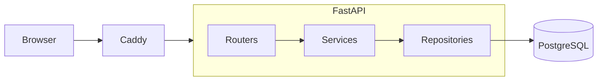
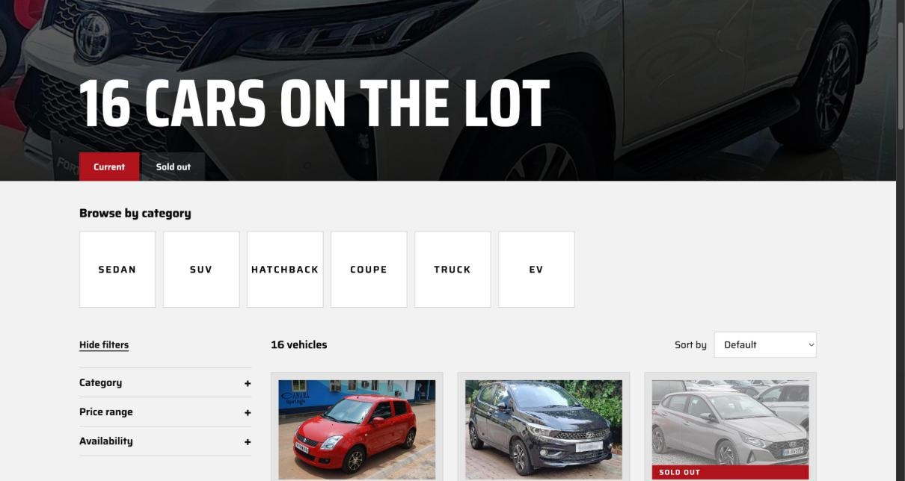
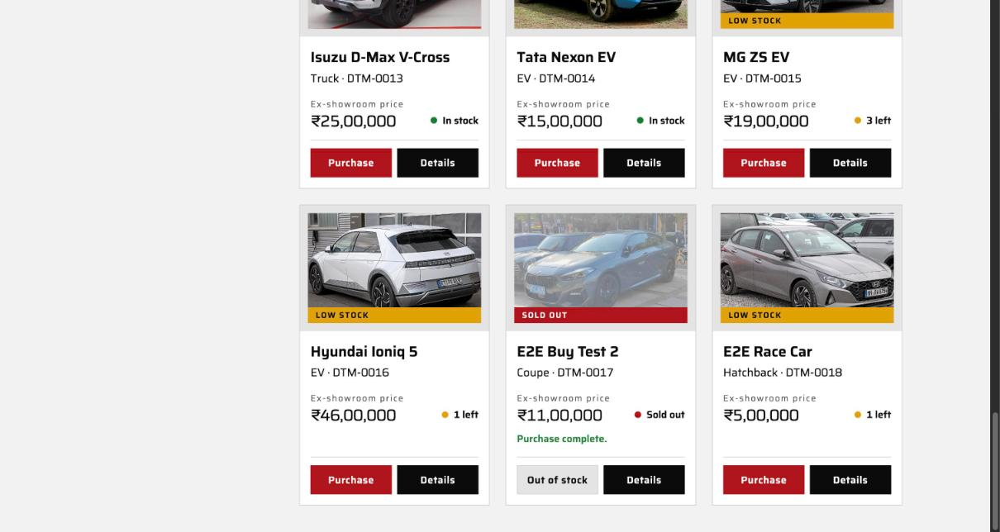

# DTM — Dhyey Tandel Motors

DTM is a car dealership inventory app. Signed-in customers browse the lot and buy a car, one unit at a time. An admin adds, edits, deletes and restocks cars.
It is a FastAPI and PostgreSQL backend with a React frontend, built test first, one behaviour at a time.
It was written for the Incubyte take-home: small commits, a test before every change, and CI on every push.

**Live demo:** https://example.com (placeholder, to be replaced)

## Tech stack

- Backend: FastAPI, SQLAlchemy, Alembic, PostgreSQL, pytest
- Frontend: React, Vite, TypeScript, Tailwind, TanStack Query
- Deploy: Docker Compose and Caddy behind Cloudflare, on a VPS
- CI (GitHub Actions): ruff and mypy plus pytest on the backend; eslint, prettier and tests on the frontend

## How it fits together



Routers handle HTTP only. Services hold the business rules and raise domain errors such as `OutOfStock`; one handler turns those into status codes. Repositories are the only code that talks to the database.

## Key decisions

The full list, with the reason for each, is in [docs/DECISIONS.md](docs/DECISIONS.md). It is append only.

- **Atomic purchase.** A purchase is one statement, `UPDATE ... SET quantity = quantity - 1 WHERE id = ... AND quantity > 0`, never a read and then a write. If no row changes, the answer is 409 (or 404). A test starts 10 threads that all buy the last unit at once. It was committed red against the naive read-then-write version, where 10 buyers won a single unit ([`e3126cb`](../../commit/e3126cb)), and went green with the atomic update ([`1fee284`](../../commit/1fee284)). See [the entry](docs/DECISIONS.md#2026-10-24-purchase-is-one-atomic-update-409-when-out-of-stock).
- **Money is paise.** Prices are integer paise (INR) in a BigInteger column. No floats, and the frontend turns paise into rupees for display. See [the entry](docs/DECISIONS.md#2026-10-24-prices-are-inr-stored-in-paise-as-biginteger).
- **The role comes from the database, not the token.** The JWT holds only the user id and an expiry, so a role change takes effect on the next request. See [the entry](docs/DECISIONS.md#2026-10-24-token-holds-the-user-id-the-role-comes-from-the-database).
- **422 for all validation.** Every bad input is a 422, so a client has one rule to learn. See [the entry](docs/DECISIONS.md#2026-10-24-all-input-validation-is-422).
- **Unknown fields are rejected.** A body with an extra field is a 422, set once on a shared base schema. See [the entry](docs/DECISIONS.md#2026-10-24-unknown-fields-are-a-422-set-once-on-a-shared-base-schema).
- **Self hosted images.** Vehicle photos are served from the frontend's own `public/images/vehicles` folder, so the page does not depend on another site being up. Credits are in [docs/IMAGE_CREDITS.md](docs/IMAGE_CREDITS.md).

## Screenshots

| | |
|---|---|
|  |  |
| Login | Inventory |
|  |  |
| Admin form | A sold out card, with its button disabled |
|  | |
| Someone else bought the last unit first (409) | |

## Local setup

You need Docker, [uv](https://docs.astral.sh/uv/) and Node 24.

### Database

```sh
docker compose up -d --wait postgres
```

### Backend

```sh
cd backend
cp .env.example .env        # then set SECRET_KEY, ADMIN_EMAIL and ADMIN_PASSWORD
uv sync
uv run alembic upgrade head
uv run python -m app.seed   # creates the admin and, on an empty table, 16 sample cars
uv run uvicorn app.main:app --reload
```

The API is on http://localhost:8000/api. Interactive docs are at http://localhost:8000/docs.

### Frontend

```sh
cd frontend
npm ci
npm run dev
```

The app is on http://localhost:5173. The dev server proxies `/api` to the backend.

## Running the tests

Backend tests use a separate in-memory Postgres (`postgres-test`, port 5433), so they never touch dev data.

```sh
docker compose up -d --wait postgres-test
cd backend && uv run pytest
cd ../frontend && npm test
```

Lint and type checks, as CI runs them:

```sh
cd backend && uv run ruff check . && uv run ruff format --check . && uv run mypy .
cd frontend && npm run lint && npm run format:check && npm run typecheck
```

### Test report

```sh
make test-report
```

This starts the test database, runs the backend suite and writes an HTML report and a branch coverage report. Both are committed: [docs/test-report/report.html](docs/test-report/report.html) and [docs/test-report/coverage/index.html](docs/test-report/coverage/index.html).

## API

All routes are under `/api`. Errors are JSON with a `detail` key.

| Method | Path | Who | What |
|---|---|---|---|
| GET | `/api/health` | anyone | Liveness, 503 if the database is down |
| POST | `/api/auth/register` | anyone | Create a customer account (never an admin) |
| POST | `/api/auth/login` | anyone | Email and password in, bearer token out |
| GET | `/api/auth/me` | signed in | The current user, including role |
| GET | `/api/vehicles` | signed in | Every vehicle, including zero stock |
| GET | `/api/vehicles/search` | signed in | Filter by `make`, `model`, `category`, `min_price`, `max_price` |
| POST | `/api/vehicles` | admin | Add a vehicle |
| PUT | `/api/vehicles/{id}` | admin | Replace make, model, category, price and image (not quantity) |
| DELETE | `/api/vehicles/{id}` | admin | Delete a vehicle |
| POST | `/api/vehicles/{id}/purchase` | signed in | Buy one unit, 409 if out of stock |
| POST | `/api/vehicles/{id}/restock` | admin | Add stock |

## Known limitations

- The detail page reads its car from the list. There is no single vehicle endpoint, so a list request serves both screens.
- The seed only fills an empty vehicles table. A database seeded earlier keeps what it has.
- Out of scope on purpose: refresh tokens, email verification and pagination.

## My AI Usage

I planned the architecture and made the decisions. I answered the architect's findings, chose the design direction by looking at real dealer sites, and reviewed every phase before the next one started.

Claude Code wrote the implementation and the tests under that direction, test first, and ran the end to end browser checks. The repo's rules for it are in [CLAUDE.md](CLAUDE.md). Every commit it helped with carries a co-author trailer. The raw chat logs are in [PROMPTS.md](PROMPTS.md).

Agent setup, and why:

- **Sonnet, main session.** It writes the code and makes the commits. It is fast enough for the red, green, refactor loop, and I review each step.
- **Opus, architect.** Read only. I call it for design and data model reviews, such as the schema before the first migration and the purchase concurrency design, where a wrong choice is expensive. It only advises and never edits.
- **Haiku, test runner.** It runs the suite and reports failures only. That is cheap, mechanical work.
- **Sonnet, reviewer.** It reviews the diff against the code rules at the end of each phase, read only.

Some tests passed the first time they ran, because the earlier green step already covered the behaviour. I did not fake a failing run for them. They are committed as `test:` commits with no red phase, and the commit message says so.

## Reflection

